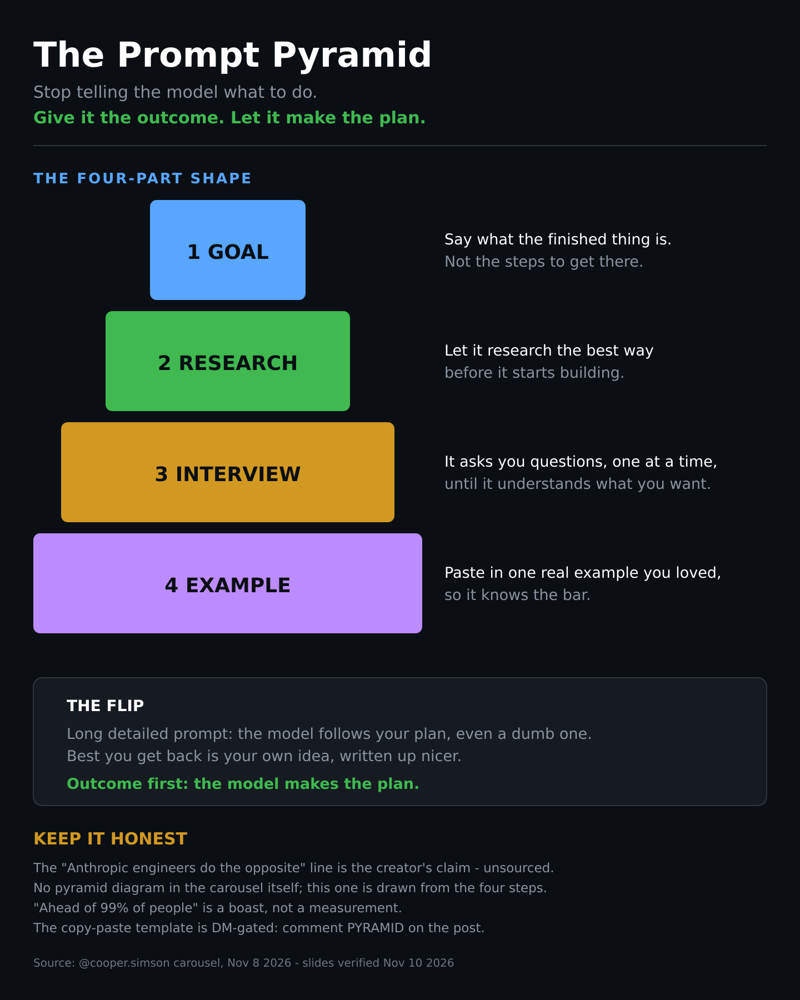
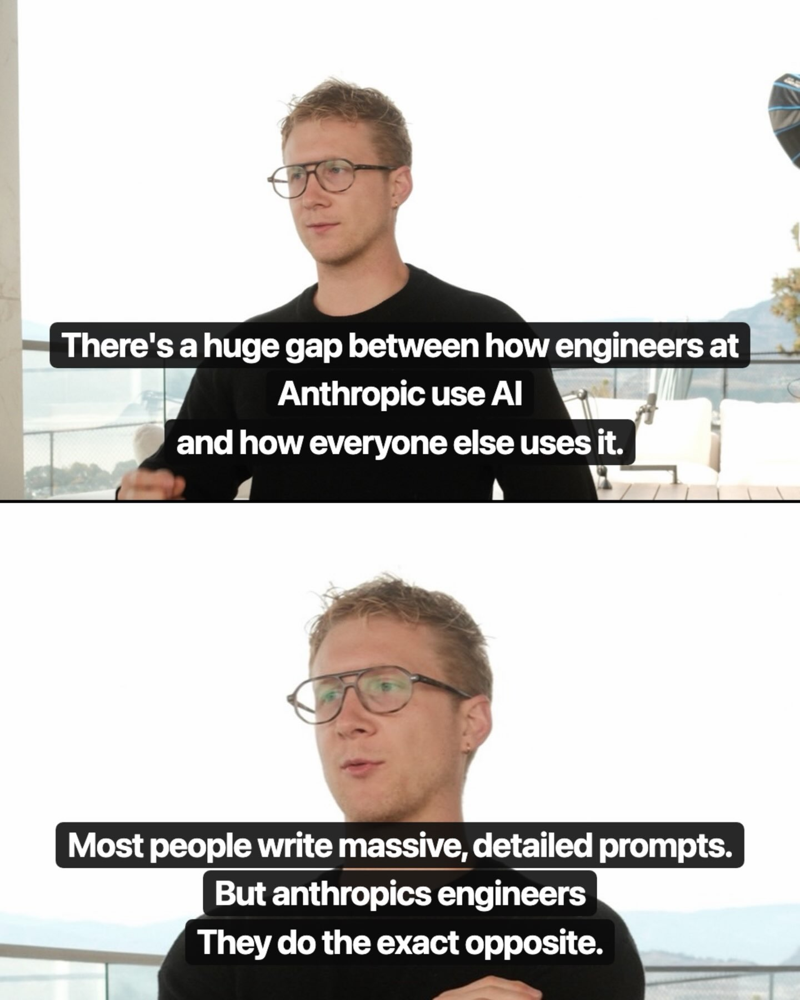
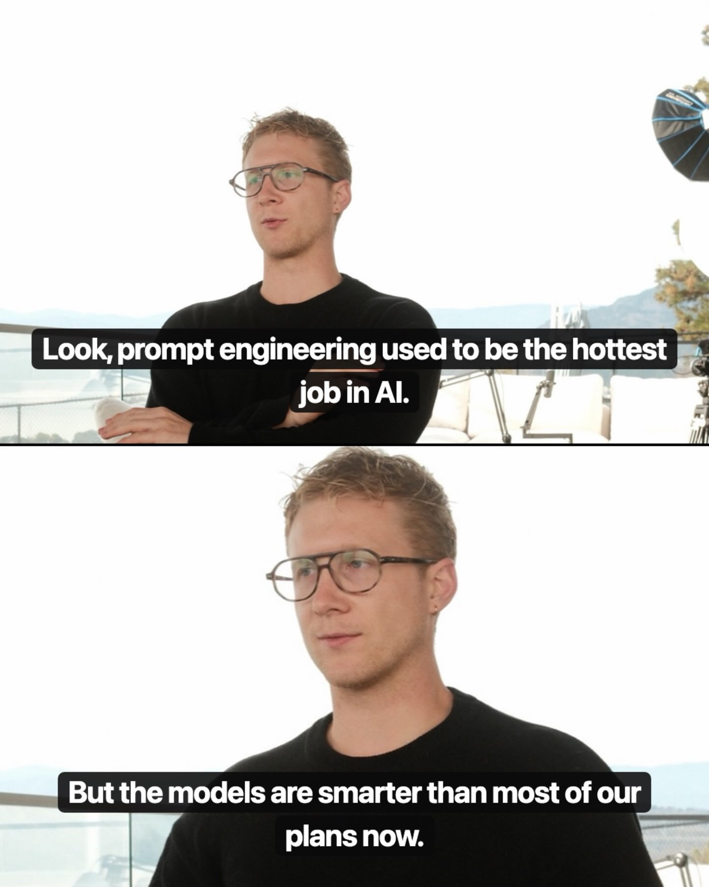
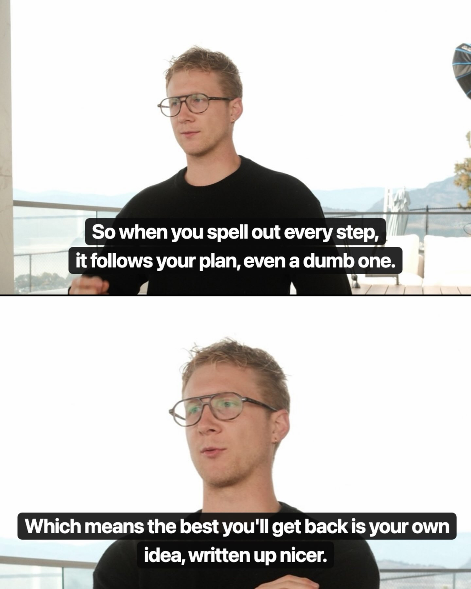
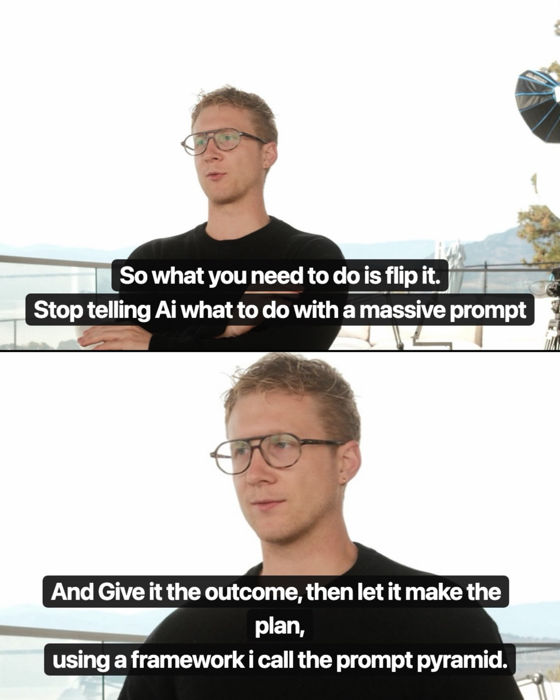
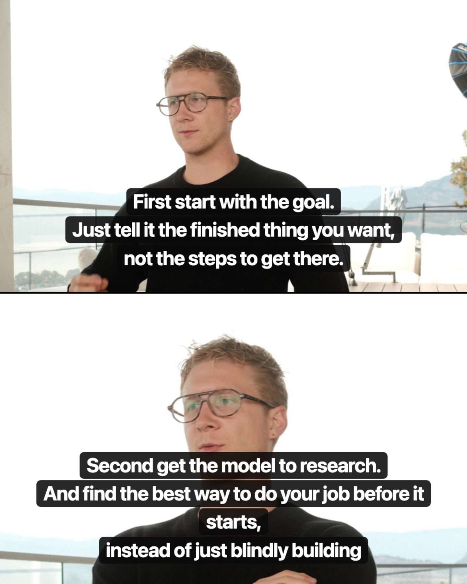
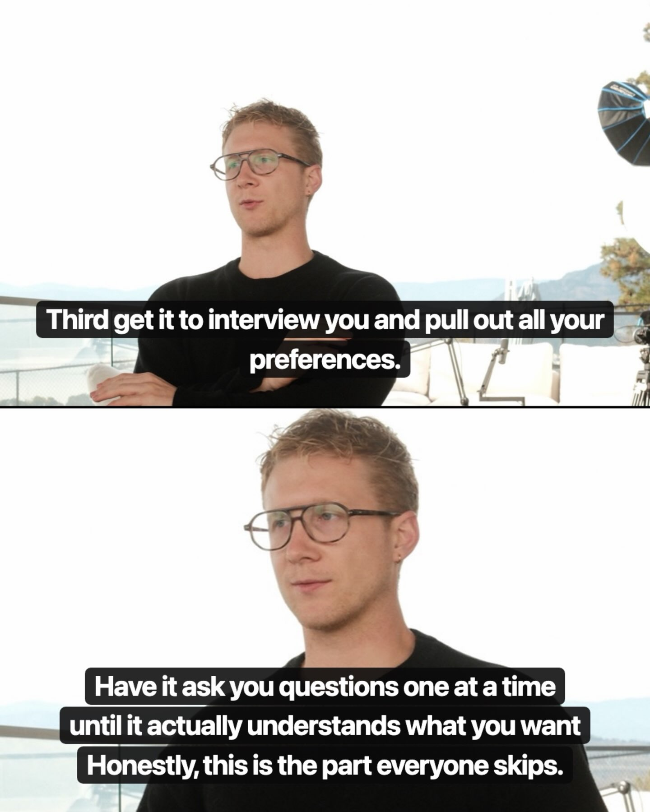
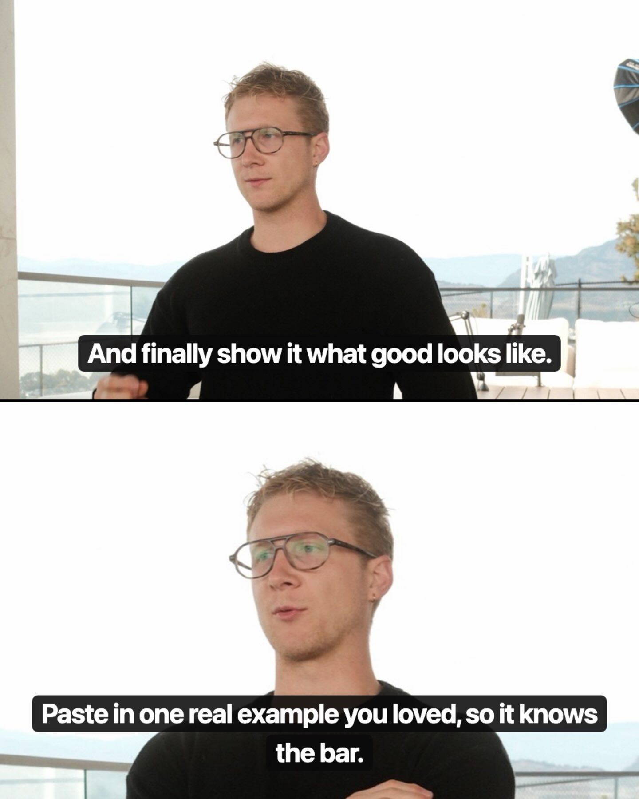
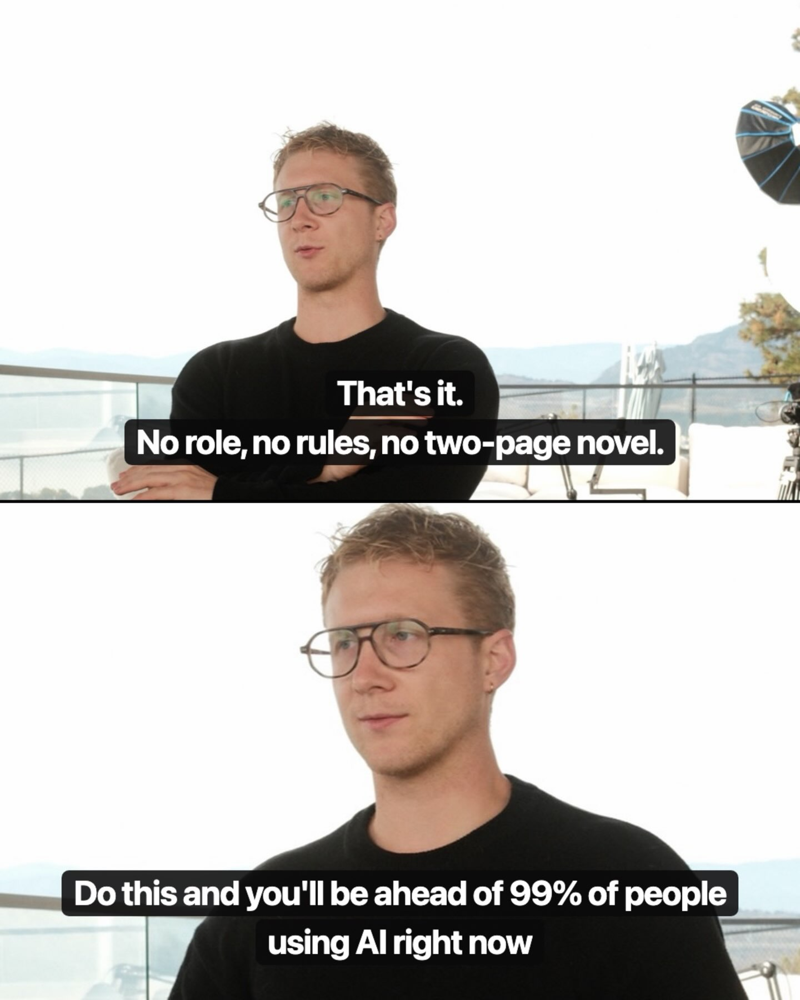
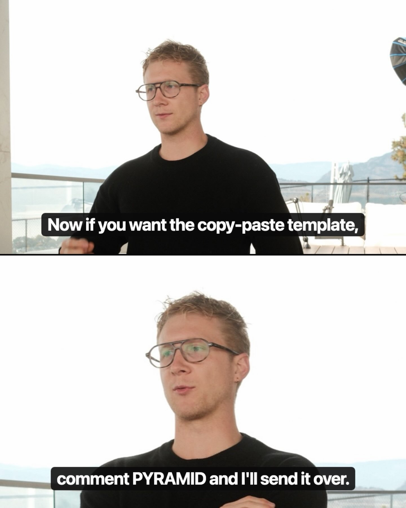

# 05 — Prompts & Evals

**Thesis:** A single reel, but it carries a discipline the whole collection depends on: prompts are not set-and-forget text — they're experimental surfaces with measurable ROI per rule. Everything else in this repo (skills, memory, routing) only compounds if someone is testing what actually improves output and deleting what doesn't.

### The Prompt Pyramid: stop telling the model what to do, give it the outcome
- **Creator:** @cooper.simson · **Date:** 2026-11-08
- **What it suggests:** Prompt engineering as a discipline is mostly wasted effort now, because the models got smarter than most of our plans. Spell out every step in a long detailed prompt and the model follows your plan — even a dumb one — so the best you get back is your own idea, written up nicer. The flip: give the model the outcome and let it make the plan. The four-part shape, in plain language: (1) **Goal** — say what the finished thing is, not the steps to get there; (2) **Research** — have the model find the best way to do your job before it starts building, instead of blindly building; (3) **Interview** — let it ask you questions one at a time until it actually understands what you want, pulling out your preferences (the part everyone skips); (4) **Example** — paste in one real example you loved, so it knows the bar. That's it: no role, no rules, no two-page novel. Two honest notes: the "Anthropic engineers do the exact opposite" line is the creator's claim, unsourced, and "ahead of 99% of people" is a boast, not a measurement. The copy-paste template is DM-gated behind commenting PYRAMID — it isn't in the slides. The carousel itself has no drawn pyramid (talking-head stills only), so the diagram below is drawn from the four steps.
- **Repos/tools:** None (methodology)
- **Extractable skill:** Outcome-first prompting — goal, research, interview, example as a fixed four-part prompt shape; the Interview step is the same move as the Nov 5 "interview the model about the job" step in 01 — let the model pull the spec out of you instead of you writing it upfront.
- **Source:** https://www.instagram.com/p/DfftX9kkgsL/

### How to run experiments on prompts when output quality is critical
- **Creator:** @camillaintech · **Date:** 2026-07-24
- **What it suggests:** After 50 hours building an AI model workflow, the hard-won method for prompt iteration: decompose output quality into three pillars — the foundational LLM, the customization layer (knowledge base, user info), and the quality gates/rules governing output — then test changes to each pillar systematically and measure aggregate improvement. The counterintuitive finding that drives the whole method: adding more rules to force quality actually degrades it. Each rule is another check the model must run before generating, which slows responses and — worse — forces the model to prioritize across a long list, producing worse output. Unless a rule is deterministic and explicit, the model infers its meaning slightly differently each time, so you can't eyeball single outputs; you need repeated runs and aggregate measurement to know whether a rule earns its keep. The promised Part 2 (the actual system) isn't in this reel, but Part 1's frame is the valuable part: treat every prompt addition as a hypothesis with a measured payoff, and assume rules have costs until proven otherwise.
- **Repos/tools:** None (methodology)
- **Extractable skill:** Rule-ROI testing — for each prompt rule, run repeated trials, measure aggregate quality and latency, keep only rules that prove their worth; default to fewer, deterministic rules.
- **Source:** https://www.instagram.com/reel/DbL2Wd3tK_4/

### ASD-STE100: prompt LLMs in aerospace controlled English for clearer explanations
- **Creator:** @vyzual.ai (surfacing Andrej Karpathy's recommendation) · **Date:** 2026-10-05
- **What it suggests:** Karpathy's tip: ask the LLM to "explain [topic] using an ASD-STE100 style." ASD-STE100 (Simplified Technical English) is a real controlled-language standard developed for aerospace maintenance documentation — restricted ~900-word vocabulary, short sentences, active voice, one idea per sentence. The mechanism: heavy constraints on diction and syntax force the model into plain, structured output, which reads far more clearly than default LLM prose. The carousel's worked example (explaining "endogeneity"): the normal output is dense academic prose; the STE100 version says the same thing in simple words and short sentences. Karpathy notes he sometimes softens it ("part of the way to ASD-STE100") when the full spec feels too stringent. The generalizable principle: output constraints beat output instructions — telling the model *how* to write (vocabulary, sentence length, voice) constrains the output space more reliably than asking it to "be clear."
- **Repos/tools:** ASD-STE100 spec (Aerospace and Defence Industries Association of Europe).
- **Extractable skill:** Constraint-style prompting — append "using ASD-STE100 style: simple words, short sentences, active voice, one idea per sentence" to explanation prompts; prefer structural constraints over vague quality adjectives.
- **Source:** screenshot of Karpathy's post via @vyzual.ai carousel (user-supplied, Oct 5 2026); spec: ASD Simplified Technical English.
