# Agentic AI Roadmap 2026 — From Zero to Advanced

**Source:** Instagram carousel by [@decode_leox](https://www.instagram.com/decode_leox/) (Aman, Computer Science Engg., ~101k followers) — [the post](https://www.instagram.com/p/DfMTlJRjUPP/) (published Nov 1, 2026, 20 slides, 2,113 likes). A 380-hour guided path from calling an LLM API to running a safe, observable agent service in production: 19 sections, 16 projects, three phases, one project per phase minimum.

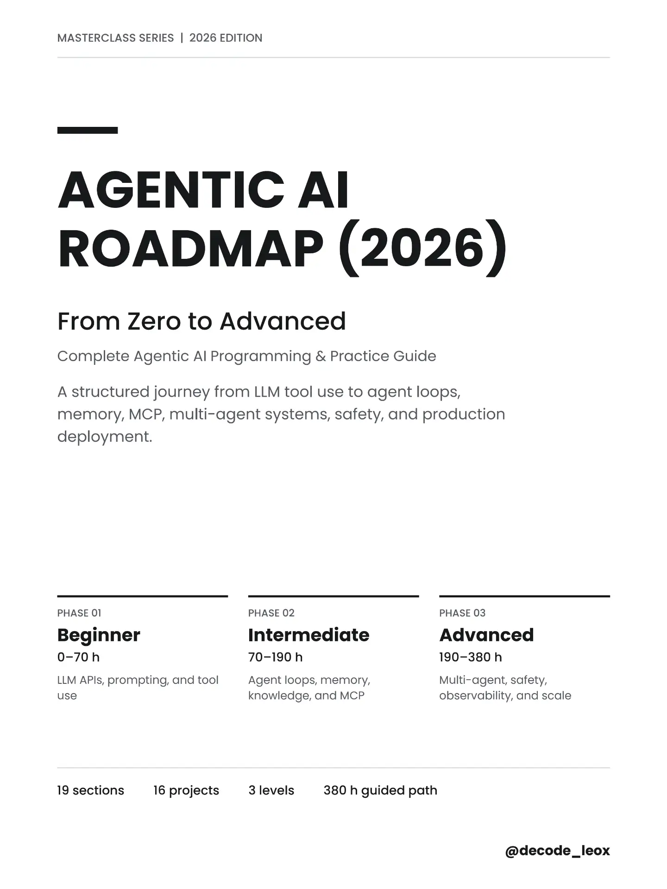

> Note on method: this is a deep-dive *distillation*, not a transcript — the guide's architecture, the working code shapes, and the project ladder, rewritten in original prose. The slide images are reproduced for reference; code is described, not copied. One gap: section 19, the Cheat Sheet, is not in the carousel — the contents list promises it on p. 20, but the carousel jumps from the Learning Roadmap (p. 19) to the closing slide, whose footer reads p. 22. The cheat sheet itself is not reproduced here.

## TL;DR

1. **The shape is three phases, 380 hours, one milestone each.** Beginner (0–70 h) ends with an assistant that calls real tools; Intermediate (70–190 h) ends with a tested agent that has memory and an MCP server; Advanced (190–380 h) ends with a safe, observable agent service in production. The hours are the creator's estimates for focused study, and they add up exactly: 70 + 120 + 190.
2. **The whole guide is built on one loop, about fifteen lines of Python.** Send the task, call the model, and while it asks for tools, run them and feed the results back — with a hard step cap. Everything after that is a variation: the same loop with memory, with retrieval, with several agents, with guardrails.
3. **The cost discipline is the through-line, not an afterthought.** Cost and latency grow with tokens and steps, so the guide keeps returning to the same controls: a maximum step count, a token budget that raises when it runs out, routing easy steps to smaller models, caching repeated lookups, and tracking cost per task instead of per token. One looping run with no spend cap can eat a month of budget.
4. **Safety is a permission list, not a vibe.** Tools split into always-allowed and needs-approval; unknown tools are refused outright; errors come back as text so the model can recover; web pages, emails and files are treated as untrusted data that can carry injected instructions.
5. **The project ladder is the real curriculum.** Sixteen projects, each named with the concepts it teaches and the outcome it should produce — from a tool-calling calculator bot (Easy) to a production agent service (Hard). The guide's own rule: finish one project per phase, and type every example yourself instead of copy-pasting.

## The three phases

| Phase | Hours | Covers | Milestone |
|---|---|---|---|
| 01 Beginner | 0–70 | LLM APIs, prompting, tool use | Build an assistant that calls real tools |
| 02 Intermediate | 70–190 | Agent loops, memory, knowledge, MCP | Ship a tested agent with memory and an MCP server |
| 03 Advanced | 190–380 | Multi-agent, safety, observability, scale | Run a safe, observable agent service in production |

Prerequisites are light on purpose: basic Python helps, no AI background needed. The guide's usage rules are worth quoting in spirit: follow the sections in order and skip what you already know; tick each phase checkpoint before moving on; keep the cheat sheet handy.

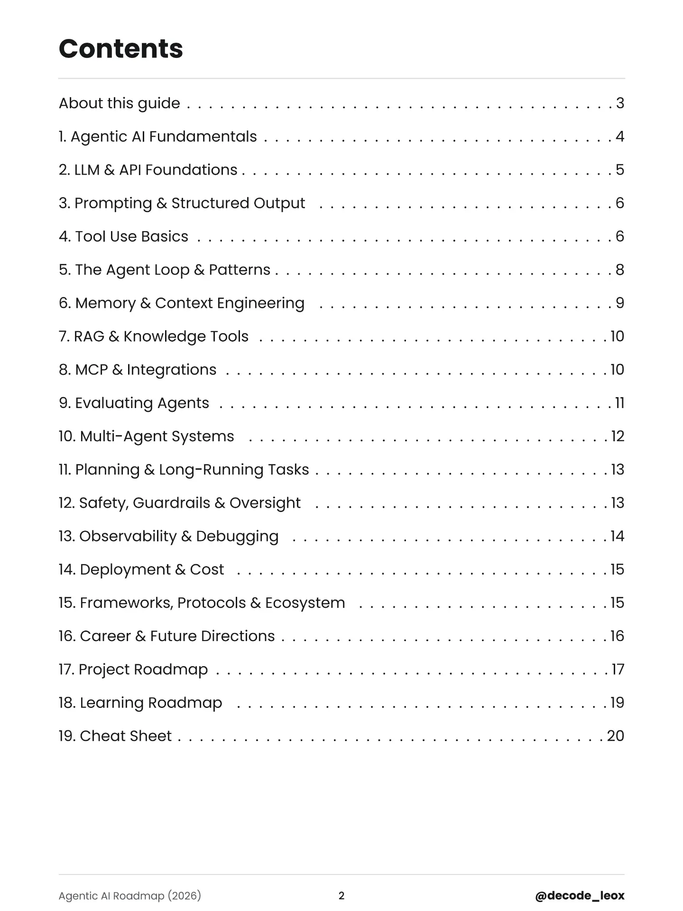

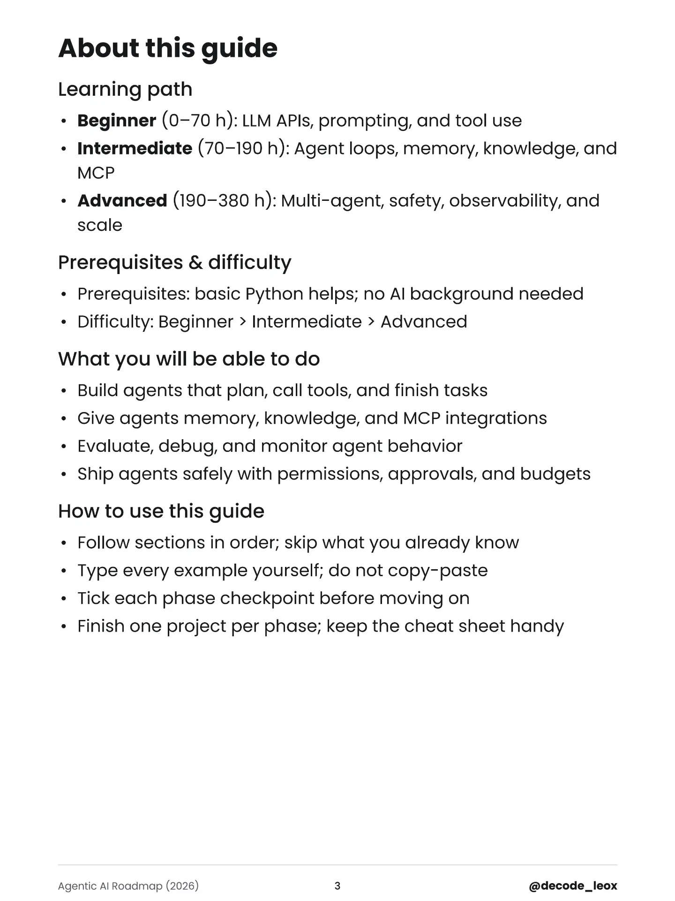

## Phase 01 — Beginner (0–70 h): LLM APIs, prompting, tool use

### 1. Agentic AI Fundamentals

The guide's definition: an agent is a model that uses tools in a loop to pursue a goal, deciding its own next step from what it observes. The distinction that matters is the spectrum of autonomy. A chatbot answers one message at a time. A workflow runs fixed steps you designed, with LLM calls inside. An agent chooses its own actions and when to stop. More autonomy buys flexibility and costs money and risk — the trade is stated up front, before any code.

Five components make up the machine: the model (reasons and decides), tools (APIs, code, search, files, browsers), memory (short-term context plus long-term storage), loop and controls (step budget, approvals, stop rules), and the environment (the systems the agent acts on). The guide's examples of where agents help are all enterprise-shaped: coding and debugging assistants, research and report writing, customer support with account actions, data analysis and operations tasks.

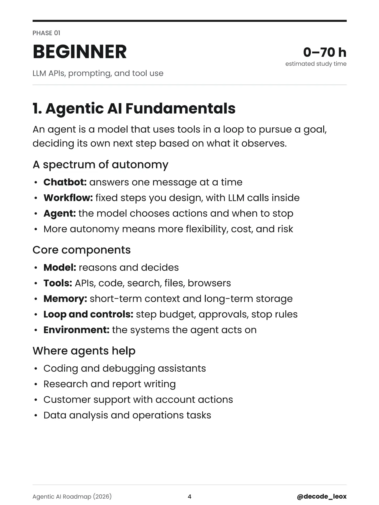

### 2. LLM & API Foundations

Setup is a venv, the Anthropic SDK plus Pydantic, httpx and python-dotenv, and the MCP CLI package — then one API key in the environment. The guide's first best practice is the one this playbook keeps repeating in other words: start with the simplest solution. A single call or a fixed workflow first; add agent autonomy only when the task truly needs it.

The vocabulary section is short and load-bearing: a token is the unit of text the model reads and writes; the context window is how much it can see at once; the stop reason tells you why it stopped (done, token limit, tool request); streaming shows output as it is generated. And the cost line that sets up the rest of the guide: cost and latency grow with tokens and steps.

The worked code is a first API call (Anthropic client, a Sonnet-class model, 500 max tokens, one user message) that prints the reply text and the stop reason — then the same call as a stream. The guide's own note: model names change often, check the provider docs; the patterns transfer across providers.

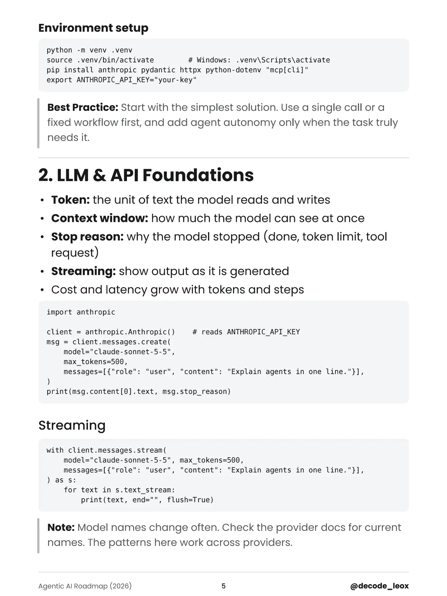

### 3. Prompting & Structured Output

The system prompt does four jobs: say who the agent is, what it can do, and when to stop; list what it must never do; describe tools clearly (good descriptions improve tool choice — the model picks tools from names and descriptions); and request JSON when code has to read the answer. Then validate before you trust: the guide's example parses the model's JSON into a Pydantic model (`Plan` with a goal string and a list of steps) and falls back to retry-or-give-up on a validation error instead of passing bad data downstream.

The common mistake is the one that costs the most in practice: vague tool descriptions. Write them like documentation for a new teammate, because the model is reading them the same way.

### 4. Tool Use Basics

Tool use lets a model request an action; your code runs it and returns the result. The guide's example defines one tool — a `get_time` lookup with a JSON schema requiring a city string — sends a question about the time in Pune, and reads back the model's tool-use block (name and arguments). Then the safe-runner pattern: a dispatch table mapping names to functions, an unknown-name guard that returns an error string, and a try/except that returns tool errors as text so the model can recover. The warning is explicit: never run tool arguments blindly; validate them first.

**Checkpoint: Beginner.** You can now explain the chatbot/workflow/agent difference, call an LLM API and read its stop reason, and define a tool, run it, and return the result to the model.

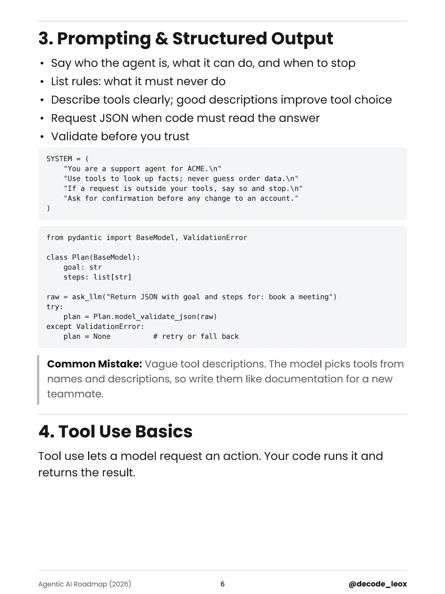

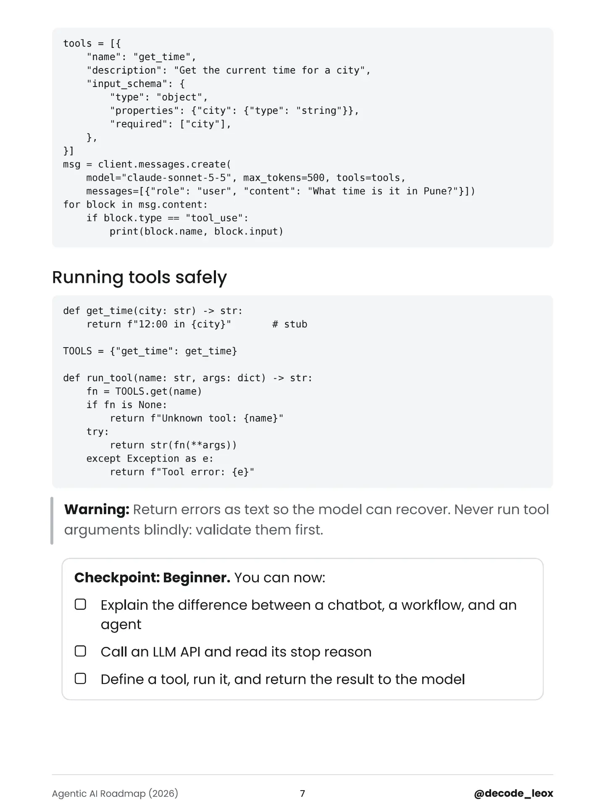

## Phase 02 — Intermediate (70–190 h): agent loops, memory, knowledge, MCP

### 5. The Agent Loop & Patterns

The loop is the guide's center of gravity, and it is deliberately small: keep a message list starting with the user's task; for each step up to a maximum, call the model with the tools attached; if it didn't ask for a tool, stop; otherwise append the assistant's reply, run each requested tool, and append the results as a user message. The loop ends on the model's say-so or the step cap — whichever comes first.

Six patterns sit on top of that loop, and the guide names each in one line: prompt chaining (step 1 feeds step 2), routing (classify, then send to a specialist prompt), parallelization (independent subtasks together), orchestrator-workers (one model splits and delegates), evaluator-optimizer (one drafts, one critiques, repeat), autonomous agent (open-ended loop with tools). The best practice is the cost control again: always set a maximum step count and a token budget. A loop without limits is a bug waiting to happen.

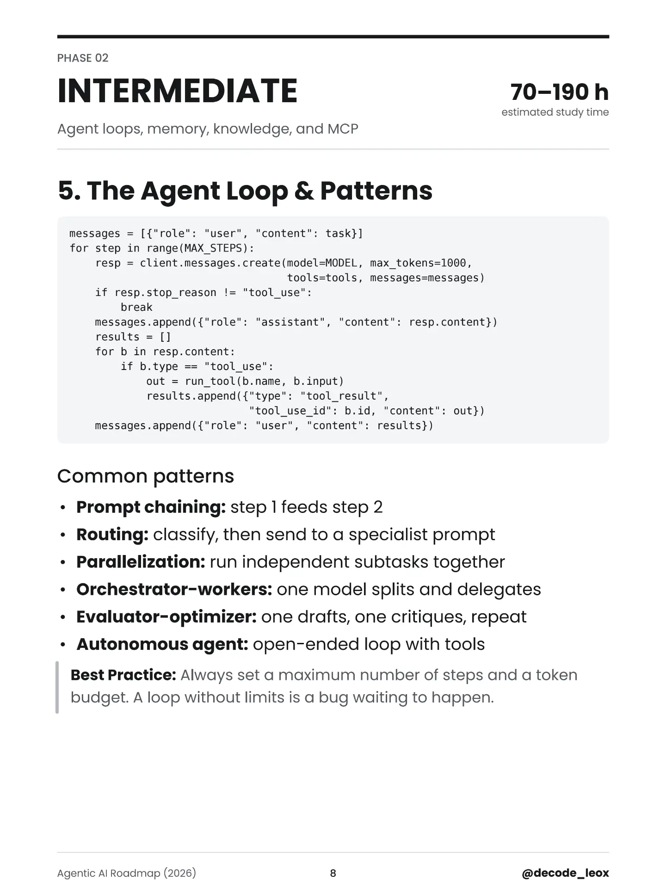

### 6. Memory & Context Engineering

Three layers, three jobs. Short-term memory is the messages in the current context. Working notes are facts and plans the agent writes to a scratchpad. Long-term memory is stored facts, preferences, and past results. The governing rule is the tokenomics one: context is limited and costly, so include only what helps — summarize or trim old turns.

The worked code is a JSON file store with remember/recall helpers and a trim function that keeps the first message plus the last ten. Two warnings carry the section. The common mistake: trimming between a tool request and its result — keep tool-use and tool-result messages together, or the API rejects the history. And the privacy warning: memory can store wrong or sensitive facts, so let users view and delete what the agent remembers.

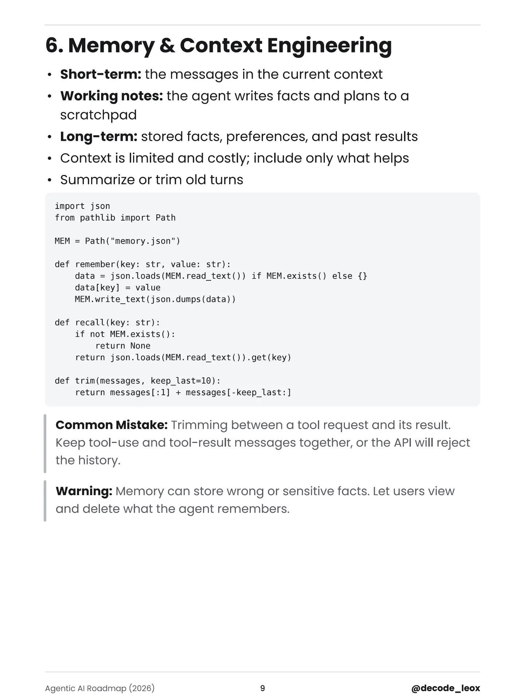

### 7. RAG & Knowledge Tools

In agentic RAG, retrieval is a tool, not a pipeline stage. The agent decides when to search, what to ask, and whether to search again. The guide's example wraps a vector search (top 4 passages) as a `search_docs` tool, then adds the four rules that make it work: chunk and embed documents into a vector index; return source names so the agent can cite them; let the agent rewrite queries and search again; enforce document permissions inside the tool, not in the prompt. The best practice is the anti-hallucination rule in one sentence: instruct the agent to say it could not find something instead of guessing when retrieval comes back empty.

### 8. MCP & Integrations

MCP is the open standard for connecting models to tools and data through servers: a server exposes tools, resources, and prompts; a client is the app or agent that connects to servers. Build a tool once, reuse it across compatible clients — and treat third-party servers as untrusted code. The worked example is a minimal FastMCP server exposing one tool (an `add` function with a docstring), run from `__main__`. The warning is the security one: only connect servers you trust, review what tools they expose, grant the least access — tool descriptions can carry injected instructions. The guide also flags that MCP SDKs evolve quickly and to follow the official docs for current APIs.

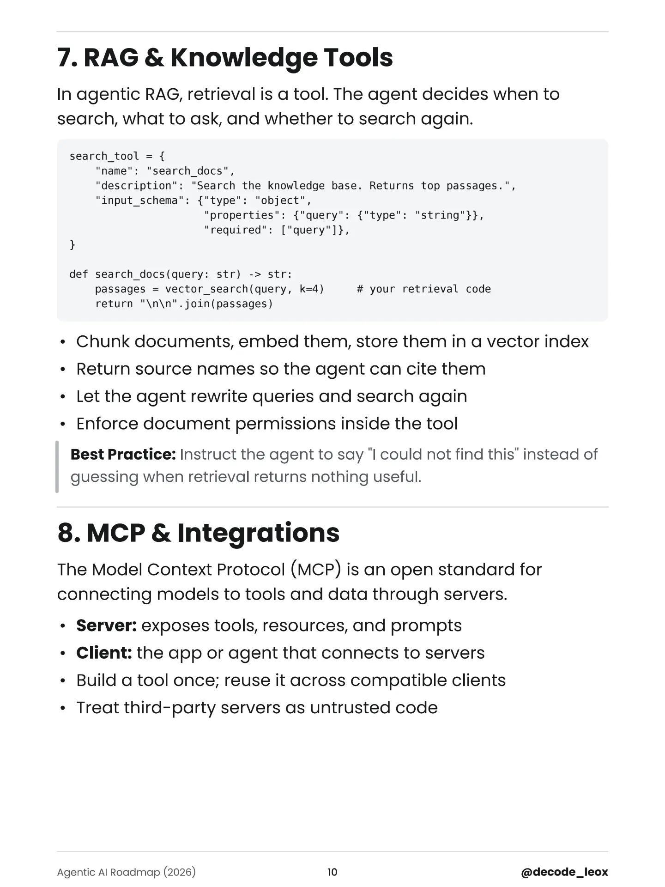

### 9. Evaluating Agents

Build a task suite from real requests, and measure task success, not text quality. Check tool choice and arguments, not only the final answer. Track steps, tokens, latency, and cost per task. Use LLM judges with a rubric — and verify with humans. The worked example is a tiny harness: each task names a goal, the tool it must call, and the expected phrase in the answer; the runner executes the agent, checks both conditions, and prints PASS or FAIL. The best practice is the discipline that makes evals real: rerun the suite after every prompt, tool, or model change, and run each task several times, because agents are stochastic.

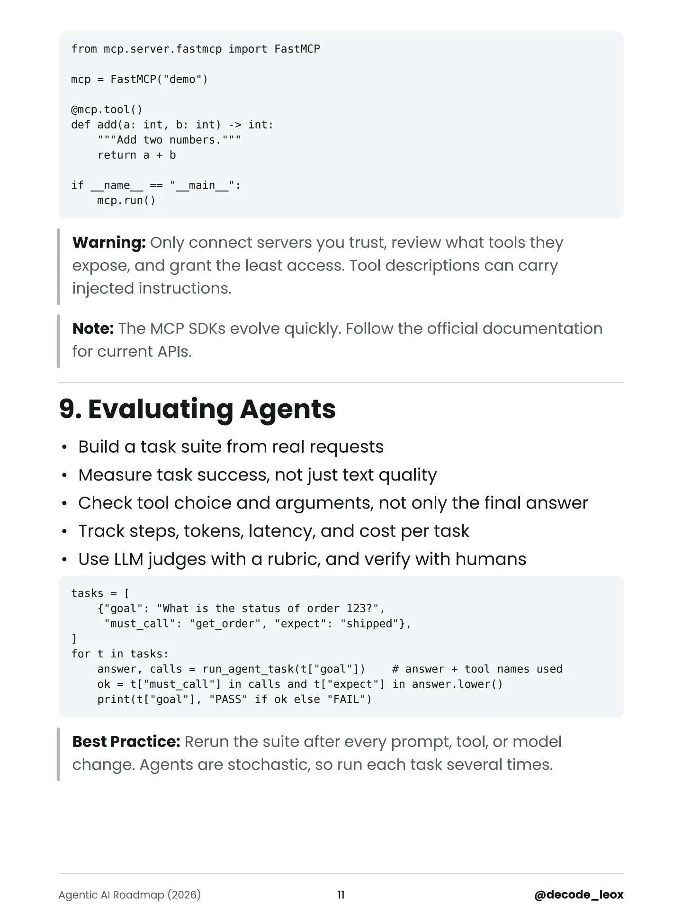

**Checkpoint: Intermediate.** You can now write an agent loop with a step budget, manage context with trimming, notes, and memory, and expose tools through an MCP server and evaluate the agent.

## Phase 03 — Advanced (190–380 h): multi-agent, safety, observability, scale

### 10. Multi-Agent Systems

Use multiple agents when subtasks are independent or need different tools. The common shape is orchestrator plans, workers execute — and the guide's example is exactly that: one call breaks a goal into subtasks, one call per subtask runs a researcher role, and a final call merges the findings into a concise report. Two costs are named up front: costs and failure modes grow with each agent, and handoffs between agents must be clear and compact. The common mistake is the one the playbook's own entries keep warning about: adding agents to look sophisticated. If one agent with good tools works, keep it — a multi-agent design has to earn its cost.

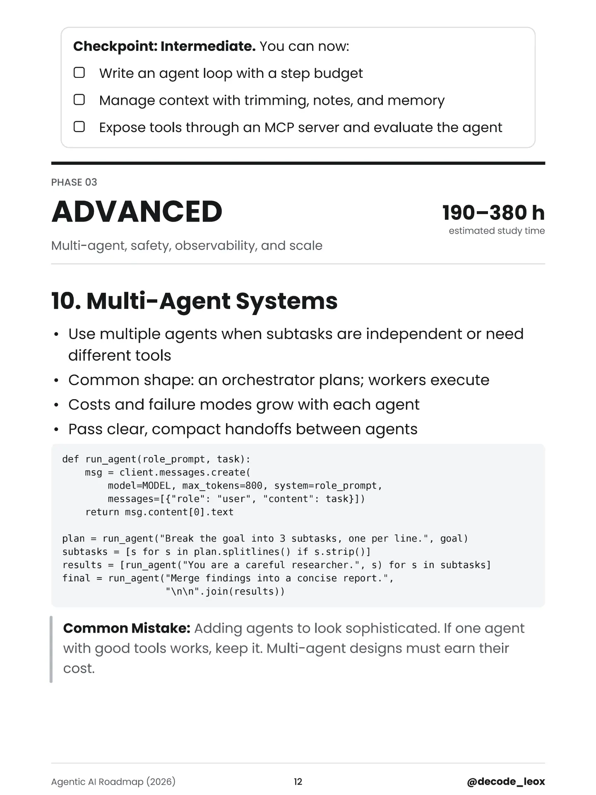

### 11. Planning & Long-Running Tasks

Break big goals into checkable steps; save state so a run can pause and resume; run long tasks in background workers; ask for human approval at risky steps; verify results by running tests and checking outputs. The worked code is a JSON state file with save/load helpers tracking the current step and notes. The best practice is idempotency: if a run crashes and resumes, repeating a step must not cause duplicate effects.

### 12. Safety, Guardrails & Oversight

Prompt injection is the first item: content the agent reads can contain instructions, so web pages, emails, and files are untrusted data. The rest of the list is the enterprise checklist in miniature: give tools the least privilege, sandbox code execution, require approval for irreversible or costly actions, cap spend, steps, and rate, keep audit logs, and red-team with hostile inputs before launch. The worked code is a guarded dispatcher: an allowlist of always-permitted tools, a second list that requires asking a human first, and an outright refusal for anything else. The warning that closes the section: an agent that reads untrusted text and can take actions is an attack surface — limit its permissions as if it will be tricked.

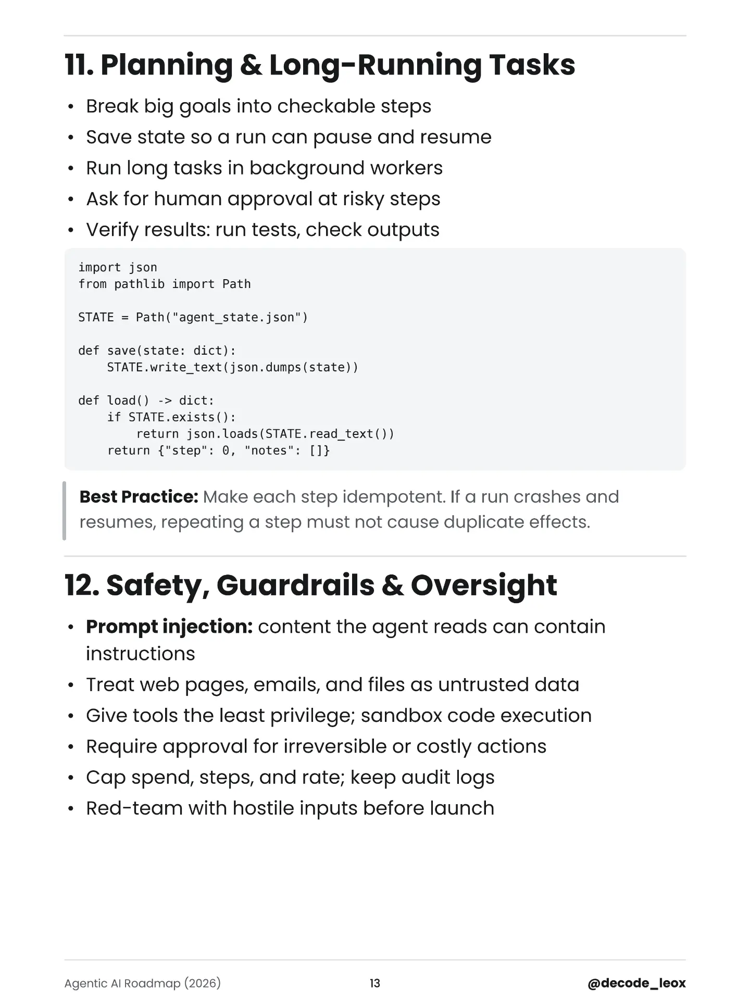

### 13. Observability & Debugging

Log every step (input, tool call, result, tokens), assign a run ID and trace each run end to end, replay failed runs with the same inputs, classify failures (wrong tool, bad arguments, loops, bad answers), and alert on cost spikes and error rates. The worked code is a JSON-lines logger stamping each step with run ID, step number, kind, timestamp, tokens, and data. The best practice is the debugging rule that pays for the whole section: when an agent fails, read the full trace first — most bugs are visible in the sequence of tool calls.

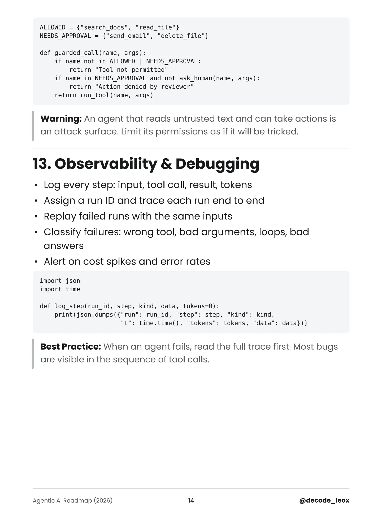

### 14. Deployment & Cost

Expose the agent through an API, run long jobs in queues, set timeouts, retries, and per-run budgets, cache repeated lookups and retrieval results, route easy steps to smaller models, and track cost per task — not only per token. The worked code is a `Budget` class that counts down a token allowance and raises when it runs out. The common mistake is the one-line horror story: shipping without a spend cap, because one looping run can consume a month of budget.

### 15. Frameworks, Protocols & Ecosystem

The named examples are LangGraph, LlamaIndex, CrewAI, and provider agent SDKs. The guide's position is the one the playbook's harness entries take: frameworks speed up common patterns but add abstraction, so learn the raw loop first — that is what lets you debug any framework. On protocols, MCP covers tools and data; agent-to-agent protocols are still emerging. Judge a framework on debuggability, control, and community. The best practice: prototype with plain code, then adopt a framework only for features you actually need, like persistence or graph workflows. And the ecosystem note: it changes quickly, check each project's current documentation.

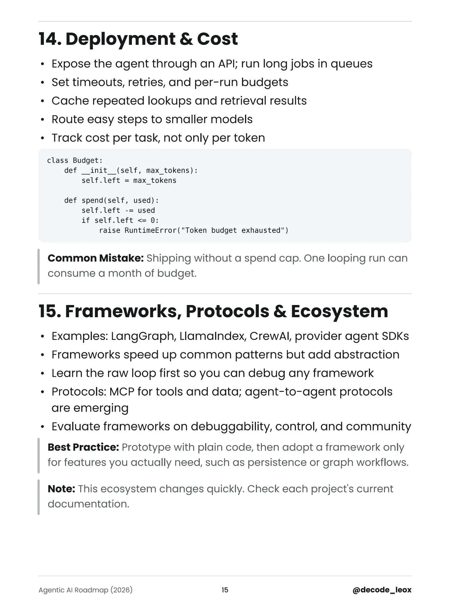

### 16. Career & Future Directions

The roles the guide names: AI engineer or agent engineer, applied AI developer, evaluation and reliability engineer, AI product engineer. Trends to watch: coding agents and computer-use agents, longer-horizon tasks with checkpoints, agent identity, permissions, and audit, and stronger evaluation and safety practices. The portfolio advice is concrete: 3–5 agent projects with traces and eval results, one project with human approval and guardrails, and clear write-ups of failures and fixes — the failures are the point, not the embarrassment.

**Checkpoint: Advanced.** You can now decide when multiple agents are worth the cost, gate risky tools with permissions and human approval, and trace, replay, and budget every agent run.

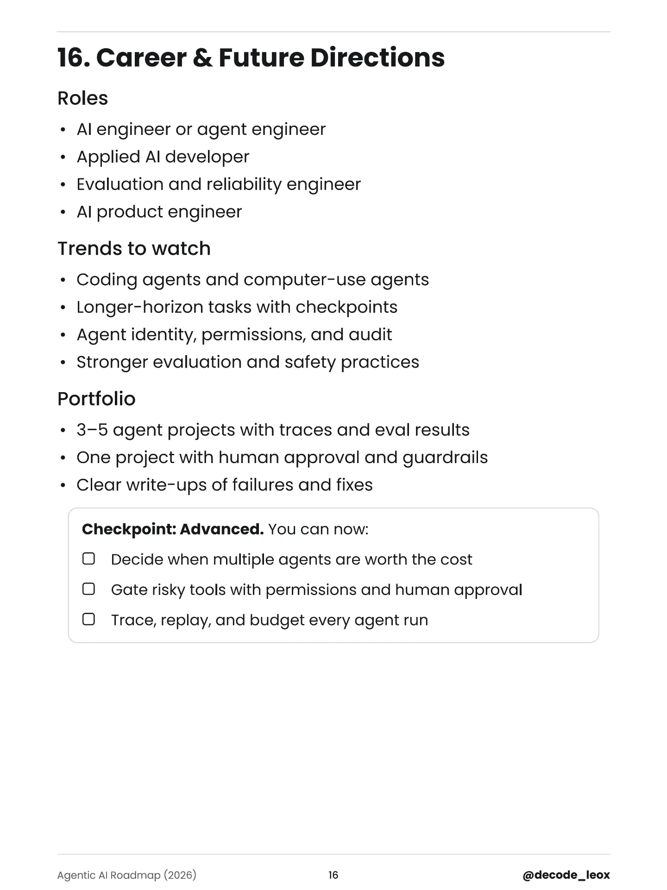

## The 16 projects

Every project names the concepts it teaches, its difficulty, and the outcome it should produce. Five Beginner, five Intermediate, six Advanced.

| # | Project | Concepts | Difficulty | Outcome |
|---|---|---|---|---|
| B1 | Tool-Calling Calculator Bot | Tool schema, dispatch, results | Easy | Bot that computes via tools |
| B2 | Info Lookup Assistant | API tool, error handling | Easy | Answers using live data |
| B3 | Task Extractor | Structured output, validation | Easy | Text turned into validated tasks |
| B4 | File Helper Agent | Read-only tools, confirmation | Easy–Medium | Safe file search and summary |
| B5 | Daily Planner Agent | Multiple tools, loop, limits | Easy–Medium | Plan built from calendar data |
| I1 | Research Assistant | Search tool, citations, loop | Medium | Cited briefs on a topic |
| I2 | Support Agent with RAG | Retrieval tool, order lookup | Medium | Grounded customer answers |
| I3 | Agent with Long-Term Memory | Memory store, summarization | Medium | Assistant that remembers preferences |
| I4 | MCP Server for Your Data | MCP tools and resources | Medium | Reusable tool server |
| I5 | Agent Eval Harness | Task suite, success rate | Medium | Report across prompt versions |
| A1 | Multi-Agent Research Team | Orchestrator, workers, handoffs | Hard | Merged, cited research report |
| A2 | Sandboxed Coding Agent | Run tests, propose patches, approvals | Hard | Safe code-fixing assistant |
| A3 | Computer-Use Task Agent | Browser actions, guardrails | Hard | Supervised web task automation |
| A4 | Resumable Workflow Agent | Checkpoints, queues, idempotency | Hard | Long task that survives crashes |
| A5 | Agent Observability Dashboard | Traces, cost, failure types | Hard | Runs searchable and replayable |
| A6 | Production Agent Service | Approvals, evals, monitoring | Hard | Deployed agent with safety controls |

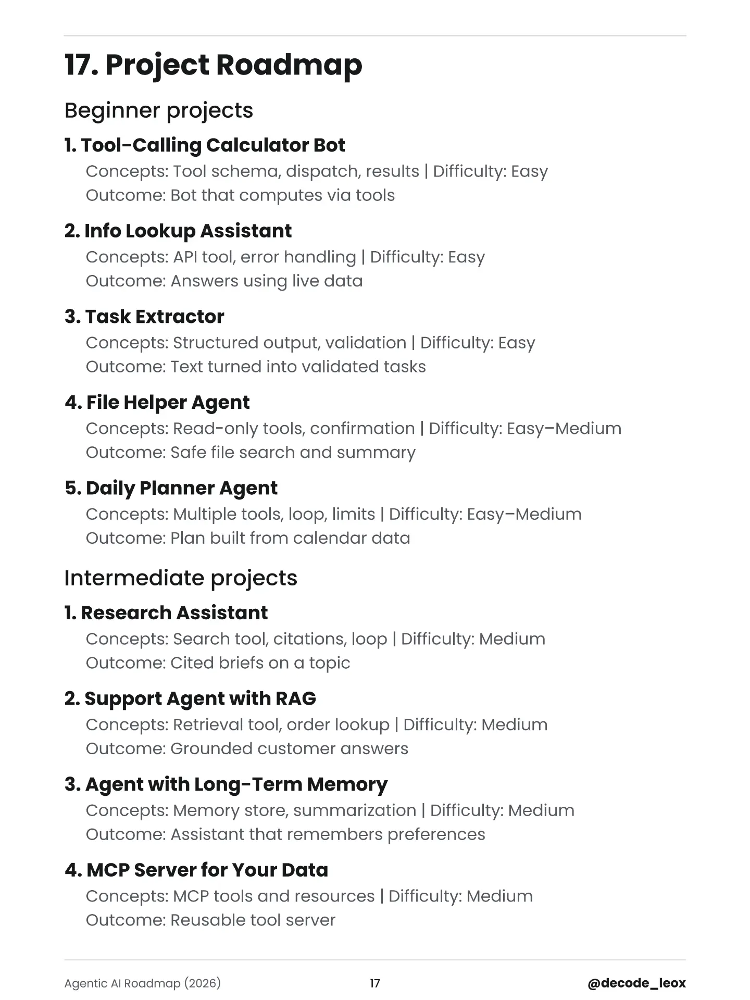

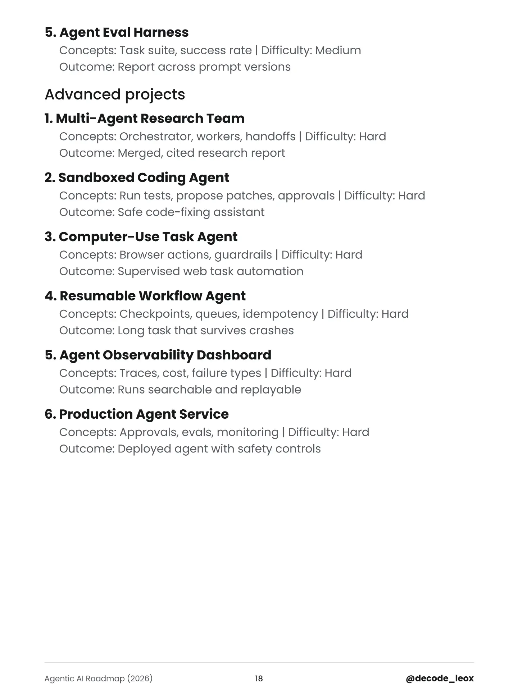

## The learning roadmap, hour by hour

Follow the path top to bottom; hours are estimates for focused study. The three phase totals check out against the cover: 70 + 120 + 190 = 380.

| Step | Topic | Focus | Hours |
|---|---|---|---|
| **Beginner — 0–70 h** | | | |
| 1 | LLM & API fundamentals | Tokens, context, calls, streaming | 25 |
| 2 | Prompting & structured output | System prompts, JSON, validation | 20 |
| 3 | Tool use basics | Schemas, dispatch, tool results | 25 |
| | *Milestone: build an assistant that calls real tools* | | |
| **Intermediate — 70–190 h** | | | |
| 4 | Agent loop & patterns | ReAct loop, chains, routing | 30 |
| 5 | Memory & context | Trimming, notes, long-term memory | 25 |
| 6 | RAG & knowledge tools | Agentic retrieval, citations | 25 |
| 7 | MCP & integrations | Servers, tools, resources | 20 |
| 8 | Evaluation basics | Task suites, trajectories, judges | 20 |
| | *Milestone: ship a tested agent with memory and an MCP server* | | |
| **Advanced — 190–380 h** | | | |
| 9 | Multi-agent systems | Orchestrator, workers, handoffs | 35 |
| 10 | Planning & long tasks | Checkpoints, resume, approvals | 30 |
| 11 | Safety & guardrails | Injection, sandbox, permissions | 35 |
| 12 | Observability & debugging | Traces, replay, failure types | 25 |
| 13 | Deployment & cost | Queues, budgets, routing, caching | 35 |
| 14 | Frameworks & portfolio | Ecosystem, projects, career | 30 |
| | *Milestone: run a safe, observable agent service in production* | | |

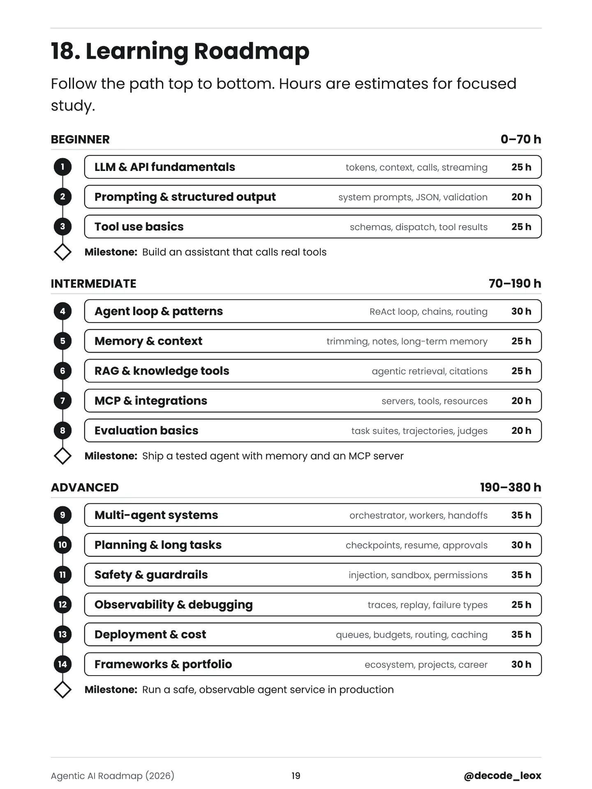

## Tokenomics read

This guide is a cost document wearing a curriculum's clothes, and it lines up with the playbook's own cost levers in five places:

- **The loop is the furnace; the caps are the brakes.** The agent loop's step budget and the token budget that raises on exhaustion are the same shape as the Jev loop CONTINUE/STOP decisions in 02 and the goal-based loop evaluator in 01 — the cheapest brake on the most expensive shape.
- **Cost per task, not per token.** The eval section tracks steps, tokens, latency, and cost per task, and deployment tracks cost per task too. That is the unit that matters for a team budget: a cheap model that loops ten times costs more than a dear one that finishes in two.
- **Routing is a first-class control.** "Route easy steps to smaller models" sits in the deployment section next to caching and budgets — the same ladder the playbook's routing entries describe, stated as a deployment default rather than an optimization.
- **Deterministic work stays out of the model.** Idempotent steps, saved state, Pydantic validation, and JSON-lines traces are all ways of moving work from tokens to code — the same instinct as the Jev classifier entries: spend the model only where a decision is actually being made.
- **Evals are the spend gate.** Rerunning the task suite after every prompt, tool, or model change is what makes a cheaper model safe to adopt — it is the measurement layer the Nov 6 Copilot usage-metrics API provides at enterprise scale, here in fifteen lines of Python.

## Honest notes

- **The cheat sheet is missing.** Section 19 is listed in the contents (p. 20) but no slide in the carousel covers it — the carousel jumps from the Learning Roadmap to the closing slide. Do not cite the guide as having a cheat sheet; it promises one the post does not deliver.
- **The page numbers don't line up.** The closing slide's footer reads p. 22, but the carousel has 20 slides and the contents list ends at p. 20. The guide's own pagination runs two pages past what the post shows.
- **The 380 hours are estimates, not measurements.** The per-topic hours are the creator's study-time estimates for focused study; nothing in the post measures how long learners actually took, and the phase totals are arithmetic, not evidence.
- **Model names are the guide's own.** The code uses a Sonnet-class model name current at publication; the guide itself warns that model names change often and to check provider docs. Treat the name as a placeholder for "your capable model."
- **Python + Anthropic throughout.** Every worked example is Python against the Anthropic SDK and FastMCP. The guide says the patterns transfer across providers, and they do — but nothing here is tested against another SDK.

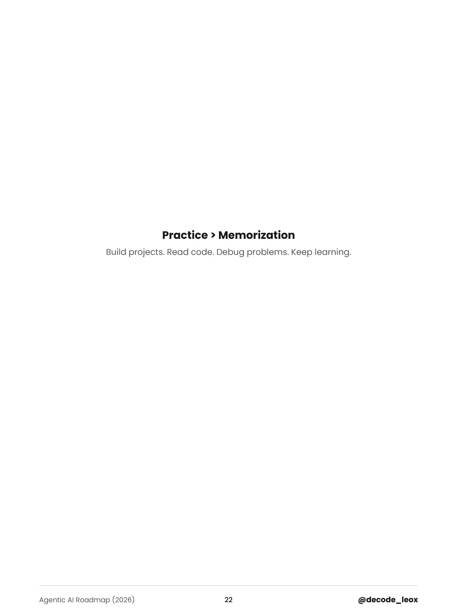

**Source:** https://www.instagram.com/p/DfMTlJRjUPP/ · Creator: @decode_leox (Aman) · Posted Nov 1, 2026 · 20 slides
