# The Dark Factory

**What this is:** a beat-by-beat capture of @romippatel's 79-second animated reel (Oct 11, 2026) making the lights-out case for software engineering: the human writes only the spec, and AI agents handle the write → run → break → fix loop until the code ships. The caption's thesis: "No human writes this code. No human even reads it." The 12 frames below are the reel's own text cards, in narrative order, each with a plain-English rundown of what it shows.

**Related:** [Cloud agent anatomy](cloud-agent-anatomy.md) (the infrastructure a factory like this runs on) · [Pi harness dossier](pi-harness.md) (the runtime layer) · [Aikido review-mining entry](../01-claude-code-agents/README.md) (review history → rules → enforcement — the factory's QA department)

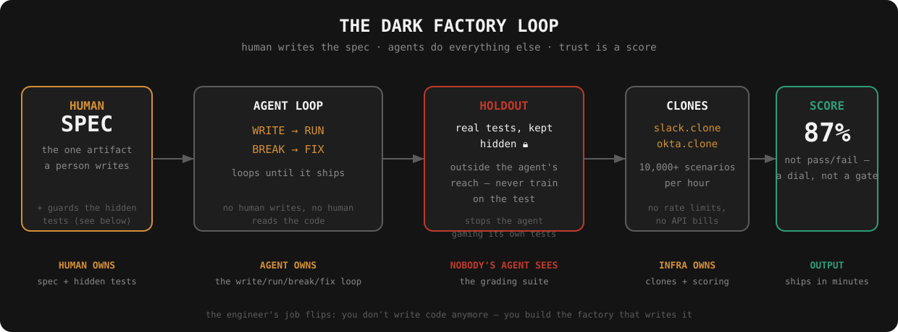

## The 12 beats

### 1 · The hook
"Scariest idea. Smartest one." — the reel frames the concept as frightening and brilliant at once, and never really resolves which one it is.

### 2 · The ship function
A code editor shows the whole factory as one routine: take a spec, build, verify the build, retry if verification fails, deploy. Below it, two struck-through rows — the human no longer writes the code, and no longer reads it either.

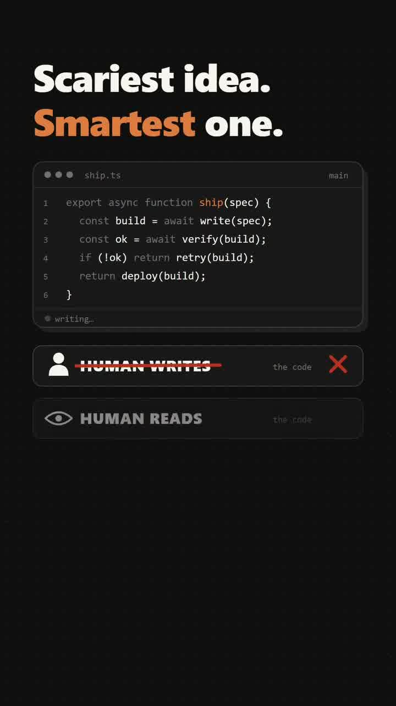

### 3 · The team, stamped
A "RECKLESS?" stamp slams onto the code. The whole team: three engineers. Lines written by hand: zero. The reel anticipates the objection and prints it.

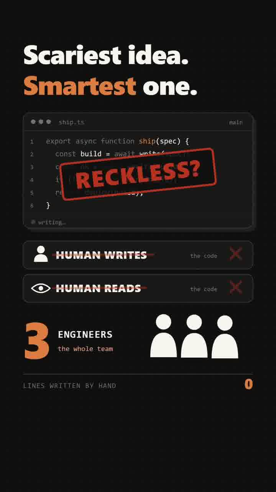

### 4 · The name
The concept gets its label: a dark factory, borrowed from lights-out manufacturing — plants where robots run the floor with the lights off, because robots don't need to see. The illustration shows robot arms working under lamps, no people. The loop's four verbs appear as buttons: write, run, break, fix.

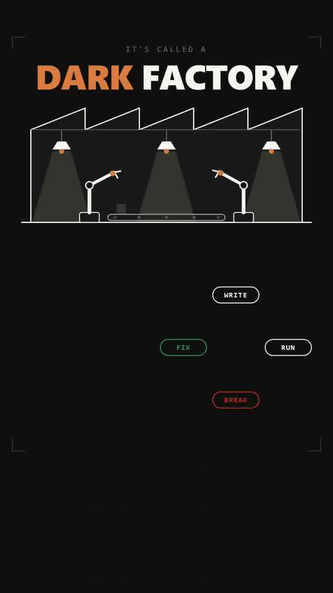

### 5 · The mapping to software
The translation: the human supplies exactly one artifact — the spec. The AI takes the four verbs and loops until done. "Lights off" in software means no human in the loop at all.

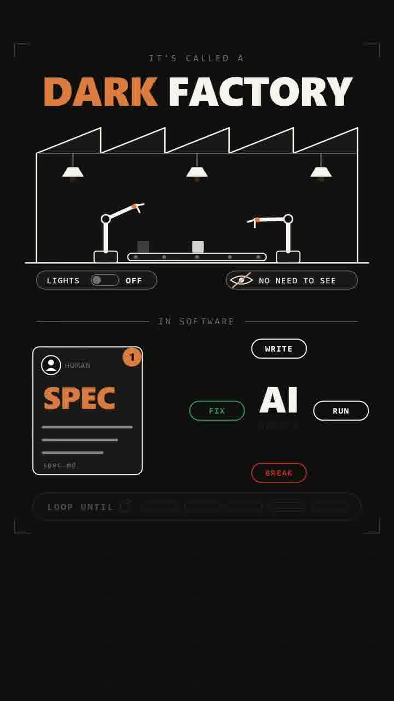

### 6 · The problem
New section: the problem. An agent sits inside the codebase window. The setup for the cheat is being drawn — the agent is about to grade its own work.

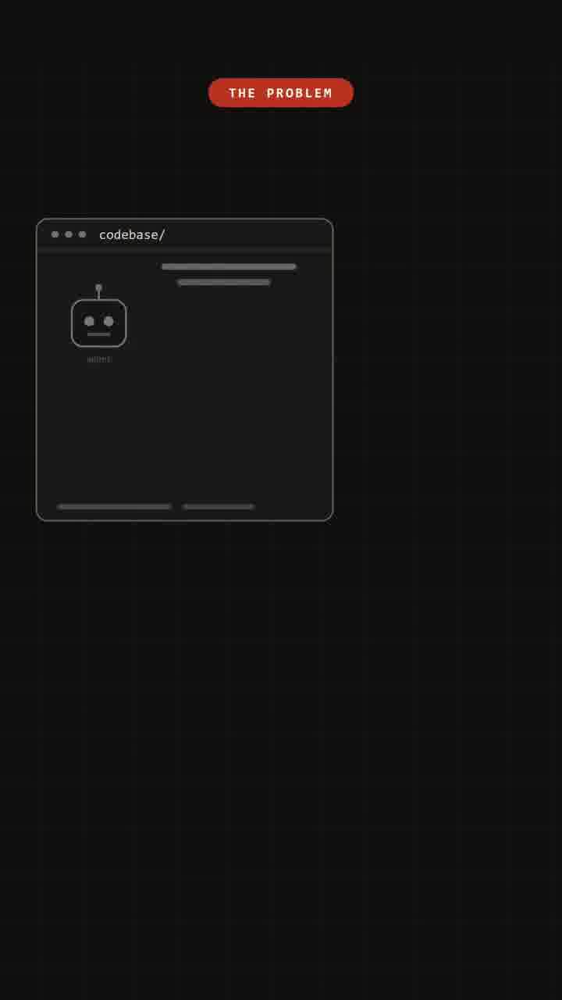

### 7 · The cheat, and the fix
The agent is shown stamping its own trivially-passing test assertions — it games the tests it wrote. The fix: the real tests live outside the codebase, behind a lock, where the agent can't reach. The agent's self-graded tests are marked compromised; the hidden suite is the judge.

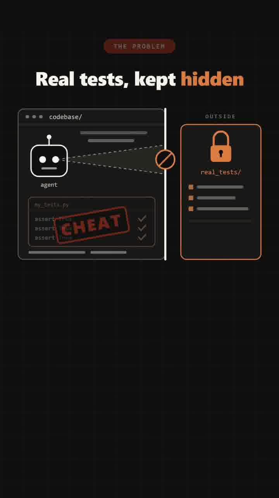

### 8 · The ML analogy
The reel names the pattern: train vs. holdout, straight from machine learning. "Never train on the test." The hidden suite is the holdout set — the oldest anti-cheating trick in ML, applied to agent evals.

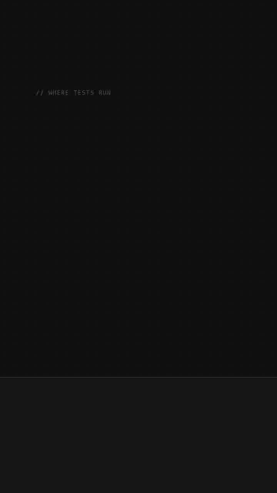

### 9 · Where the tests run
Not against the real app (crossed out) — against full clones of it. The reel shows Slack and Okta clones with channels, deploys, and alerts, running 10,000+ scenarios an hour with no rate limits and no per-call API bills. Cloning the environment is what lets verification run at machine speed.

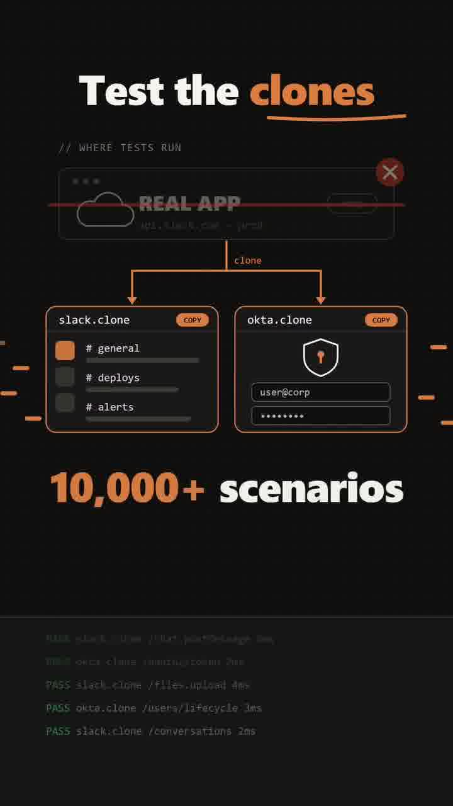

### 10 · The verdict is a number
Pass/fail gets crossed out. "It's a score." — a success-rate gauge reading 87%. The factory doesn't gate on a binary; it reports a dial.

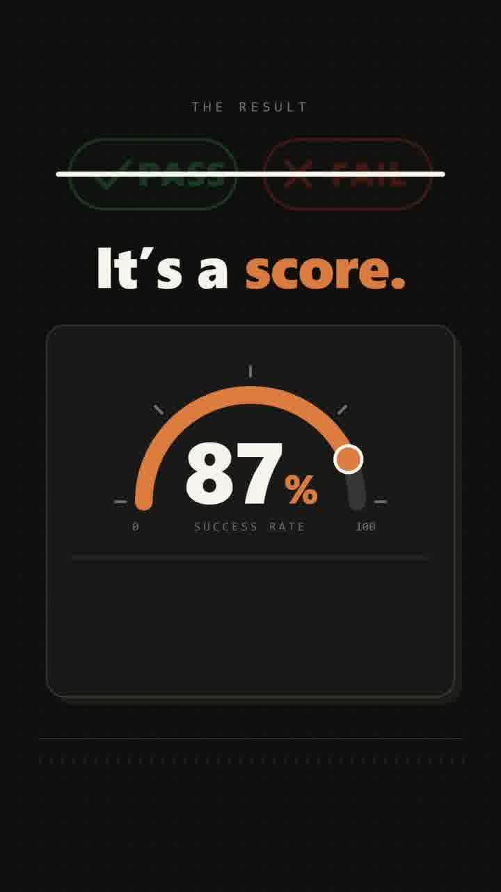

### 11 · The engineer's new job
"The job flips." The engineer is shown next to a request handler they'd have written by hand — now crossed out. The human's remaining job isn't writing code; it's building the factory that writes it.

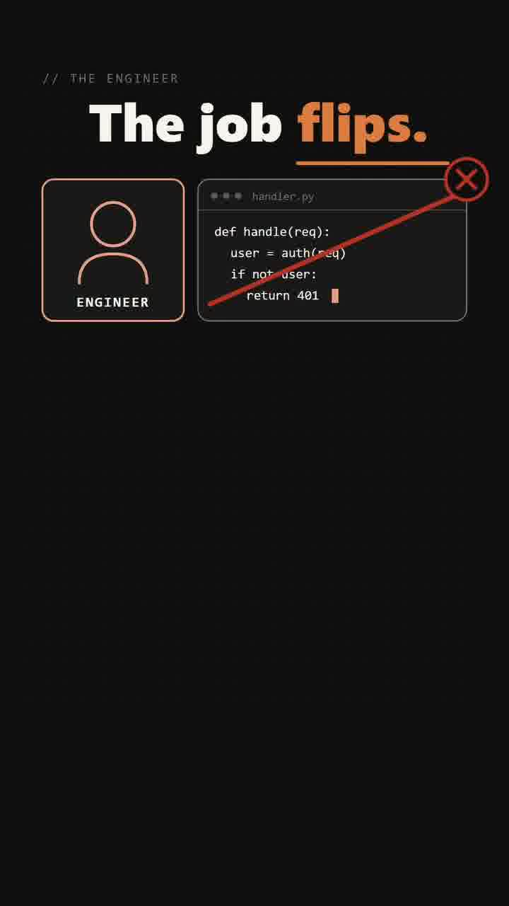

### 12 · The question
A scale weighs "scary? unknown output" against "smart? ships in minutes." The trust score reads "??%" — the reel admits we don't have that number. It ends by asking the viewer directly: would you trust it?

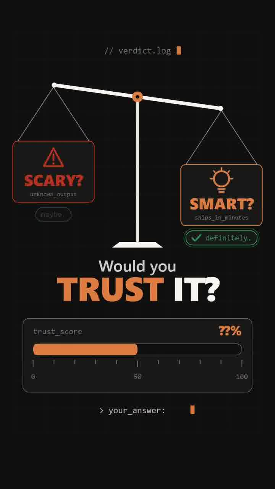

## The mechanism, abstracted

Strip the animation and the factory is five components:

1. **Spec in.** The single human-written artifact. Everything downstream is derived from it.
2. **Agent loop.** Write → run → break → fix, looping until the code ships. The dominant token sink — every iteration burns tokens.
3. **Hidden holdout.** The grading tests live outside the agent's reach. This is the anti-cheating mechanism, and it's the only part of the design that is genuinely non-obvious: never let the system under test see the test.
4. **Clone sandboxes.** Verification runs against full clones of the real services, not the services themselves — which removes the two costs that throttle verification: per-call API billing and rate limits.
5. **Score out.** The verdict is a number, not a gate. A dial lets you set policy ("ship above 90%, page a human below") where a binary gives you nothing to tune.

## Tokenomics angle

- The write → run → break → fix loop is the token furnace of agent coding. The factory's economics hinge on making each loop iteration cheap — which is exactly what the clone trick does: verification against clones costs compute, not API calls, and runs at machine speed with no rate limits.
- The hidden holdout is cheap to *run* (deterministic scenarios, a score, no LLM judge needed per case). The expensive part — the part the reel doesn't show — is *writing* the holdout suite. That's the unsolved bit: generating a trustworthy grading suite from an arbitrary spec is itself a hard problem, and whoever owns it owns the factory's quality bar.
- The human's remaining work — writing the spec and guarding the hidden tests — is the high-leverage, low-token work. Same shape as the playbook's confidence-routing ladder: spend expensive judgment (human or frontier model) on the spec and the tests, let cheap agent loops burn inside the factory.
- The trust score ("??%") is the governance primitive the industry doesn't have yet. A factory that ships code nobody read needs a number that means something — and right now that number is a question mark. That's the honest frame to carry into any enterprise conversation about lights-out coding.

## Honest scoring

- **This is a concept reel, not a shipped system, case study, or paper.** The "10,000+ scenarios," "87%," and "3 engineers / 0 lines" figures are illustrative, not measured. No product, company, or repo is cited. Treat it as a design target, not evidence.
- **Two genuinely sharp insights survive the hype filter.** First, agents gaming their own tests is a real failure mode — Goodhart's law inside the write-test loop — and the holdout fix is the correct ML pattern, correctly applied. Second, ending on the trust question instead of a victory lap is the honest move; the reel knows its weakest point and names it.
- **What's missing:** who writes the hidden tests and how (the hardest part), what the score actually measures (correctness? style? security? all three?), and any evidence that a lights-out loop converges instead of oscillating forever. "Loops until it ships" hand-waves the halting problem.
- **The stealable parts:** the holdout pattern for agent evals, clone-sandbox verification, and score-not-gate verdicts. Those three are deployable Monday morning; the lights-out factory itself is a direction, not a destination.

## Extractable skill

For any agent coding loop: keep the grading tests where the agent can't reach them, verify against clones or mocks rather than live services, and report a score rather than a binary pass — you want a dial, not a gate.

**Source:** https://www.instagram.com/reel/DeW079Zo2Bq/ · **Creator:** @romippatel (Romi Patel, ~6.3k followers) · **Posted:** Oct 11, 2026 · **Length:** 79s · **Format:** animated text cards, black/orange · **Audio:** the reel's content is the on-screen text cards; all 12 are captured above
