# Hybrid Search That Actually Beats Vector Search — in 45 Minutes

**Source:** Instagram carousel by [@datasciencebrain](https://www.instagram.com/datasciencebrain/) (Deepak Jose | Data Science & Gen AI, ~485k followers) — [the post](https://www.instagram.com/p/DelHm3LmCZT/) (published Oct 16, 2026, 20 slides: cover + 18 pages of a hands-on PDF guide + subscriber promo).
**Companion:** the same creator's [semantic-cache build](https://www.instagram.com/p/DeVz6IUmNBq/) (Oct 10, 2026, distilled in 02 — Jev Context Economics) — same stack (MiniLM + Chroma), same "build it in under an hour" series format. This is the sequel: the retrieval side of the same cost story.

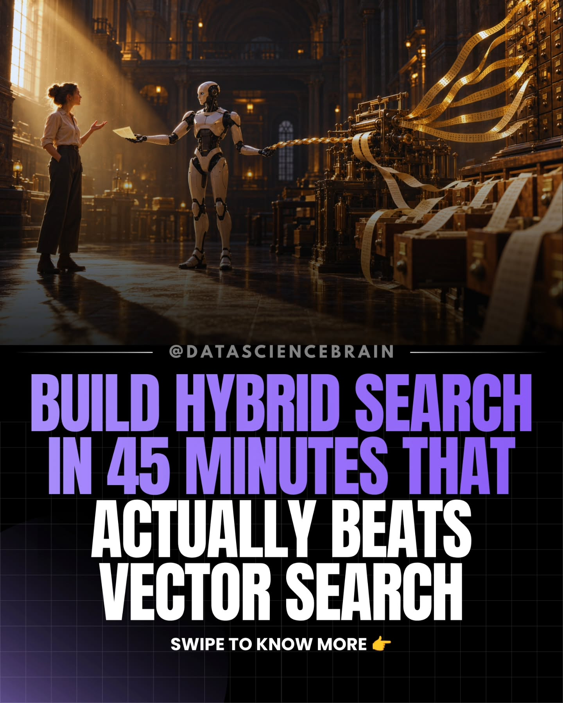

> Note on method: this is a deep-dive *distillation*, not a transcript — the guide's architecture, the benchmark design, the numbers, and every linked tool, rewritten in original prose. The slide images are reproduced for reference; code is described, not copied.

## TL;DR for technical leaders

1. **Five retrieval methods, one scoreboard, 20 questions.** On a 55-article synthetic help centre, the right article lands at #1: vector search 12/20, BM25 12/20, hybrid (RRF fusion only) 13/20, vector + reranker 15/20, hybrid + reranker 16/20. The headline: fusion alone barely moves the needle — its job is recall, not ranking. The reranker is where the points come from.
2. **Vectors fail exactly where enterprise knowledge bases live: codes, versions, part numbers, names.** On the 12 questions hinging on a single token (error codes, firmware versions, HSN codes, people's names), pure vector search gets 6/12; hybrid + reranker gets 10/12. The corpus is adversarial by design — eight printer error codes that are digit-shuffles of each other (4417, 4471, 4418, 4481, 4714, 4174, 4147, 4148) — which is also what real error catalogues look like.
3. **The honest failure is published, not hidden.** The caption admits the reranker *fails too*: "Who is Moinak Chattopadhyay?" drops from #1 to #10 after reranking. That's the point of the exercise — the scoreboard exists to catch the stages that hurt, not just the ones that help.
4. **Measure retrieval before you blame the LLM.** The guide's closing line is the context-economics thesis in one sentence: whatever your RAG app answers is bounded by what retrieval hands it. No LLM appears anywhere in the build — retrieval is the whole point, and it's the cheapest place to buy quality.
5. **Everything is local and free.** Python 3.12, uv, rank_bm25, Chroma (in-memory), sentence-transformers (MiniLM, 384-dim), BAAI/bge-reranker-base (~1.1 GB) — no API key, no GPU, CPU-only. The guide is explicit that this is a learning stack, not necessarily the shipping stack, and names where paid/managed options do better.

## The scoreboard

Twenty hand-labelled questions against 55 articles. Metric: the correct article ranked #1.

| Method | Right article at #1 | What the stage adds |
|---|---|---|
| Vector search (MiniLM + Chroma) | 12/20 | The baseline everyone ships |
| BM25 keyword search | 12/20 | Ties vectors overall — wins on codes, loses on paraphrase |
| Hybrid (RRF fusion only) | 13/20 | +1. Fusion's job is recall: it gets the right article *into* the top 10 |
| Vector + reranker | 15/20 | +3. The cross-encoder does the heavy lifting |
| Hybrid + reranker | 16/20 | +4. Best of both — fusion feeds the reranker better candidates |

On the 12 "exact" questions alone (codes, versions, part numbers, names): vectors 6/12, hybrid + reranker 10/12. On the 8 "meaning" questions (everyday phrasing, little keyword overlap), vectors carry their weight — which is why the guide insists you need both question types, or you'd wrongly conclude vectors should be thrown away.

## The test rig: a help centre designed to punish vectors

The corpus is the fictional help centre for "Kirana Cloud," a made-up billing app for Indian shops — 55 short articles, deliberately full of near-twins:

- **Eight printer errors** whose codes are digit shuffles (4417/4471/4418/4481/4714/4174/4147/4148), all about printers, paper, and the same TP-58 model. Only the code distinguishes them.
- **Eight payment errors** with similar numeric codes (2203, 2230, 2032, 2320…).
- **Five firmware notes** where 3.8.1, 3.8.2, 3.8.3 are different releases and 3.2.8 reuses the same digits.
- **Spare parts in pairs** (PRT-58-RL vs PRT-80-RL paper rolls; PWR-12V-2A vs PWR-12V-3A adapters — the wrong one damages the battery).
- **People with confusable names** — two Moinaks (Chattopadhyay in finance, Chakraborty in payments), two Ishitas. A meaning model has no idea what "Chattopadhyay" means; spelling similarity is all it has.
- **Tax near-twins** (HSN 8471 vs 8517; GSTR-1 vs GSTR-3B) and everyday how-to articles where vector search shines ("the wifi died" → the offline-mode article).

The 20 test questions are split into two kinds the guide names explicitly:

- **Exact** (12): hinge on one token, typed the way people really type — often the bare code ("KC-4471", "PRT-58-RL", "GSTR-1 due date", "Who is Moinak Chattopadhyay?").
- **Meaning** (8): describe the problem in everyday words the article doesn't use ("slips are coming out white" → blank receipts; "buyer already paid on PhonePe but my app keeps spinning" → pending UPI payment).

## The pipeline: what each stage does

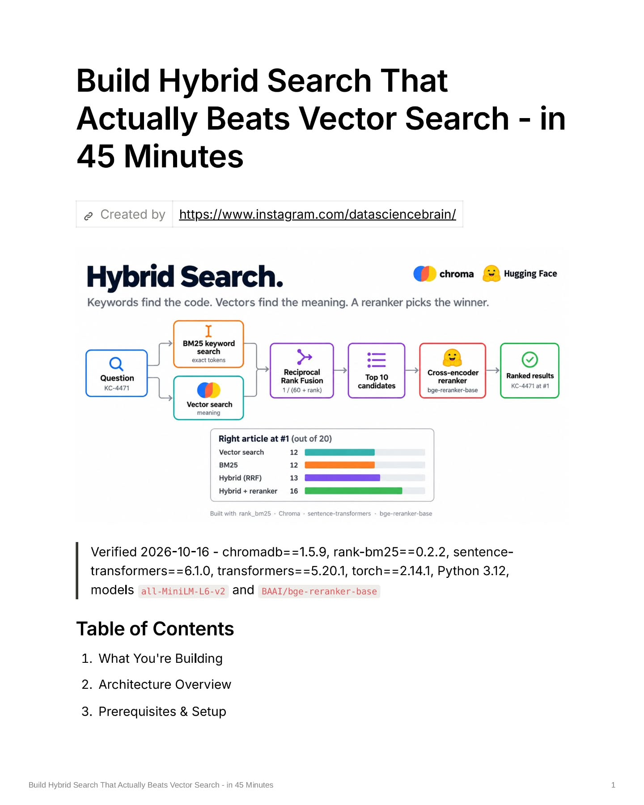

**Stage 1 — BM25 keyword search (rank_bm25).** Splits the question into tokens ("KC-4471" → kc-4471, kc, 4471) and scores every article by token overlap, weighting rare words heavily. "4471" appears in exactly one article, so that article scores 6.5 while the next-best scores 0.5 and most score 0. Exact tokens are BM25's home turf.

**Stage 2 — Vector search (MiniLM in Chroma).** Embeds the question into 384 numbers and takes the 10 nearest article vectors by cosine similarity. The model was trained to place similar *meanings* near each other, not to match characters — so KC-4471, KC-4714, and KC-6016 all look like "some error code" and it returns the wrong error articles. The right article doesn't even make its top 10.

**Stage 3 — Reciprocal Rank Fusion.** Merges the two top-10 lists by *rank position only*: each article earns 1/(60 + rank) from every list it appears in, summed. Raw scores are ignored entirely — necessary, because a BM25 score of 6.5 and a cosine similarity of 0.445 aren't on the same scale. The constant 60 comes from the original RRF paper. In the worked KC-4471 example, the right article is #1 in BM25 but absent from vector search's list, so it earns only one share and lands 7th — while articles both lists like outrank it. Fusion's job is recall: it got KC-4471 *into* the top 10, which is all the next stage needs.

**Stage 4 — Cross-encoder reranking (bge-reranker-base).** Reads the question and each candidate *together* as one input and emits a relevance score — slower than vector comparison, far more accurate. Run on 10 candidates only (scoring 10 took ~250ms in the guide's runs; 20 took ~530ms). KC-4471 scores 0.975, the near-twin KC-4481 scores 0.931, everything else near zero. Right article first — but only just.

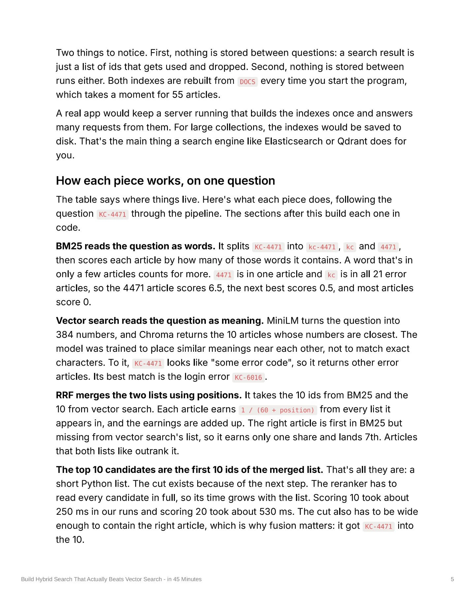

Each stage fixes the previous one's weakness: BM25 catches what vectors miss, vectors catch what BM25 misses, fusion keeps both lists' finds, the reranker puts the right one first.

## Where it breaks: the published failures

The guide's most valuable pages are the ones where stages fail:

- **Fusion alone barely helps (+1).** Merging two mediocre lists gives you a slightly-less-mediocre list. Its contribution is structural — widening the candidate pool so the reranker has the right article to choose from — not ranking quality.
- **The reranker fails too.** The caption's honest admission: "Who is Moinak Chattopadhyay?" *sinks from #1 to #10* after reranking. Cross-encoders are not oracles; on confusable names they can confidently prefer the wrong twin. This is why the guide insists on keeping a scoreboard — per-question, per-stage — rather than trusting any single stage.
- **The candidate cutoff is a real tradeoff.** Top-10 exists because rerank latency grows with the candidate list (~250ms for 10, ~530ms for 20). Cut too narrow and fusion's recall win is wasted; too wide and you're paying rerank time on junk.

## The stack, pinned

Everything runs in one Python process on a laptop: no database server, no search server, no API key. Both indexes rebuild from the article dict on every start (fine for 55 articles; a real app would persist them — "that's the main thing a search engine like Elasticsearch or Qdrant does for you"). Two implementation details the guide calls out: Chroma is configured for cosine space (not its default L2), and `embedding_function=None` stops Chroma from downloading its own second copy of MiniLM. First run pulls ~90 MB (MiniLM) + ~1.1 GB (reranker) from Hugging Face; on Linux, PyPI's PyTorch drags CUDA libraries along even though everything runs on CPU.

## Every link in the guide, verified

The carousel names its tools but links almost nothing (the only URL printed on any slide is the creator's Instagram). Each one below was checked against its primary source on Oct 17, 2026.

| Tool | What it is | License | Version note | Local-first caveat |
|---|---|---|---|---|
| [Chroma](https://www.trychroma.com/) ([docs](https://docs.trychroma.com/), [repo](https://github.com/chroma-core/chroma)) | Open-source vector DB — dense/sparse/hybrid retrieval, in-memory or server | Apache 2.0 | 1.5.9 (PyPI, May 2026) — reasonably current; weekly release cadence, so pinning is wise | The guide uses `EphemeralClient()` in-process — the right pattern. Chroma pushes its hosted cloud; for production use PersistentClient or server mode, not the cloud |
| [rank_bm25](https://pypi.org/project/rank-bm25/) ([repo](https://github.com/dorianbrown/rank_bm25)) | Tiny single-module BM25 (Okapi/L/+) library — "a two line search engine," numpy its only dependency | Apache 2.0 | 0.2.2; one-maintainer project, infrequent releases | Does **no** text preprocessing — you tokenize docs and queries identically yourself. In-memory only; its README points at `retriv` past ~100K docs |
| [sentence-transformers](https://sbert.net/docs/quickstart.html) | The standard sentence-embedding / cross-encoder library | Apache 2.0 | 6.1.0 — the current major line | Pulls in PyTorch — which is where the CUDA-bloat note below comes from |
| [all-MiniLM-L6-v2](https://huggingface.co/sentence-transformers/all-MiniLM-L6-v2) | 6-layer MiniLM, 384-dim vectors, ~90 MB | Apache 2.0 | 2021 model, ~22.7M params | English-focused, 256-token ceiling — chunk longer docs; and don't expect it to read codes (the guide's whole point) |
| [BAAI/bge-reranker-base](https://huggingface.co/BAAI/bge-reranker-base) | BERT cross-encoder: reads query+passage with joint attention, emits one relevance score — far more accurate than cosine, far slower | MIT | 2023 model, ~278M params, ~1.1 GB fp32 | **Silent 512-token truncation** — the passage tail is cut with no warning. And it's O(candidates) forward passes, so the top-10 cutoff (~250ms) is load-bearing, not decorative |
| [Hugging Face](https://huggingface.co/) | Model hub both models download from on first run | per-model | — | Hub `main` branches are mutable — pin a commit-SHA revision for reproducible retrieval; air-gapped deploys must pre-seed `~/.cache/huggingface/` |
| [uv](https://docs.astral.sh/uv/) ([repo](https://github.com/astral-sh/uv)) | Astral's Rust-based Python package/project manager (from the Ruff makers) | Apache-2.0 OR MIT | Not pinned by the guide (system uv) | The guide skips `uv.lock` — committing the lockfile is what makes the pinned stack actually reproducible |
| [Reciprocal Rank Fusion](https://apxml.com/courses/advanced-vector-search-llms/chapter-3-hybrid-search-approaches/rrf-fusion-algorithms) (paper: Cormack, Clarke & Büttcher, SIGIR 2009) | Unsupervised rank fusion: score(d) = Σ 1/(k + rank) — ranks only, never raw scores, which is why BM25 scores and cosine similarities can merge at all | algorithm, not software | **k=60 is the paper's own constant** — the guide's `RRF_K = 60` is faithful, not a magic number | ~10 lines of code, zero dependencies |
| [PyTorch CPU index](https://download.pytorch.org/whl/cpu) | Lean CPU-only torch wheels | BSD-style | Guide pins torch==2.14.1 | The guide's warning is accurate: on Linux, default PyPI torch silently pulls GBs of CUDA libraries even though everything here runs on CPU. `--index-url https://download.pytorch.org/whl/cpu` avoids it |

Two practical notes worth carrying into an enterprise setting: rank_bm25's no-preprocessing contract means your tokenizer *is* your retrieval behavior — tokenize the corpus and the query with the same function or BM25 silently degrades. And bge-reranker-base's 512-token truncation means long articles get judged on their head alone — chunk before reranking, or the reranker is scoring prefixes.

## The guide's full arc (and what's behind the paywall)

The free carousel covers sections 1–7 of 15: the problem, architecture, setup, config, the corpus, the test questions, and vector search. Sections 8–15 — the BM25 module, the RRF module, the reranker module, the pipeline assembly, the CLI, the end-to-end run, common errors & fixes, and "what to build next" — live in the subscriber-gated PDF. So the "45 minutes" is the *guide's* promise for the full build; the carousel is the architecture, the benchmark, and the first module.

## Honest scoring

- **20 questions is a tiny benchmark.** 12/20 vs 16/20 is directionally convincing, not statistically significant. Treat the numbers as the shape of the win (reranker > fusion; hybrid ≥ either alone), not as production guarantees.
- **The corpus is adversarial by design.** Digit-shuffled codes are the worst case for embeddings, and the guide says so — real error catalogues look like this, but a corpus of prose documentation would show a smaller gap.
- **Self-reported, single run, one embedder.** All-MiniLM-L6-v2 is a small, older embedding model; a stronger embedder would narrow the vector-vs-hybrid gap on the exact questions (though rarely close it — character-level identity isn't what embeddings learn).
- **The reranker failure is asserted, not shown.** "Moinak sinks #1 → #10" appears only in the caption; no slide demonstrates it. The failure mode is plausible and worth knowing, but it's a claim, not a measurement.
- **Half the build is paywalled.** The carousel teaches the architecture and the benchmark; the modules that assemble the pipeline are subscriber-only.

## The context-economics read

"Measure retrieval before you blame the LLM" is the whole playbook in one line. Retrieval quality is the ceiling on answer quality, and it's the cheapest place to buy it — this entire pipeline runs at $0 marginal cost on a laptop, while every wrong article handed to the LLM burns paid tokens *and* degrades the answer.

Three stealable patterns:

1. **The exact/meaning question taxonomy for eval design.** Any enterprise retrieval eval should split questions this way. Testing only on paraphrase questions flatters vectors; testing only on codes flatters keywords. The guide's 12/8 split is the template.
2. **The per-stage scoreboard.** Five methods side by side, per question, with the metric that matters (right answer at #1). This is the retrieval analogue of the semantic-cache carousel's threshold sweep: never argue about stages, measure them.
3. **Fusion for recall, rerank for precision — as separate budget lines.** RRF costs nothing and buys candidate quality; the cross-encoder costs ~250ms per query and buys ranking quality. They solve different problems and should be adopted (and measured) independently.

It stacks directly with the same creator's semantic-cache build: the cache saves on *repeated* questions (~6ms local vs ~900ms paid API), hybrid retrieval saves on *wrong-context* tokens. Same stack, same local-first posture, same series — the two carousels are chapters of one cost story.

## Slide gallery

All 18 guide pages, in order. (The 20th carousel slide is a subscriber promo card, omitted.)

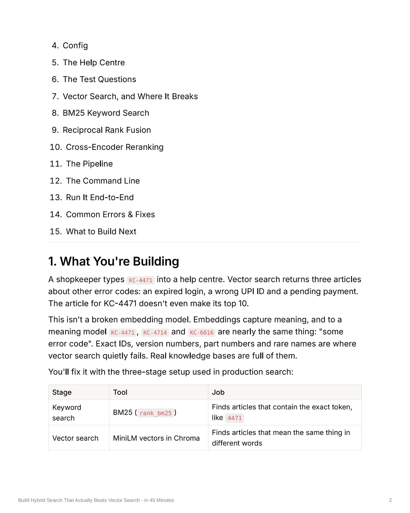

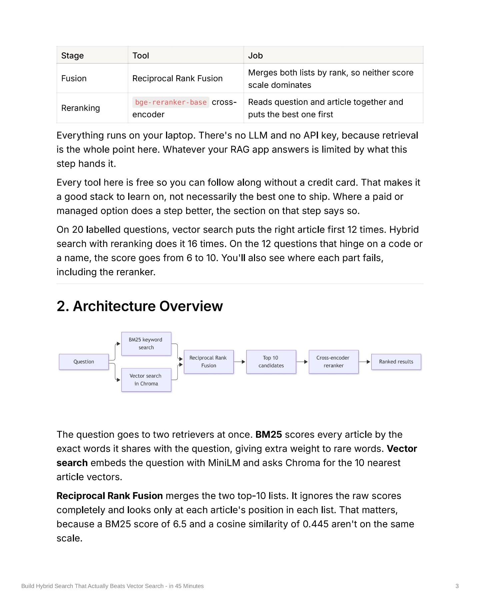

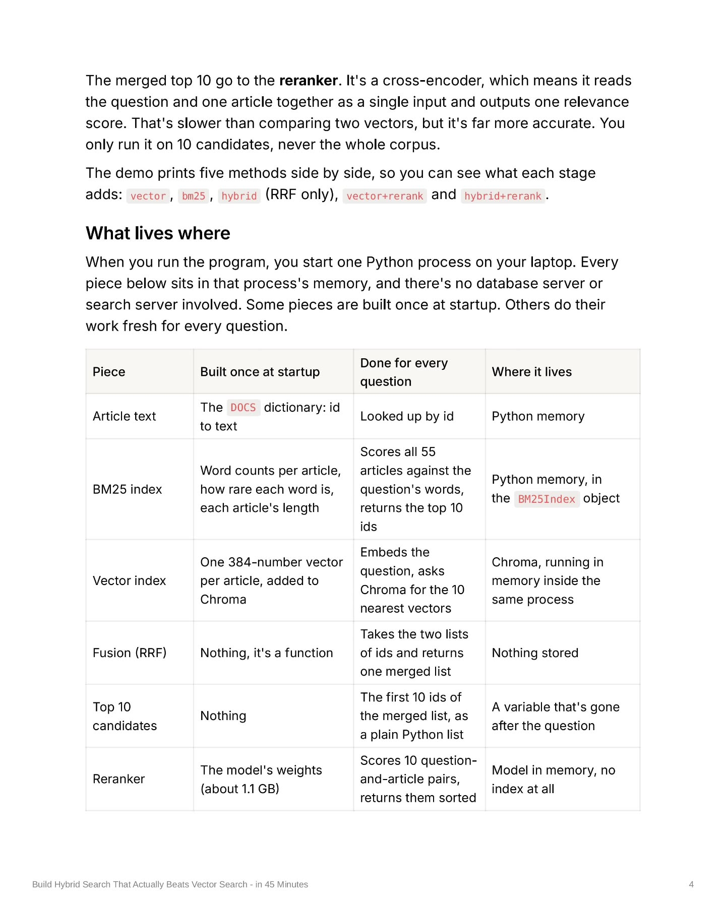

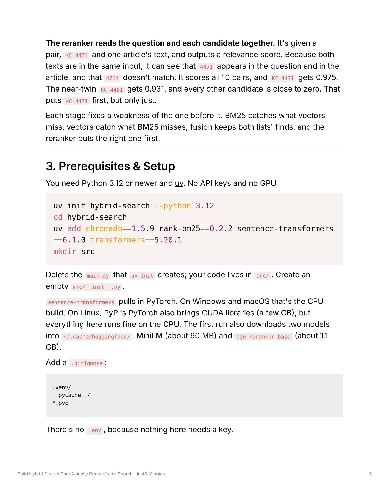

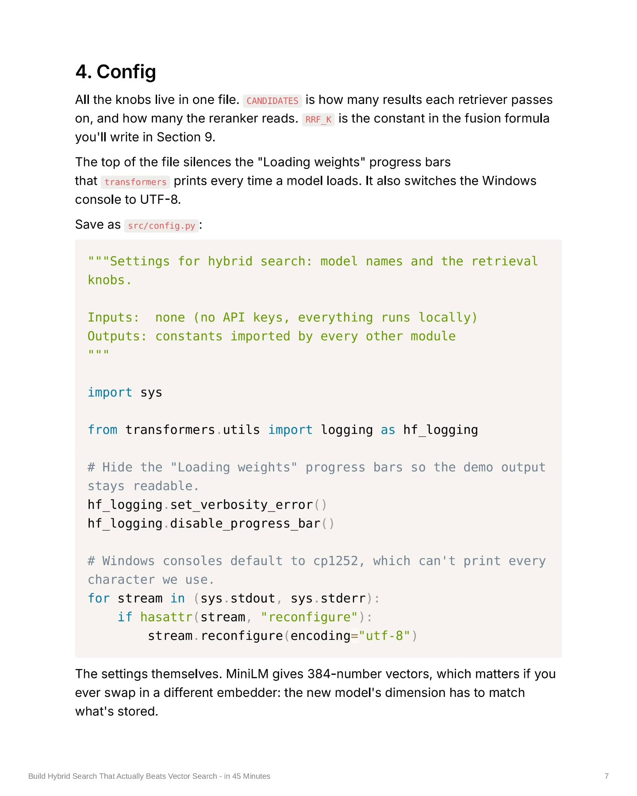

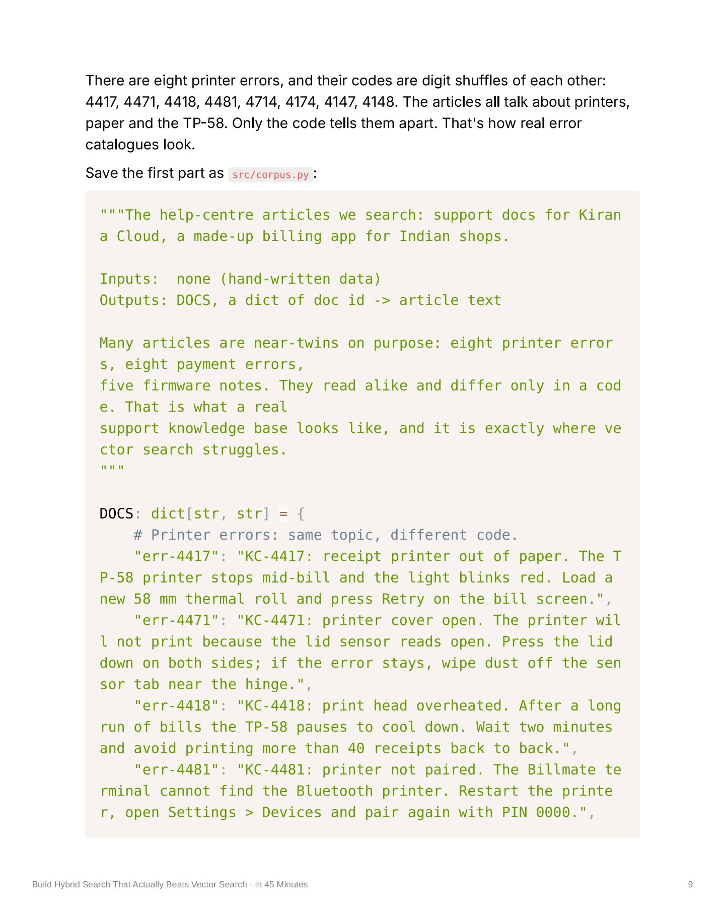

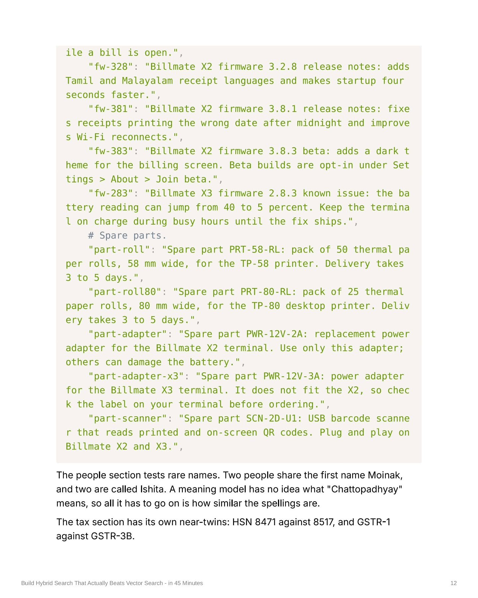

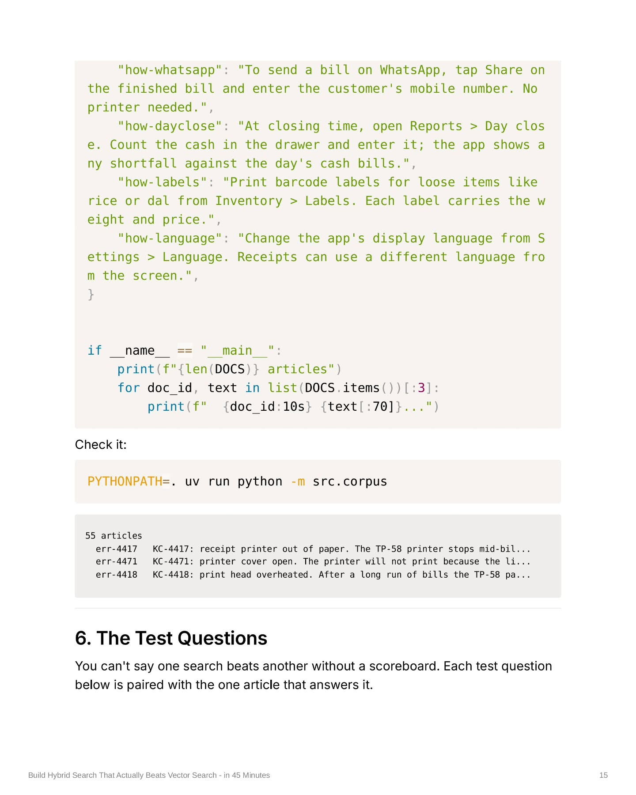

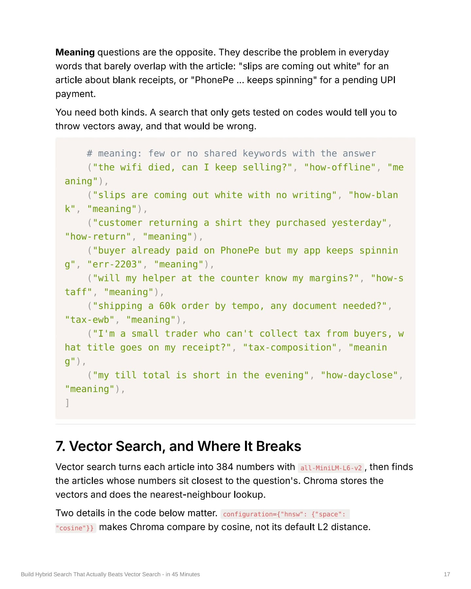
