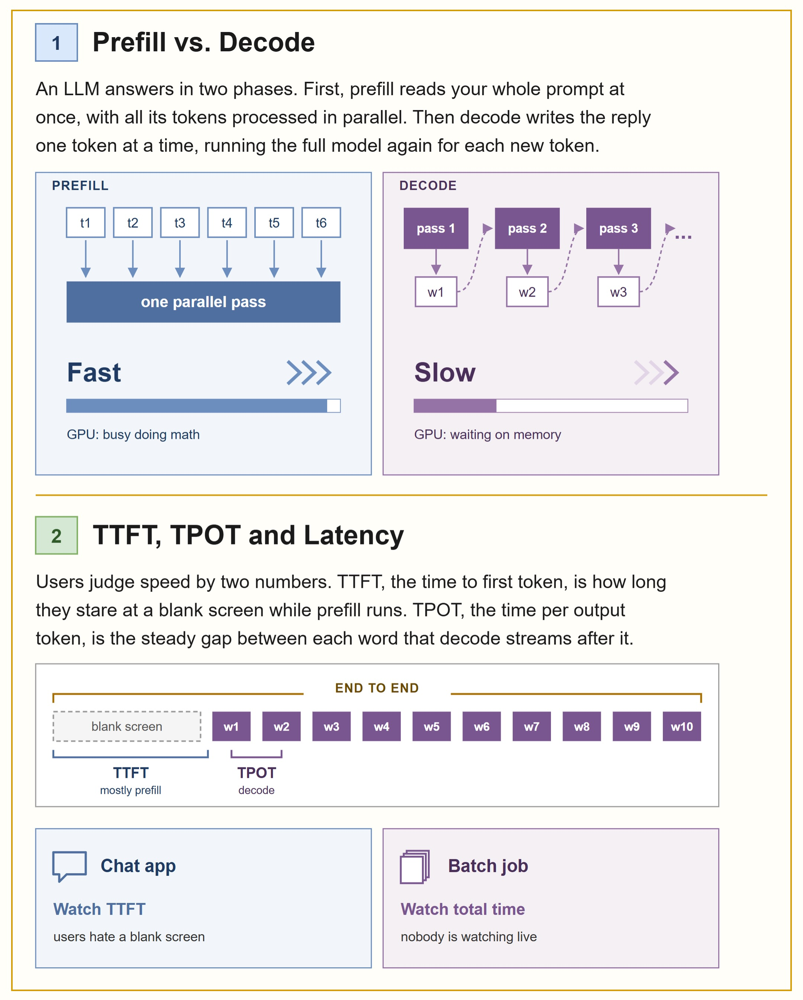
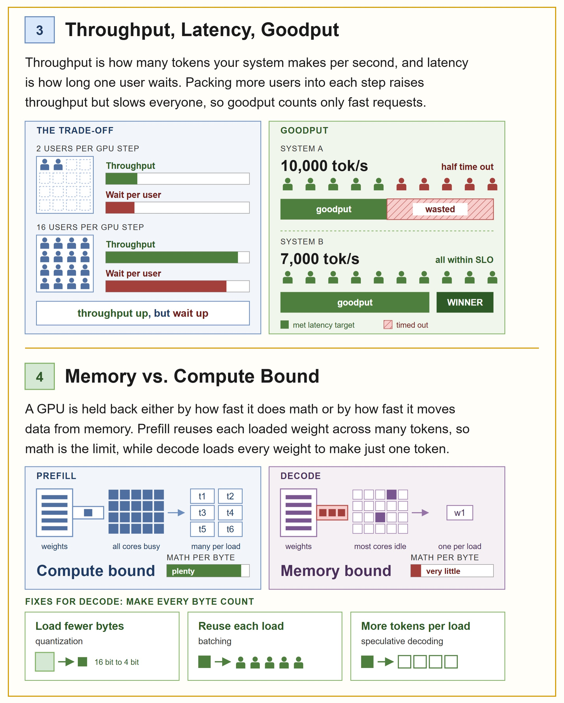
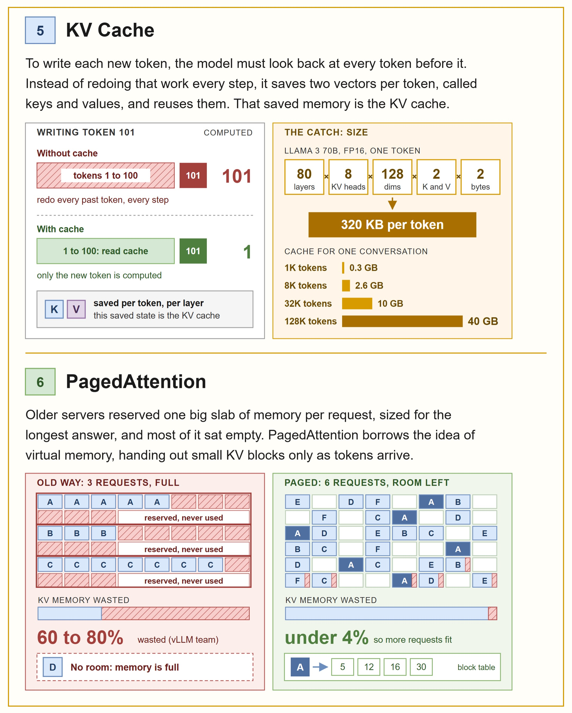
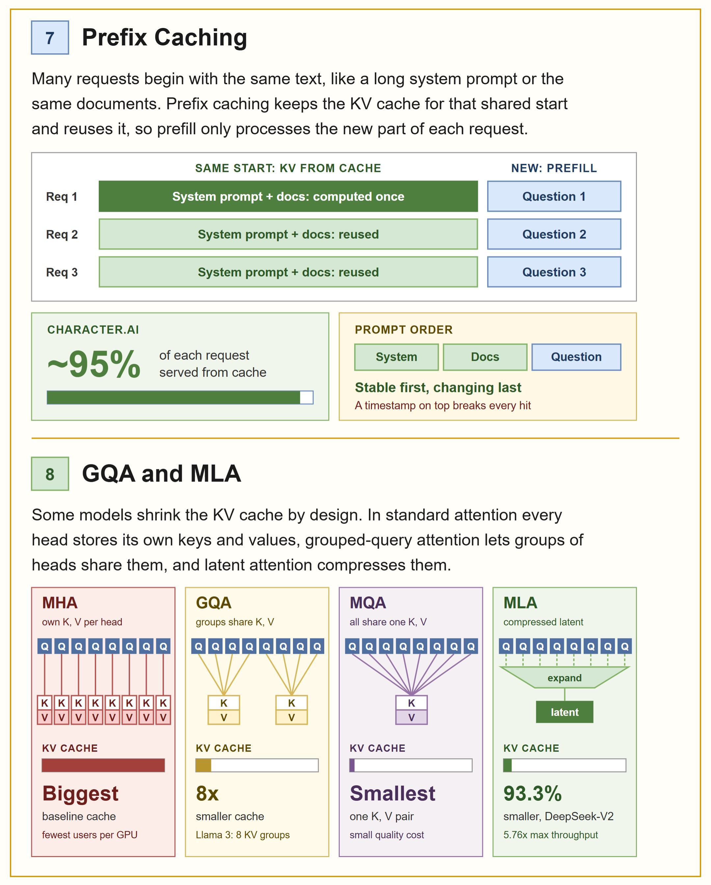
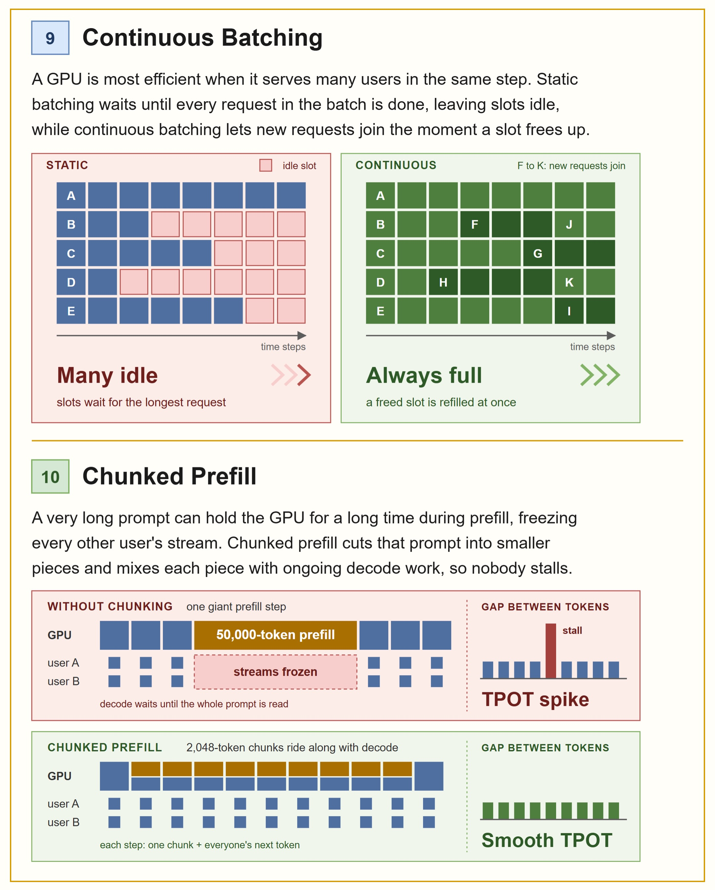
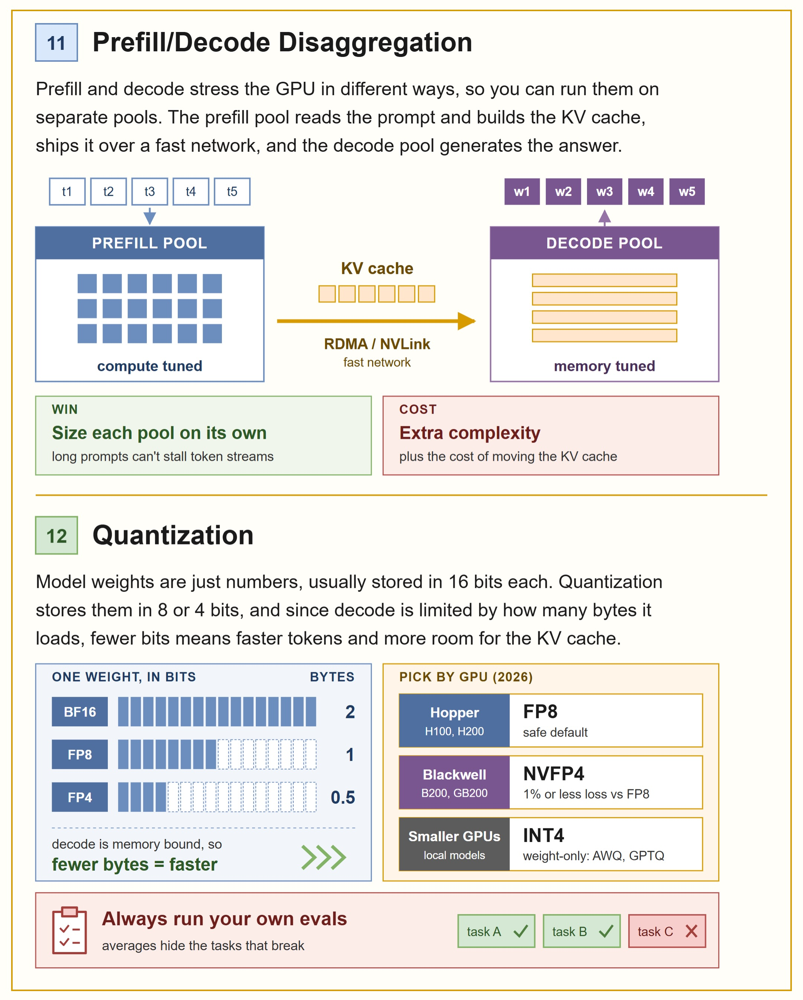
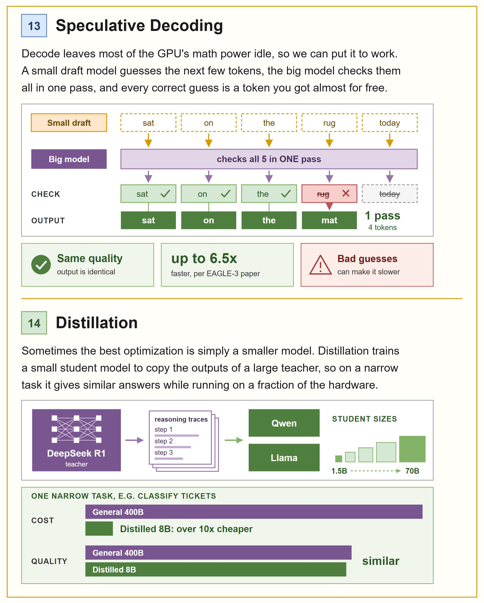
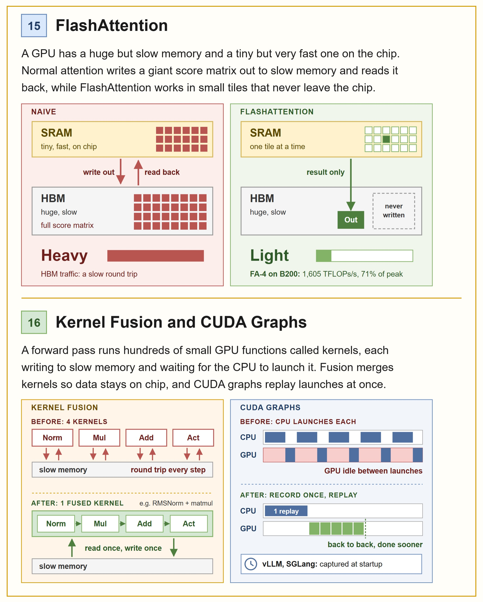
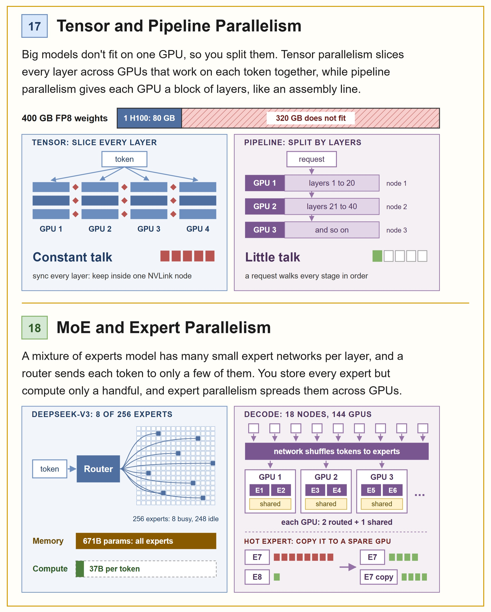
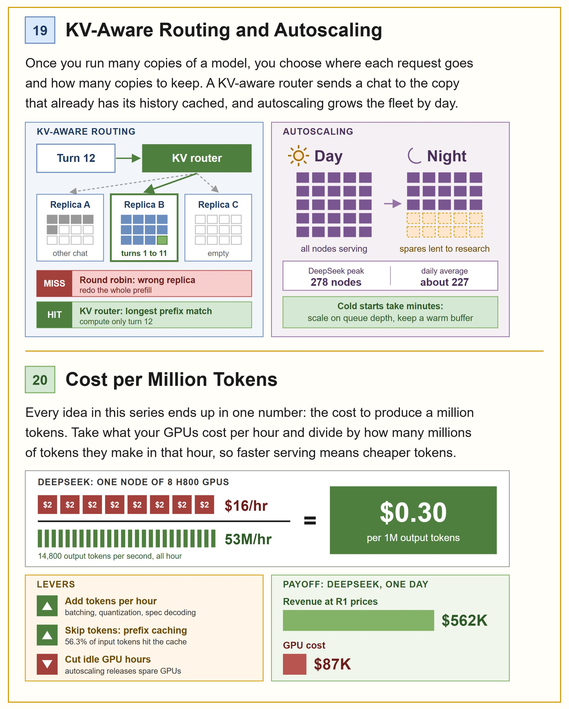

# 20 AI Inference Engineering Concepts, Explained Easily

**What this is:** a 12-slide infographic carousel by @jam.with.ai (Shirin Jam, 381k followers, Oct 13, 2026) — twenty inference-engineering concepts with clean diagrams, pitched as interview prep for moving into inference engineering. All twelve infographics are saved below, in carousel order. Distilled here in my own words.

**Related:** [The Tokenomics Playbook](../tokenomics-playbook.md) (the buyer-side companion — this page is the provider-side companion) · [OpenAI's in-house data agent](openai-data-agent.md) (context pre-compute as cost control)

**Thesis for the playbook:** every concept in this carousel is a lever on one number — cost per million tokens. The final slide makes it explicit: dollars per million tokens equals GPU dollars per hour divided by tokens per hour, so faster serving *is* cheaper tokens. If you own tokenomics, this is the machinery underneath your price board.

## The two phases: prefill vs decode

**1 · Prefill vs decode.** An LLM answers in two phases. Prefill reads the whole prompt at once — every token processed in parallel, one pass, GPU busy doing math (fast). Decode writes the reply one token at a time, running the full model once per token while the GPU mostly waits on memory (slow). This split is the root of nearly everything below.

**2 · TTFT, TPOT, latency.** Users judge speed by two numbers: time to first token (the blank-screen wait while prefill runs) and time per output token (the steady gap between streamed words). The slide's rule of thumb: a chat app should watch TTFT (users hate blank screens); a batch job should watch total time (nobody's watching live).

## The economics of serving

**3 · Throughput, latency, goodput.** Throughput is tokens per second for the system; latency is wait per user. Packing more users into each GPU step raises throughput but slows everyone — so *goodput* counts only the requests that meet their latency target. The slide's example: a system pushing 10,000 tok/s with half the requests timing out loses to one pushing 7,000 tok/s with everything inside SLO. Raw throughput without the latency qualifier is a vanity metric.

**4 · Memory vs compute bound.** Prefill reuses each loaded weight across many tokens, so math is the limit (compute-bound). Decode loads every weight to produce a single token, so memory bandwidth is the limit (memory-bound). The three fixes for decode all follow from that diagnosis: load fewer bytes (quantization), reuse each load across users (batching), or get more tokens per load (speculative decoding).

## The KV cache stack

**5 · KV cache.** To write each new token the model must attend to every token before it; instead of recomputing that every step, it saves two vectors per token (keys and values) and reuses them. The catch is size: the slide works it for Llama 3 70B in FP16 — 80 layers × 8 KV heads × 128 dims × 2 (K,V) × 2 bytes ≈ 320 KB per token. A 128K-token conversation holds ~40 GB of cache. Context windows aren't free; they're rented GPU memory.

**6 · PagedAttention.** Old servers reserved one big memory slab per request sized for the longest possible answer — 60–80% of it sat empty (per the vLLM team). PagedAttention borrows virtual memory's trick: hand out small KV blocks only as tokens arrive. Waste drops under 4%, and far more requests fit on the same GPU.

**7 · Prefix caching.** Most requests start with the same text — a long system prompt, the same documents. Prefix caching keeps the KV cache for that shared prefix and reuses it, so prefill only processes what's new. The slide cites Character.AI serving ~95% of each request from cache, and gives the ordering rule that makes or breaks hit rates: stable content first, changing content last — a timestamp at the top of the prompt defeats every hit. (This is the provider-side twin of the playbook's prompt-caching lever.)

**8 · GQA and MLA.** Some models shrink the KV cache by architecture: multi-head attention gives every head its own K/V (biggest cache); grouped-query attention shares K/V across head groups (8× smaller — Llama 3 uses 8 KV groups); multi-query attention shares one K/V pair across all heads (smallest, small quality cost); multi-head latent attention compresses K/V into a latent vector (93.3% smaller in DeepSeek-V2, 5.76× max throughput). Smaller cache means more users per GPU — a hardware multiplier on goodput.

## Batching

**9 · Continuous batching.** A GPU is most efficient serving many users per step. Static batching waits until the longest request in the batch finishes, leaving slots idle; continuous batching slots each freed position immediately with a new request. Many idle vs always full.

**10 · Chunked prefill.** One giant prefill (the slide shows 50,000 tokens) freezes every other user's decode stream — a visible TPOT spike. Chunked prefill cuts the long prompt into pieces (2,048 tokens in the example) and mixes each chunk with ongoing decode work, so nobody stalls and TPOT stays smooth.

## Splitting the work

**11 · Prefill/decode disaggregation.** Since prefill is compute-bound and decode is memory-bound, run them on separate GPU pools: a compute-tuned prefill pool builds the KV cache and ships it over a fast network (RDMA/NVLink) to a memory-tuned decode pool. The win: each pool is sized independently and long prompts can't stall token streams. The cost: real complexity plus the KV-cache transfer itself.

**12 · Quantization.** Weights are usually stored at 16 bits; quantization stores them at 8 or 4 — and because decode is memory-bound, fewer bytes per weight means faster tokens *and* more room left for KV cache. The slide's 2026 picks by hardware: FP8 as the safe default on Hopper (H100/H200), NVFP4 on Blackwell (B200/GB200, ≤1% quality loss vs FP8), INT4 weight-only (AWQ/GPTQ) for smaller local GPUs. Its warning, quoted because it's the right one: always run your own evals — averages hide the tasks that break.

**13 · Speculative decoding.** Decode leaves most of the GPU's math units idle, so put them to work: a small draft model guesses the next few tokens, the big model verifies them all in one pass, and every correct guess is a token earned nearly free. Output is identical to normal decoding; the slide cites up to 6.5× faster per the EAGLE-3 paper — with the honest caveat that bad guesses can make it slower.

**14 · Distillation.** Sometimes the best optimization is just a smaller model: train a student to copy a teacher's outputs (the slide shows DeepSeek R1's reasoning traces distilled into Qwen/Llama students from 1.5B to 70B). On one narrow task — the example is ticket classification — a distilled 8B runs over 10× cheaper than a general 400B at similar quality. (This is the training-time version of the playbook's routing ladder.)

## Kernel-level

**15 · FlashAttention.** A GPU has huge-but-slow memory (HBM) and tiny-but-fast on-chip memory (SRAM). Naive attention writes the full score matrix out to HBM and reads it back; FlashAttention tiles the computation so it never leaves SRAM — only the result is written out. The slide's datapoint: FlashAttention-4 on a B200 hits 1,605 TFLOPs/s, 71% of peak.

**16 · Kernel fusion and CUDA graphs.** A forward pass launches hundreds of tiny GPU kernels, each round-tripping through slow memory and waiting on the CPU to launch the next. Fusion merges kernels (read once, write once — e.g., RMSNorm + matmul); CUDA graphs record the launch sequence once and replay it (vLLM and SGLang capture graphs at startup). Less waiting, back-to-back execution.

## Scaling out

**17 · Tensor and pipeline parallelism.** Big models don't fit one GPU (the slide's example: 400 GB of FP8 weights vs one 80 GB H100). Tensor parallelism slices every layer across GPUs that collaborate per token — constant communication, so keep it inside one NVLink node. Pipeline parallelism gives each GPU a block of layers, assembly-line style — far less chatter as each request walks the stages in order.

**18 · MoE and expert parallelism.** In a mixture-of-experts model a router sends each token to a few experts out of hundreds — DeepSeek-V3: 8 of 256 experts per token, 671B parameters stored but only 37B computed. Expert parallelism spreads experts across GPUs (the slide's decode example: 18 nodes, 144 GPUs, the network shuffling tokens to experts), with the practical trick of copying a hot expert onto a spare GPU when one expert gets hammered.

**19 · KV-aware routing and autoscaling.** At fleet scale, *where* a request lands matters: a KV-aware router sends each chat turn to the replica already holding that conversation's cache (longest-prefix match) instead of round-robining it somewhere that must redo the whole prefill. And the fleet itself breathes — the slide cites DeepSeek's peak of 278 nodes vs a ~227 daily average, spares lent to research at night, scaling on queue depth with a warm buffer because cold starts take minutes.

**20 · Cost per million tokens.** The money slide: cost per million tokens = GPU dollars per hour ÷ millions of tokens produced per hour. Worked for a DeepSeek node of 8× H800 at $2/hr ($16/hr) producing 14,800 output tokens/sec (53M/hr): **$0.30 per million output tokens**. Three levers move that number — more tokens per hour (batching, quantization, speculative decoding), skipping tokens (prefix caching: 56.3% of DeepSeek's input tokens hit cache), and cutting idle GPU hours (autoscaling). The payoff box: one day at R1 prices, $562K revenue against $87K of GPU cost.

## Tokenomics / enterprise angle

This carousel is the provider-side companion to the Tokenomics Playbook — it explains *why* tokens cost what they cost and where the margin lives:

1. **The $0.30/M slide is the clearest public inference-margin math available.** $562K of daily revenue against $87K of GPU cost is the shape every provider's P&L takes; the gap between those numbers is what your price board negotiates against. When a vendor quotes you $2/M input tokens, concepts 1–19 are the cost stack behind the quote.
2. **Prefix caching is your cheapest lever and it's already proven at scale.** 56.3% input-cache hits at DeepSeek, ~95% of each request served from cache at Character.AI — and the mechanism is identical to the playbook's prompt-caching lever (stable prefix first, changing content last). If your agent prompts don't have byte-stable prefixes, you're donating margin.
3. **Decode is memory-bound, so the local-first decision is a memory decision.** The quantization picks (FP8 on Hopper, NVFP4 on Blackwell, INT4 for small GPUs) plus GQA/MLA cache-shrinking are the actual math behind "what fits on the box" — the same arithmetic the RTX-era deep dive in this repo used, generalized.
4. **Goodput > throughput is a procurement insight.** When evaluating providers or self-hosting, ask for latency-qualified numbers. A vendor quoting raw tok/s without the SLO qualifier is selling you System A from concept 3.

## Honest scoring

This is an educational carousel, not a benchmark — the headline numbers (DeepSeek's $0.30/M, 56.3% cache hits, 278-node peaks, EAGLE-3's 6.5×, FA-4's 1,605 TFLOPs/s) are cited from their sources (mostly the providers' own disclosures), not independently verified here. The techniques themselves are standard and accurately described; the value is the compression — twenty concepts, one coherent cost model, each with the diagram that makes it stick. Treat the numbers as directional and the mechanisms as solid.

**Source:** https://www.instagram.com/p/DecKXp5AOh7/ (@jam.with.ai, Oct 13, 2026)
