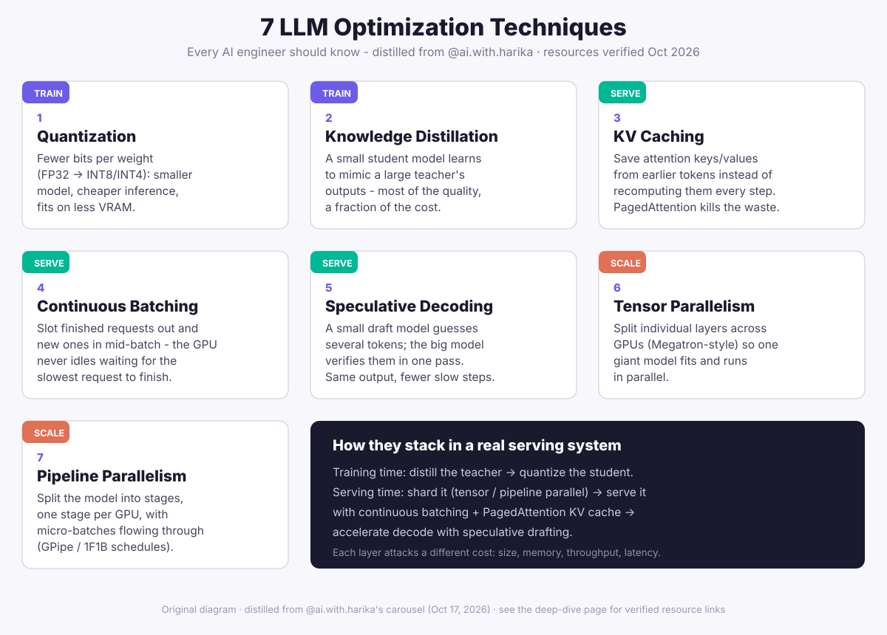

# 7 LLM Optimization Techniques Every AI Engineer Should Know

**Source:** Instagram carousel by [@ai.with.harika](https://www.instagram.com/ai.with.harika/) (Harika Satti | Gen AI, ML, Tech & Careers, ~28k followers) — [the post](https://www.instagram.com/p/DemU7U7meZc/) (published Oct 17, 2026, 9 slides: cover, one per technique, and a "comment LLM" CTA card).
**The "helping out" part:** each slide ends with a "learn more" resource box, but the actual links are gated behind commenting "LLM" for a DM. Every one of the 7 was tracked down independently and verified against its official page — the full list is below, no comment required.

> Note on method: Instagram's CDN blocked retrieval of the carousel's original images, so the infographic above is an original diagram, not the creator's slides. This is a deep-dive *distillation* — the techniques explained in original prose, the resource links verified, the composition logic added. Short paraphrases only; nothing copied.

## TL;DR for technical leaders

1. **Seven techniques, three jobs.** Quantization and distillation shrink the model (training-time levers). KV caching, continuous batching, and speculative decoding make serving faster and cheaper (serving-time levers). Tensor and pipeline parallelism let a model too big for one GPU run at all (scale-out levers).
2. **They compose into a stack, not a menu.** The real-world order: distill the teacher into a student, quantize the student, shard it across GPUs with tensor/pipeline parallel, serve it with continuous batching over a PagedAttention KV cache, and accelerate decode with speculative drafting. Each layer attacks a different cost: size, memory, throughput, latency.
3. **These are the provider-side levers behind your token bill.** When a vendor's price per million tokens drops, it's usually one of these seven doing the work. Understanding them is how you read a price cut — and how you reproduce it on your own infrastructure.
4. **The carousel is a map, not a manual.** One line per technique, no numbers, no trade-offs. The value here is the verified resource list: the official guides behind each "learn more" box, checked link by link.

## The seven, with their real resources

### 1. Quantization — fewer bits per weight
Represent weights in INT8 or INT4 instead of FP32/FP16. The model gets several times smaller, needs less VRAM, and runs cheaper — with a small, measurable quality trade-off you evaluate per use case. This is the single most common reason a model that "needed an A100" suddenly runs on a cheaper card.
**Resource:** [Hugging Face Quantization Guide](https://huggingface.co/docs/transformers/quantization/overview) — the official Transformers hub: what quantization is, a compatibility table across ~24 methods (bitsandbytes, AWQ, GPTQ, GGUF, torchao…), and a picker for model + hardware.

### 2. Knowledge Distillation — the student learns from the teacher
Train a small model to mimic a large model's outputs (or its full next-token distribution). You keep most of the capability at a fraction of the serving cost. The modern LLM flavor is on-policy distillation: the student learns from the teacher's judgments on the student's *own* generations.
**Resource:** [Hugging Face TRL DistillationTrainer](https://huggingface.co/docs/trl/main/en/distillation_trainer) — the LLM-focused distillation guide (GKD), with a worked Qwen2.5-1.5B → 0.5B example, vLLM-accelerated generation, and LoRA support.

### 3. KV Caching — never recompute the past
During generation, each new token attends to all previous ones. The key/value projections of past tokens don't change, so you cache them instead of recomputing them every step. Naive caching wastes memory on fragmentation; PagedAttention (vLLM's innovation) manages the cache in fixed-size blocks like OS virtual memory, nearly eliminating the waste.
**Resource:** [vLLM PagedAttention design doc](https://docs.vllm.ai/en/stable/design/paged_attention/) — the official step-by-step walkthrough of blocks, block tables, and the Q/K/V memory layout. (Flagged on the page itself as historical — it follows the original paper, not current code.)

### 4. Continuous Batching — the GPU never idles
Classic batching waits for the slowest request in the batch to finish before starting the next batch. Continuous (iteration-level) batching slots finished requests out and pulls new ones in after *every* generation step, keeping the GPU saturated. This is the throughput lever behind most modern serving stacks.
**Resource:** [the vLLM paper](https://arxiv.org/abs/2309.06180) — "Efficient Memory Management for Large Language Model Serving with PagedAttention," the canonical vLLM-team explanation of the iteration-level scheduler together with PagedAttention. (docs.vllm.ai has no standalone continuous-batching page; the paper is the closest official resource.)

### 5. Speculative Decoding — guess, then verify
A small, fast draft model proposes several tokens; the large model checks them all in a single forward pass, accepting the ones it agrees with. Output is identical to the large model alone (the verification is exact), but you skip most of the slow sequential steps. vLLM supports multiple drafting strategies: purpose-built draft models, EAGLE-style heads, even n-gram matching.
**Resource:** [vLLM Speculative Decoding guide](https://docs.vllm.ai/en/stable/features/speculative_decoding/) — all speculation methods, the method-selection table, `--speculative-config` schema with examples, and the lossless-guarantee notes.

### 6. Tensor Parallelism — split layers across GPUs
When a model doesn't fit on one GPU, Megatron-style tensor parallelism splits *individual layers* — each GPU holds a slice of the weight matrices and they synchronize at layer boundaries. The standard answer for "one giant model, several GPUs, minimum latency."
**Resource:** [PyTorch Tensor Parallel tutorial](https://docs.pytorch.org/tutorials/intermediate/TP_tutorial.html) — how TP works, when to combine it with FSDP, and a worked Llama 2 example with `parallelize_module` (Colwise/Rowwise/Sequence parallel styles).

### 7. Pipeline Parallelism — split stages across GPUs
Instead of slicing layers, carve the model into sequential stages with one stage per GPU, and keep every stage busy by streaming micro-batches through (GPipe and 1F1B schedules). Less communication per step than tensor parallel, at the cost of pipeline "bubbles" you schedule around.
**Resource:** [PyTorch Pipeline Parallel tutorial](https://docs.pytorch.org/tutorials/intermediate/pipelining_tutorial.html) — partitioning a GPT-style transformer with `torch.distributed.pipelining`, microbatch schedules, and launching with `torchrun`.

## How they compose

The carousel presents seven items; a production system layers them:

1. **Training time:** distill the frontier teacher into a small student, then quantize the student. (This is also the recipe behind most cheap open-weight releases.)
2. **Scale-out:** shard the result with tensor parallelism (within a node, latency-sensitive) and pipeline parallelism (across nodes/stages) so it fits the hardware you have.
3. **Serving:** run continuous batching over a PagedAttention-managed KV cache for throughput and memory efficiency.
4. **Decode acceleration:** add speculative drafting on top to cut per-token latency without changing outputs.

Each layer attacks a different line on the bill: model size, memory footprint, GPU utilization, time-to-first-token and per-token latency.

## The tokenomics read

These seven are the *provider-side* companion to the playbook's demand-side levers. The tokenomics playbook (and the [inference engineering concepts deep dive](inference-engineering-concepts.md), which covers quantization, KV cache, and speculative decoding in more depth) frames cost as tokens × price. These techniques are how the price side moves: every "we cut inference costs 40%" announcement from a lab or provider decomposes into one or more of these seven.

Two things worth carrying into vendor conversations: first, quantization and distillation are the levers that turn a frontier model into a cheap one — when you see a "mini" or "flash" tier, ask which of the two it is. Second, continuous batching + PagedAttention is why API throughput pricing exists at all — a provider serving you at high QPS is amortizing the same GPU across many of your requests, and the margin between their cost and your price is this scheduler.

## Honest scoring

- **A beginner's map, honestly labeled.** One line per technique is the right depth for "every AI engineer should know," and the carousel doesn't pretend otherwise. Nobody learns tensor parallelism from a slide.
- **No numbers, no trade-offs.** There's no quality-vs-cost curve for quantization, no latency figure for speculative decoding, no memory math for the KV cache. The linked resources carry the real content — which is why verifying them was the actual work here.
- **One resource is a paper, not a guide.** The carousel's "learn more with the vLLM documentation" for continuous batching has no matching docs page; the closest official vLLM-team resource is the research paper. Flagged, not fudged.
- **The gate is the business model.** "Comment LLM for the resources" is lead generation, and the resources themselves are all public official docs. Now they're in the playbook instead.

## See also

- [Inference engineering concepts](inference-engineering-concepts.md) — the 20-concept companion: prefill/decode, TTFT/TPOT, FlashAttention, MoE expert parallelism, KV-aware routing, and DeepSeek's $0.30/M cost math, from @jam.with.ai's carousel (Oct 13, 2026).
