# Build an MCP Gateway Like Uber's — in 50 Minutes

**Source:** Instagram carousel by [@datasciencebrain](https://www.instagram.com/datasciencebrain/) (Deepak Jose | Data Science & Gen AI, ~492k followers) — [the post](https://www.instagram.com/p/DfoFU_rmOMT/) (published Nov 11, 2026, 20 slides: cover + 18 pages of a hands-on guide + subscriber promo). This is the same creator and the same "build it in under an hour" series as the [hybrid search deep dive](hybrid-search-retrieval.md) — same stack shape (Python, uv, free tier), same cost story. That one was the retrieval side; this one is the tooling side.

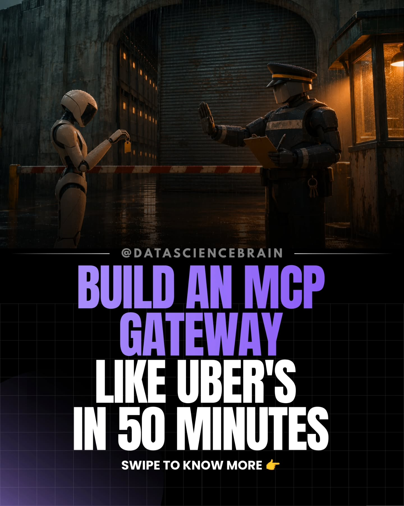

> Note on method: this is a deep-dive *distillation*, not a transcript — the guide's architecture, the numbers, and the build steps, rewritten in original prose. The slide images are reproduced for reference; code is described, not copied. Slide 20 is the subscriber promo for the complete PDF and is not reproduced.

## TL;DR

1. **The prompt is the bottleneck, not the model.** Load 19 small tool descriptions into an agent and the prompt costs 762 tokens before the first question. Load four gateway tools instead and it costs 281 — 63% fewer, measured by the creator on a small demo with tiny descriptions. Real descriptions are longer and companies have thousands of tools, so the gap grows with scale.
2. **The fix is four meta-tools, not a bigger context window.** The agent starts with four tools and nothing else: find a server, list its tools, get one schema, call it. Only the tool it actually picks ever gets described. The agent carries a menu of four, not thousands.
3. **Uber already runs this shape in production.** Their Oct 1, 2026 post describes 800+ MCP servers and 5,000+ tools behind two halves: a catalog (registry) that lists every server and tool, and a runner (gateway) that checks the caller, the policy, and the rate limit before running anything. Their rule: discovery doesn't imply exposure — a tool is visible only when its owning team switches it on.
4. **The local rebuild is five small servers, 19 tools, two agents, one SQLite file.** FastMCP for the servers, SQLite for the catalog, Groq's free tier for the model (gpt-oss-120b). The worked example is a double charge: rider R-102 charged twice for one trip, found and confirmed in four calls taking 2, 2, 1 and 8 milliseconds.
5. **The governance is the point, not the plumbing.** Grants decide which servers each agent may even *see* — permissions apply to discovery, not only to calls — and rate limits are per agent (support-bot 30 calls per 60 seconds, intern-bot 3). The money-moving tool, `issue_refund`, is deny-listed for the support bot even though it may use the payments server.

## The problem: why direct connections break at scale

Connecting agents straight to tool servers works with one agent and three servers. It breaks at company scale in three ways, and the guide names all three before offering the fix.

**1. The prompt fills up.** Every tool definition costs tokens, and it costs them on every request. In the demo, 19 small tools take 762 prompt tokens and four take 281. Real descriptions are longer, and a company can have thousands of tools. The prompt is full before the user asks anything.

**2. Everyone connects to everyone.** Each agent needs the address and credentials of every server it uses. Ten agents and 800 servers is 8,000 connections, each with its own login to set up and rotate.

**3. Nobody is in charge of the rules.** Which agents may issue a refund? How many calls per minute is too many? Who called what yesterday? If every server answers those questions separately, or not at all, you cannot answer them for the company.

One idea fixes all three: put a single door in front of every tool. Agents connect to the door. The door knows the tools, checks who is asking, and writes down what happened.

## The four steps: how an agent finds a tool it has never seen

The agent starts with four tool definitions and nothing else. It never asks for a tool by name — it asks for what it needs in plain words, and each call teaches it one more thing. Steps 1–3 only read the gateway's catalog; only step 4 reaches the backend tools, and it goes through the gateway and is logged.

| Step | The agent calls | The agent learns |
|---|---|---|
| 1. Find a server | `discover_server("billing charges rider")` | Which servers fit: `payments`, `rides` |
| 2. List its tools | `discover_tools("payments")` | Tool names, one line each: `get_charge`, `list_charges`, and more |
| 3. Get one definition | `get_tool_schema("payments", "list_charges")` | The full definition: it needs a `rider_id` string |
| 4. Call it | `invoke_tool("payments", "list_charges", {"rider_id": "R-102"})` | The result: two charges of INR 240 |

Each answer comes back as plain text in the conversation. The model reads the schema in step 3 and uses it to fill in the arguments in step 4. The definition is loaded when it is needed, for one tool only.

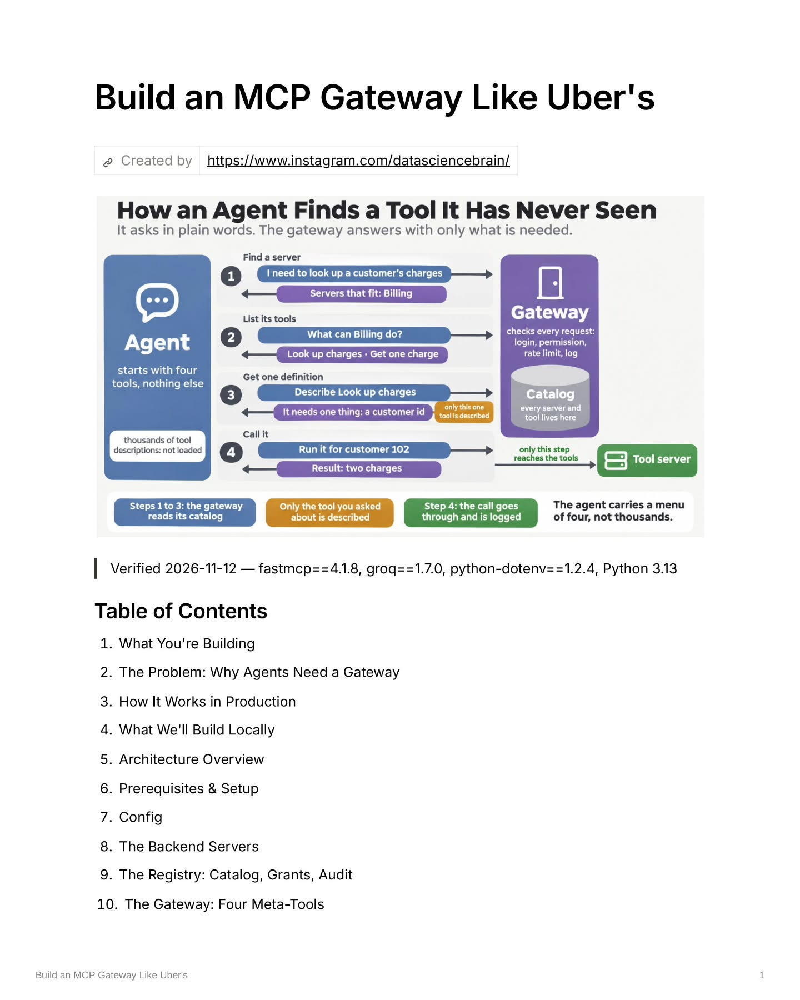

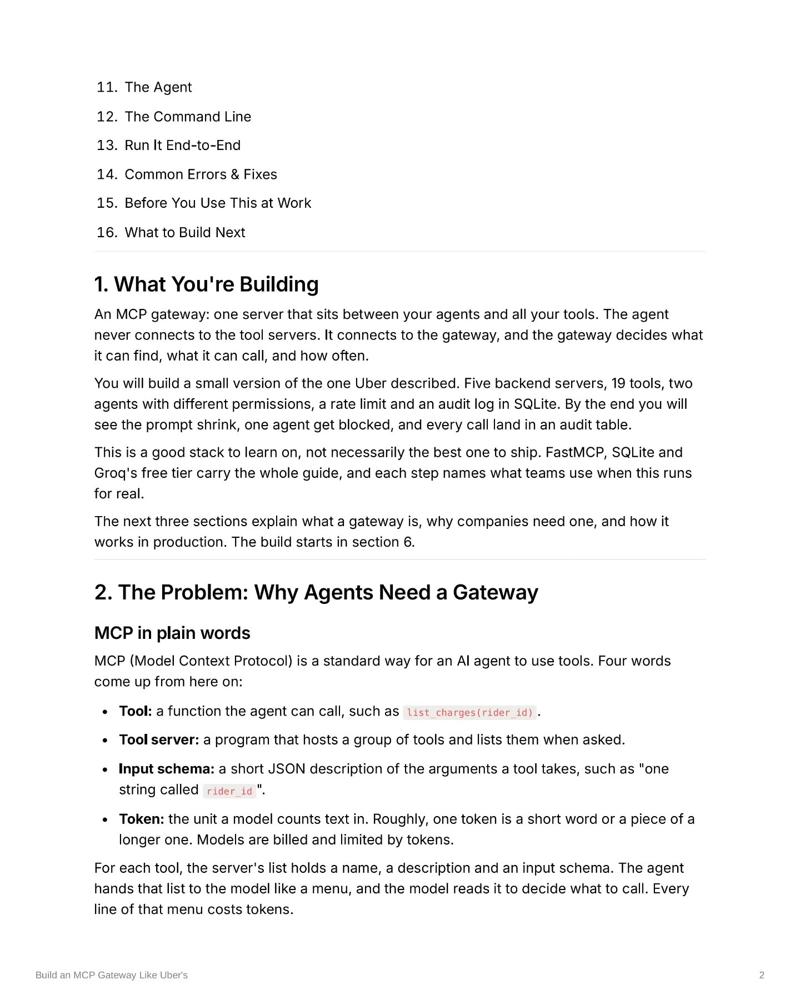

## How it works in production: Uber's two halves

Uber published how they built theirs on Oct 1, 2026. It serves over 800 MCP servers and over 5,000 tools, and it has two halves: a catalog and a runner. (These numbers match the playbook's own [Uber AI infra deep dive](uber-ai-infra-inside.md) from Oct 15, which distilled the same engineering post.)

**The catalog (the registry)** lists every server and tool. Uber does not ask teams to write MCP servers by hand. A crawler reads the definitions of services the company already runs and generates MCP servers and tools from them. An LLM writes clearer, agent-friendly descriptions for the generated tools, and owners can edit them. Servers that already speak MCP are found another way: each one sends a heartbeat signal, the crawler watches for it, asks the server for its tool list, and puts a proxy for it in the catalog.

Everything the crawler finds starts disabled. A tool becomes visible only when the team that owns it switches it on. Uber's phrase for this is "discovery doesn't imply exposure."

**The runner (the gateway)** handles each call. It works out who is calling — a person, a service, or an agent — and checks the policy for that caller. Policies are set per server, with optional overrides for single tools. Then it runs the tool and returns the answer, with sensitive data such as personal information removed from the response. For third-party MCP servers the gateway also enforces rate limits; the post names rate limiting but does not say how it works.

**Omni MCP** is how agents use all of this without loading all of it. It is one proxy with four tools, and the post says it gives agents incremental discovery:

1. `discover_server` — find servers that match what you need
2. `discover_tools` — list a server's tools
3. `get_tool_schema` — get one tool's definition
4. `invoke_tool` — run it

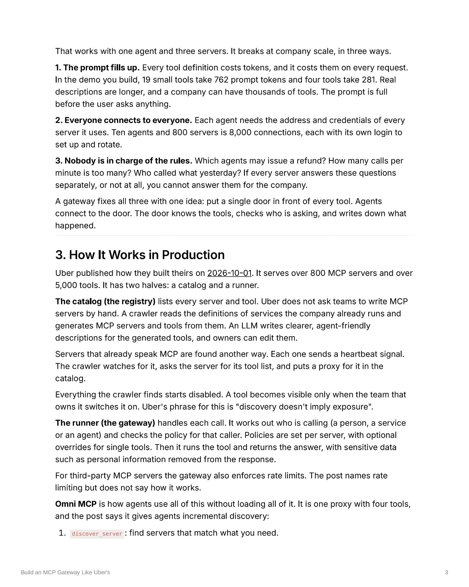

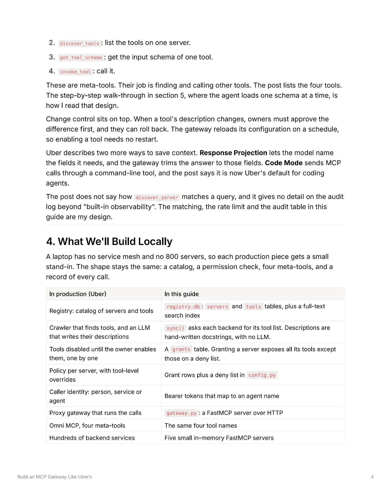

## What you build locally

The local version rebuilds Uber's idea at demo scale: five backend servers, 19 tools, two agents, one SQLite audit log. Free tools throughout: FastMCP for the servers, SQLite for the registry, Groq's free tier for the model. Versions verified by the creator on Nov 12, 2026: fastmcp 4.1.8, groq 1.7.0, python-dotenv 1.2.4, Python 3.13.

The guide is explicit about what the local version leaves out on purpose: generating servers and descriptions from service definitions, removing sensitive data from responses, approving description changes, Response Projection, Code Mode, and passing user tokens to third-party servers. Rate limits and observability get the guide's own design instead of Uber's (Uber's post gives little detail there).

## Architecture overview: one line every call travels

Agent → token check → four meta-tools → audit log → registry.db → grant check → rate limit → backend MCP server. Every call goes through the same line: who are you, are you allowed, have you called too much, then run it. The registry file feeds the grant check, and the audit log writes into the same file.

The split that matters: the three discovery tools stop at the grant check and read the catalog. Only `invoke_tool` goes on to the rate limit and the backend. And `discover_server` drops every server the agent has no grant for, so an agent never sees what it was not given.

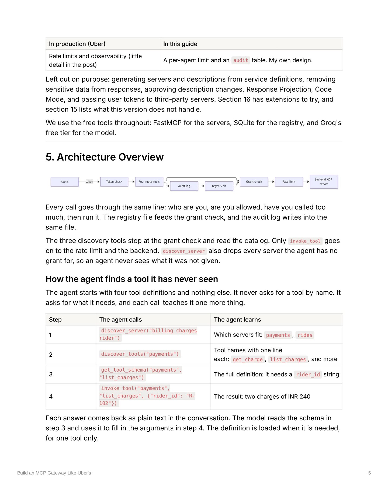

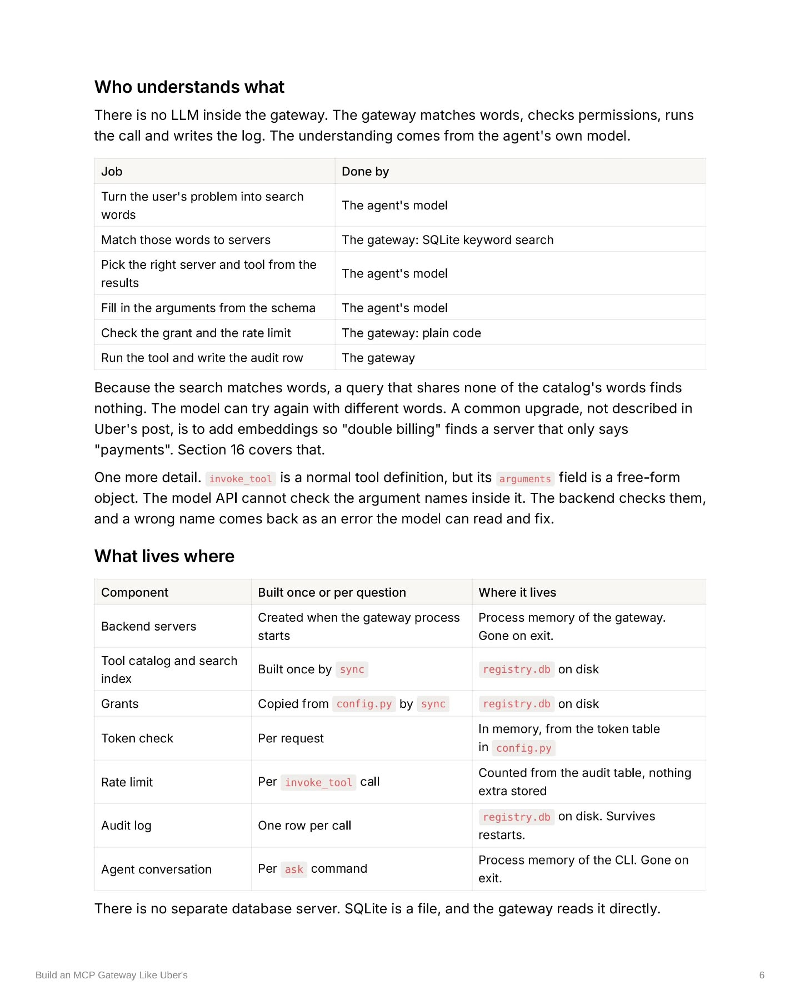

## The worked example: one question, four calls, 13 milliseconds

Take the question "Rider R-102 says they were charged twice for yesterday's trip" from `support-bot`. `sync` already ran, so the catalog holds 19 tools across 5 servers. The agent starts with four tool definitions, not 19. Groq counted 762 prompt tokens with all 19 tools loaded and 281 with the four meta-tools — 63% fewer, on a demo with tiny tool descriptions.

- `discover_server` — the gateway reads the token, gets the name `support-bot`, searches the catalog, returns the servers it may use. 2 ms.
- `discover_tools` on `payments` (2 ms) lists tool names. `get_tool_schema` for `list_charges` (1 ms) returns that one tool's input schema. `invoke_tool` (8 ms) checks the grant and the limit, calls the backend, and returns two charges of INR 240 for the same trip.

Nothing persists between questions except the audit rows. Each `ask` starts a fresh conversation, and the backend servers are rebuilt whenever the gateway restarts. A real deployment keeps the gateway running as a long-lived service, stores the registry in a shared database, and connects to backend servers over the network instead of in the same process.

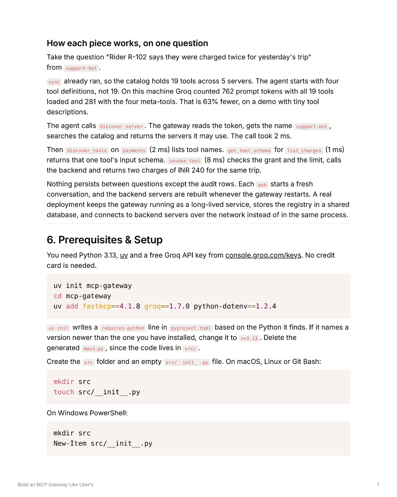

## Setup and config: everything in one file

Prerequisites: Python 3.13, `uv`, and a free Groq API key (no credit card). The project starts with `uv init mcp-gateway` and `uv add fastmcp==4.1.8 groq==1.7.0 python-dotenv==1.2.4`, code in `src/`, the key in `.env` behind `.gitignore`.

All settings live in `config.py`: the registry path (`registry.db`), the model (`openai/gpt-oss-120b` on Groq, with 5 retries on the free tier — the guide notes the free plan's tight tokens-per-minute limits, and that a paid key can keep the same model and drop the retry count), the gateway URL (`http://127.0.0.1:8000/mcp`), and a 10-step cap per agent run.

Two tables in that one file carry the whole governance model. First, **agent tokens**: demo bearer tokens per agent (`support-bot`, `intern-bot`). The guide flags this itself — a real gateway gets identity from your login system (OAuth/SSO); static tokens are for local demos only.

Second, **grants**: which backend servers each agent may use, plus an optional deny-list of tools blocked inside a granted server. That is Uber's shape — policy per server, tool-level overrides on top. `support-bot` may use `rides`, `payments`, and `support`, but not `issue_refund` inside payments. `intern-bot` may use only `eats`.

Third, **rate limits**: `invoke_tool` calls allowed per agent in the last 60 seconds — 30 for `support-bot`, 3 for `intern-bot`. The guide's line on this is worth quoting in spirit: the rate limits are not a workaround, they are the feature.

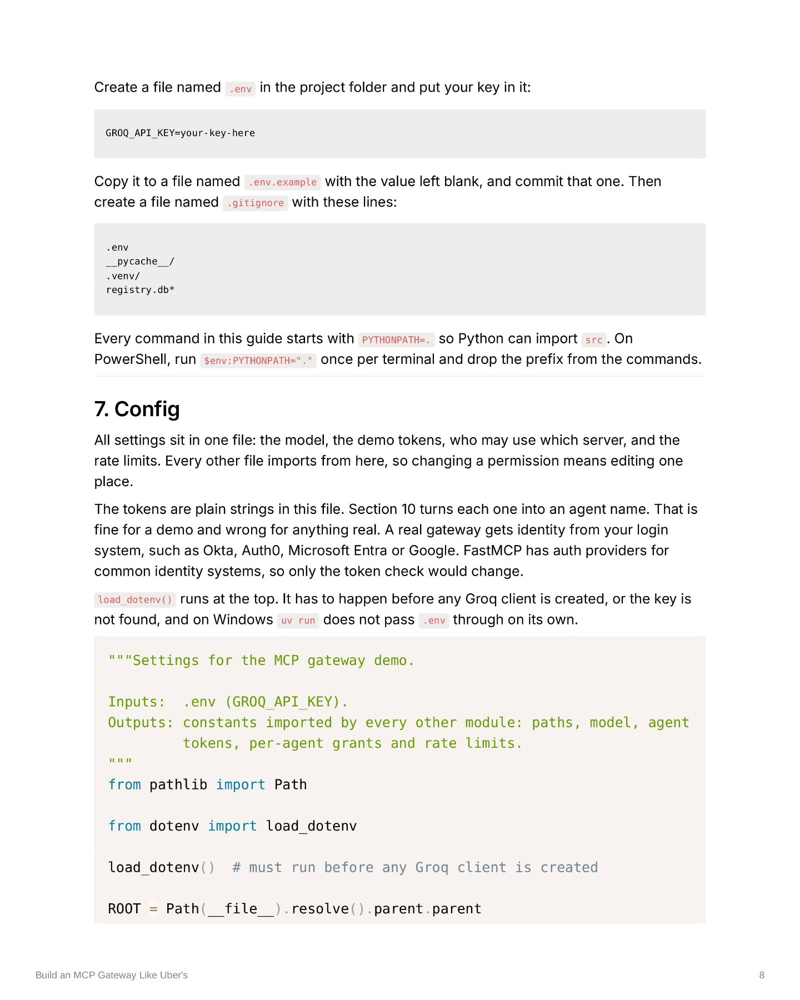

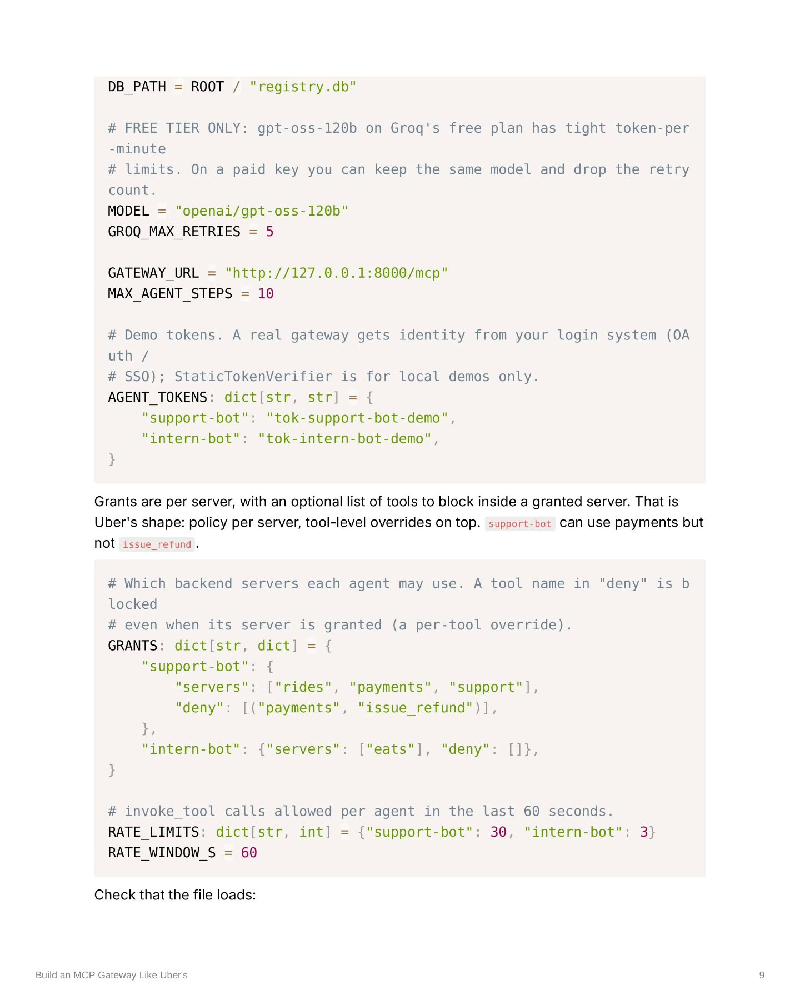

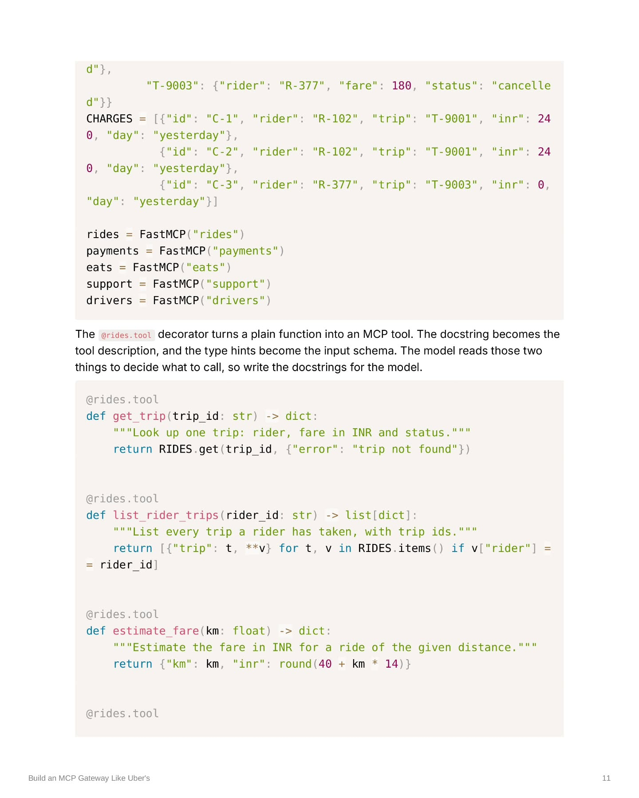

## The backend servers: five small FastMCP servers, one deliberate double charge

The demo is a fictional city mobility app with five small FastMCP servers and 19 tools between them. Rider R-102 has a deliberate double charge for trip T-9001 baked into the data, so the worked example always finds something.

- **Rides** — `get_trip`, `list_rider_trips`, `estimate_fare`, plus `cancel_trip`.
- **Payments** — `list_charges`, `get_charge`, `issue_refund` (moves real money, and the support bot is blocked from it), `list_payment_methods`.
- **Eats** — `search_restaurants` ("Dosa Corner", 25-minute ETA), `get_menu`, `track_order`, `apply_coupon`.
- **Support** — `open_ticket`, `get_policy` ("Duplicate charges are refunded in full within 3 working days after support review"), `list_tickets`.
- **Drivers** — `get_driver` ("Asha", rating 4.9), `driver_earnings`, `set_driver_status`, `list_active_drivers`.

A `BACKENDS` map names each server, and `SERVER_DESCRIPTIONS` holds the short descriptions that `discover_server` searches against — the descriptions are the search index, which is why the guide spends a section on writing them well.

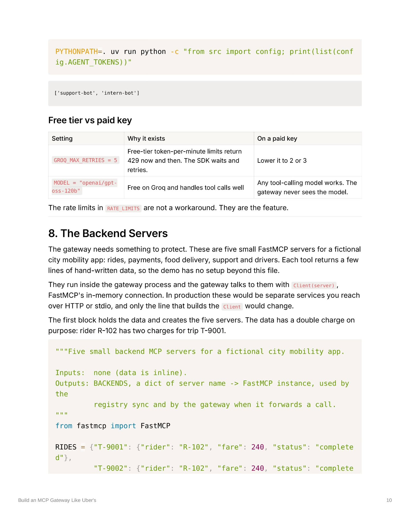

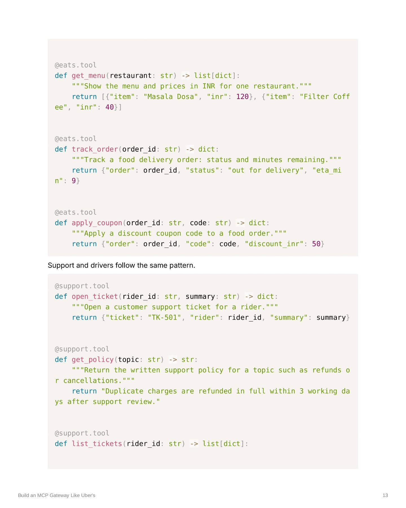

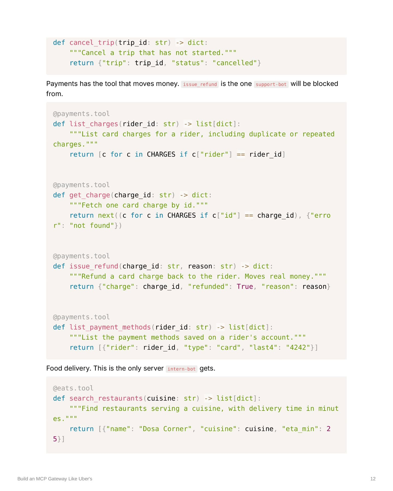

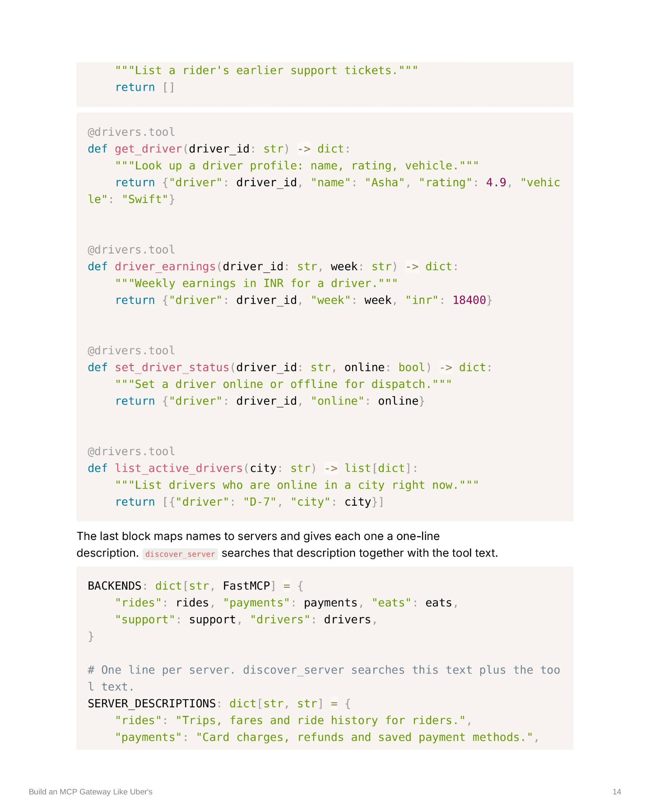

## The registry: catalog, grants, audit — one SQLite file, five tables

The registry is one SQLite file with five tables, built by `registry.py`. `sync()` lists each backend's tools into it. Search is SQLite full-text search (FTS5, with stemming and BM25 ranking, plus a stopwords list) over server names and descriptions.

Two design decisions carry the whole pattern:

1. **Permissions apply to discovery, not only to calls.** `granted_servers()` and `search_servers()` run the keyword search with BM25, then drop servers without a grant. `list_tools()` hides denied tools the same way. An agent never sees a server or tool it cannot use — which is what makes the 63% token saving real at scale, not just a call-time check.
2. **Uber's crawler vs this guide's grants table.** Uber generates servers and enables tools per tool, with the owning team switching each one on. The guide grants a whole server and exposes all its tools except the deny-listed ones — simpler, and the right shape for a demo, but coarser than production. The guide notes embeddings would help too: a keyword search for "double billing" may miss the `payments` server, where embeddings would find it.

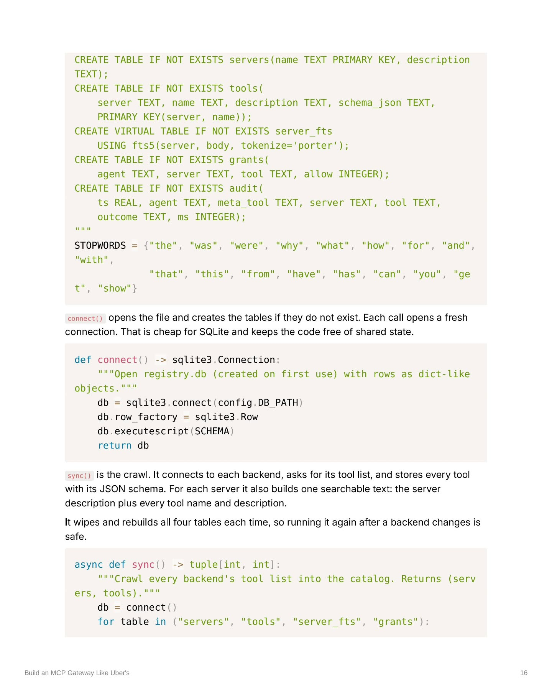

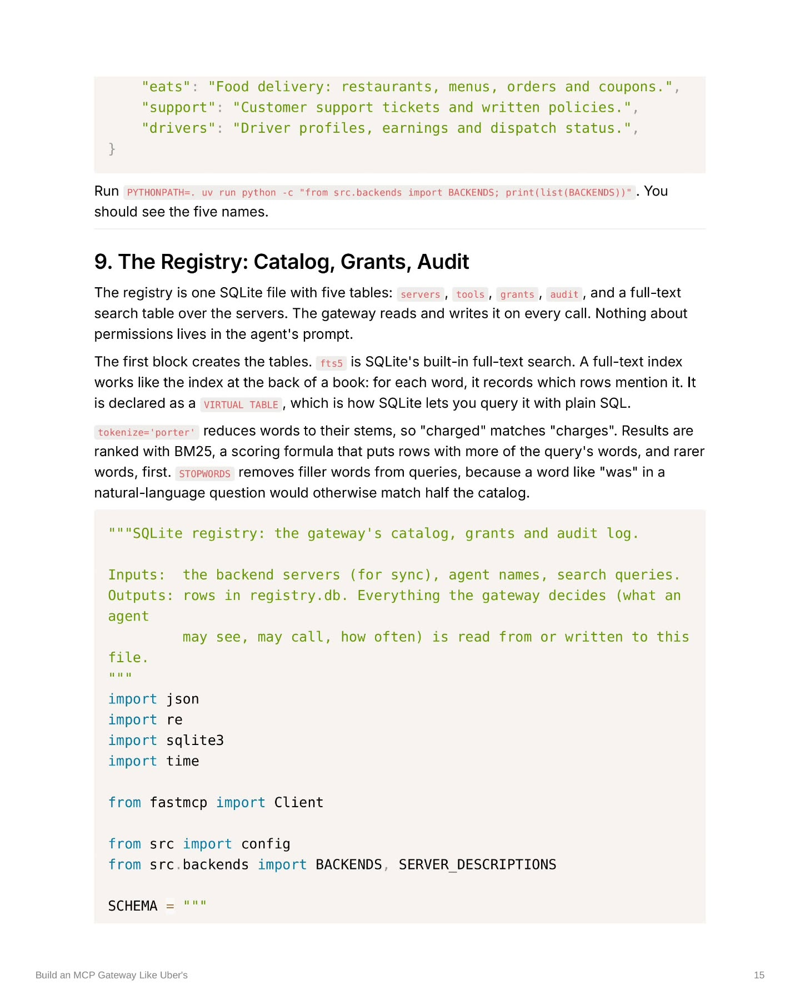

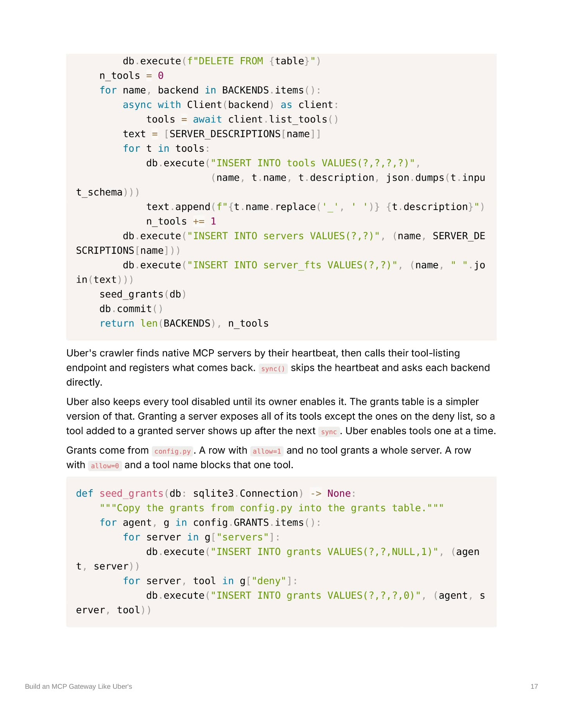

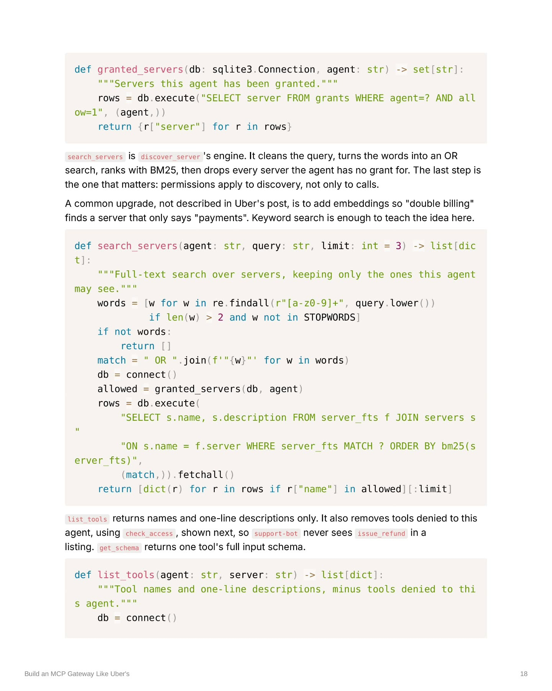

## Tokenomics angle

This is the context-economics thesis in its purest form: **the cheapest token is the one never loaded.** A gateway is context compression at the tool layer — it turns a flat list of thousands of tool definitions into a four-tool menu plus one definition fetched on demand. The 63% saving is measured on 19 tools with tiny descriptions; the saving grows with the tool count and the description length, which is exactly the direction enterprise catalogs go.

Three enterprise reads fall out of the build:

- **Discovery-time permissions are a cost control, not just a security control.** Hiding ungranted servers from search keeps them out of the prompt entirely. A call-time deny-list still pays the tokens to describe the tool it refuses to run.
- **Rate limits are the spend gate.** Per-agent limits (30 vs 3 per 60 seconds) are the same shape as the Copilot credit caps and the Cohere North 2 quotas in this collection: token spend as IT governance, enforced where the call happens.
- **The deny-list is where the money lives.** `issue_refund` moves real money. The grant that blocks it for the support bot is one line in `config.py` — and it is the only thing standing between an agent that found a double charge and an agent that refunded it without asking.

## Honest scoring

- **The 63% is a small-demo number, honestly labeled.** The guide says so itself: "on a demo with tiny tool descriptions." The direction is right and the mechanism is sound, but 762 vs 281 is one demo run on one machine, not a benchmark. At Uber scale the absolute saving is larger (longer descriptions, thousands of tools); the percentage depends on the catalog.
- **"50 minutes" is the creator's claim, not a timed build.** The carousel is 16 sections of guide text in slide form; nobody timed the build here.
- **The complete PDF is subscriber-gated.** Slide 20 is a promo: the full notes go to the creator's exclusive Instagram subscribers (Rs. 45/month). Everything distilled above comes from the 19 public slides, which are complete as a guide — the PDF is a convenience format, not missing content I can identify. But I have not seen it, so I cannot say what else is in it.
- **Tokens as plain strings are flagged by the guide itself** as demo-only; production gets identity from OAuth/SSO. Do not ship the demo config.
- **Uber's numbers cross-check.** The 800+ servers / 5,000+ tools figure and the Oct 1, 2026 post date match the playbook's own Uber deep dive, distilled from the same engineering post. The crawler, the heartbeat discovery, "discovery doesn't imply exposure," and the per-server policy shape are all from that post as the guide reports it.
- **Versions are pinned and dated.** fastmcp 4.1.8, groq 1.7.0, python-dotenv 1.2.4, Python 3.13 — verified by the creator on Nov 12, 2026, per the slide footer. Pin them; the free-tier Groq limits the guide warns about may have moved since.
