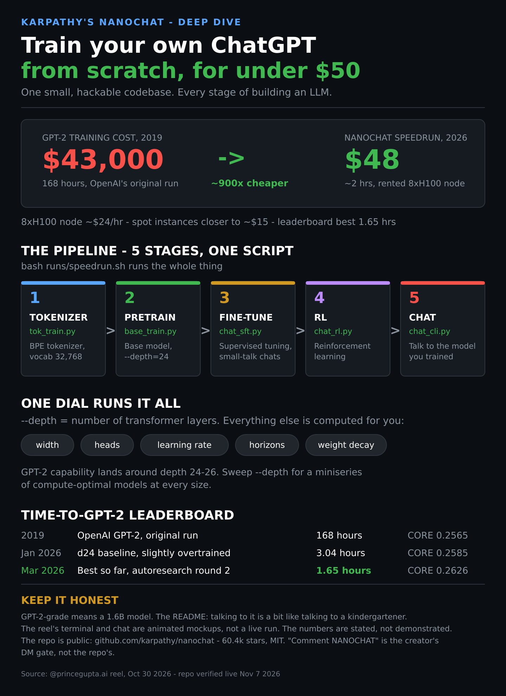

# nanochat: train your own ChatGPT for under $50

**What this is:** a ~30-second reel by @princegupta.ai (Prince Gupta, AI Engineer, Oct 30, 2026) — Day 10/10, the finale of his "repositories you should know about" series: Andrej Karpathy's nanochat. One small, hackable codebase that walks you through every stage of building a ChatGPT-style model, from tokenizer to chat, in a single speedrun script on a rented 8xH100 node. Distilled here in my own words; the reel's terminal and chat windows are animated mockups, not a live run.

**Related:** [The Tokenomics Playbook](../tokenomics-playbook.md) (the training-cost collapse is the training-time twin of the deploy-time routing ladder) · [90 GenAI concepts](../gen-ai-concepts-map.md) (LLM fundamentals — tokenization, pretraining, SFT, RL) · [GitHub Repos](../github-repos.md) (nanochat scored 8.0/10, Nov 7 entry)

**Thesis for the playbook:** the cost of training a GPT-2-grade model collapsed roughly 900x in seven years — $43,000 in 2019 to ~$48 in 2026 — and nanochat makes that collapse runnable in one script. For the team, the value isn't a production model (it's GPT-2-grade; the README's own comparison is a kindergartener). The value is upskilling: an engineer who has trained a model end to end understands what the context and token machinery actually costs, and why the routing ladder exists at all.

## 1 · The reel in 30 seconds

The hook is the whole pitch: a GitHub repo that lets you build your own ChatGPT-style model from scratch for under $50. Then the framing — day 10 of 10, the finale — and a profile card for Karpathy as the author. The middle is the file tree and the five stages (below). The speedrun beat shows a terminal running `bash runs/speedrun.sh` on an 8xH100 node, a timer at 0h 13m, a progress bar at 9%, and a rack of eight green H100 chips labelled ~$24/hr. The chat demo shows the "Why is the sky blue?" exchange over a CLI, with a "trained by you" sticker. The close is the resume pitch — the reel calls it the best AI project to put on a resume — immediately followed by the reality check, then the call to action: follow for the next series, comment "NANOCHAT" and he'll send the repo to your DMs.

## 2 · The five stages

One script, `runs/speedrun.sh`, runs the whole pipeline. The stages, with the scripts the reel names:

1. **Tokenizer** — `tok_train.py`. Train a BPE tokenizer, vocab 32,768.
2. **Pretraining** — `base_train.py`. Train the base model; the reel's command uses `--depth=24`.
3. **Fine-tuning** — `chat_sft.py`. Supervised fine-tuning on small-talk chats — the reel shows the training format, a "Why is the sky blue?" question wrapped in user/assistant markers.
4. **Reinforcement learning** — `chat_rl.py`. RL on top of the SFT model.
5. **Chat** — `chat_cli.py`. Talk to the model over a simple CLI.

That order is the whole LLM story in miniature: tokenize, pretrain, align, reinforce, serve. The README's file tree confirms the shape — `nanochat/` holds the transformer (`gpt.py`), the tokenizer, the inference engine with KV cache, and the optimizers (AdamW + Muon); `scripts/` holds one script per stage.

## 3 · The speedrun economics

| | 2019, GPT-2 | 2026, nanochat speedrun |
|---|---|---|
| Wall-clock time | 168 hours | ~2 hours (README says ~1.5h for the script; leaderboard best 1.65h) |
| Hardware | (OpenAI's original run) | Rented 8xH100 node, ~$24/hr |
| Cost | ~$43,000 | ~$48 on-demand; ~$15 on spot |

The arithmetic the README gives: at ~$3/GPU/hr, an 8xH100 node is ~$24/hr, so two hours is ~$48. The ~900x collapse is the whole stack improving at once — hardware, data, optimizers, precision — not any single trick. The leaderboard makes that visible: the same "time to GPT-2" metric, measured by the DCLM CORE score against GPT-2's 0.2565, fell from 3.04 hours (Jan 29, 2026, d24 baseline) to 1.65 hours (Mar 14, 2026, autoresearch round 2, CORE 0.2626) in six weeks of tuning, mostly dataset and batch-size changes. The leaderboard is a live benchmark of the stack's progress, and the repo invites contributions to it.

## 4 · The one dial

The design decision that makes the repo hackable: a single integer, `--depth`, the number of transformer layers, determines everything else. Width, number of heads, learning-rate adjustments, training horizons, weight decays — all computed automatically so the trained model comes out compute-optimal. GPT-2 capability lands around depth 24–26. Sweep the dial and you get the nanochat miniseries: a family of compute-optimal models at every size, from a 12-layer model you can iterate on in ~5 minutes (the README's recommended experiment loop) up to the full speedrun. For researchers, `runs/scaling_laws.sh` and `runs/miniseries.sh` are the scripts of interest. The constraint the README states: any change to the repo has to work at all depths, not just the one you tested.

## 5 · The local-first reality

- **Rented node is the happy path.** Boot an 8xH100 box (the README names Lambda), run `bash runs/speedrun.sh` in a screen session, chat with `python -m scripts.chat_cli`.
- **A single GPU works, 8x slower.** Drop `torchrun` and the code switches to gradient accumulation automatically, with ~identical results. An 8xA100 node works too, a bit slower.
- **Under 80GB of VRAM, tune `--device-batch-size` down** (32 to 16, 8, 4, 2, or 1) or you'll OOM.
- **CPU / Apple Silicon is a demo, not a result.** `runs/runcpu.sh` shrinks the model to fit a few tens of minutes of training; the README is blunt that you won't get strong results that way.
- **Precision is explicit, not magic.** No `torch.amp.autocast` — a single global `COMPUTE_DTYPE`, auto-detected per hardware (bf16 on A100/H100, fp32 elsewhere), overridable with `NANOCHAT_DTYPE`. Weights stay fp32 for the optimizer; the custom `Linear` layer casts on the forward pass.

## 6 · Honest scoring

- **The numbers check out — against the README, not the reel.** The reel itself never states the $43,000 GPT-2 figure or the ~$48 total; those come from the caption and the README, which I verified live. The reel's "~2 hours" is approximate: the README says ~1.5 hours for the script, and the leaderboard's best is 1.65 hours.
- **The demo is staged.** The terminal and the chat exchange are animated mockups. Nothing in the reel is a live training run or a live conversation with a trained model. The figures are stated, not demonstrated.
- **The repo is public; the gate is the creator's.** "Comment NANOCHAT and I'll send you the repo in your DMs" is a lead magnet. The repo is at [github.com/karpathy/nanochat](https://github.com/karpathy/nanochat) — 60,360 stars, 8,464 forks, MIT, created Oct 13, 2025. (The reel's on-screen card shows 58.0k stars / 8.2k forks — stale by a few weeks, not wrong.)
- **The capability caveat is the README's own.** The speedrun model is a 4e19-FLOP capability model — GPT-2-grade, 1.6B parameters. The README says talking to it is a bit like talking to a kindergartener, and the reel repeats that. As a resume project the story is "I trained an LLM end to end," not "I built a useful chatbot."
- **What the reel doesn't say:** the speedrun needs a rented GPU node and a couple of hours of wall-clock time — this is a weekend project, not a 30-second trick — and the $48 assumes on-demand pricing at ~$3/GPU/hr, which moves with the market.

## 7 · Why it matters for us

The tokenomics read is the cost curve itself: a capability that cost $43,000 to train in 2019 now costs $48, and the leaderboard shows the curve still falling. That is the same force behind the routing ladder — cheap models absorb bulk work because the stack keeps getting cheaper to run — measured here at training time instead of inference time. For the team, nanochat is the cheapest way to make that abstract curve concrete: one engineer, one weekend, one rented node, and the whole LLM pipeline stops being a black box. The miniseries design is also a pattern worth stealing: one complexity dial, everything else derived — the same shape as a good routing policy, where one decision (which model) derives the rest (cost, latency, quality bar).

**Source:** [instagram.com/reel/DfHsY8hE-uf](https://www.instagram.com/reel/DfHsY8hE-uf/) (@princegupta.ai, Oct 30, 2026) · [github.com/karpathy/nanochat](https://github.com/karpathy/nanochat) (README and leaderboard verified live Nov 7, 2026)
