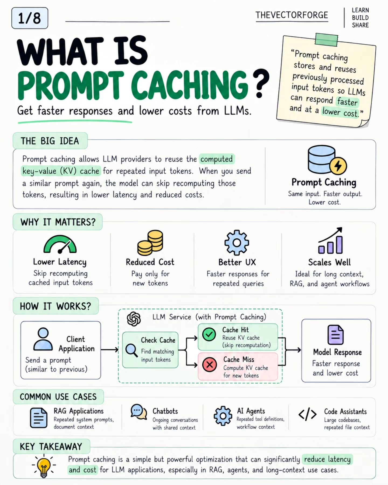
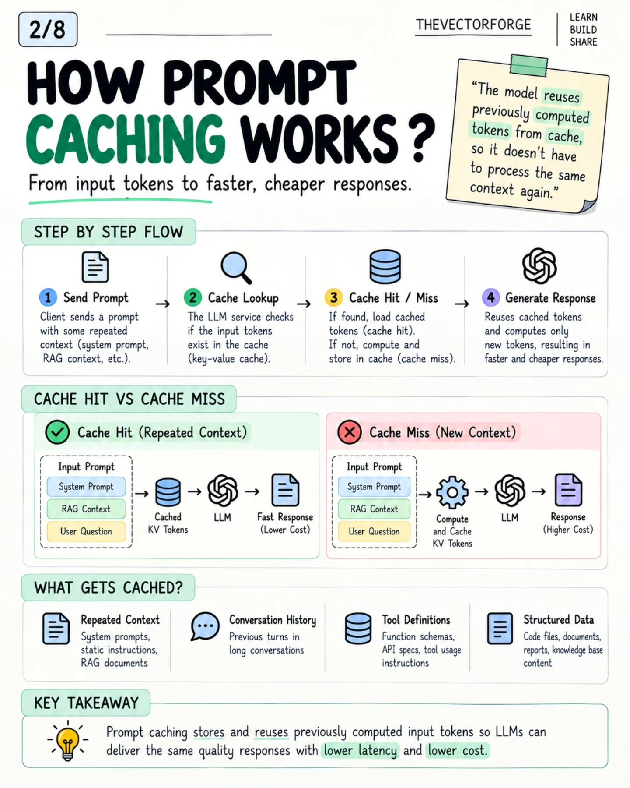
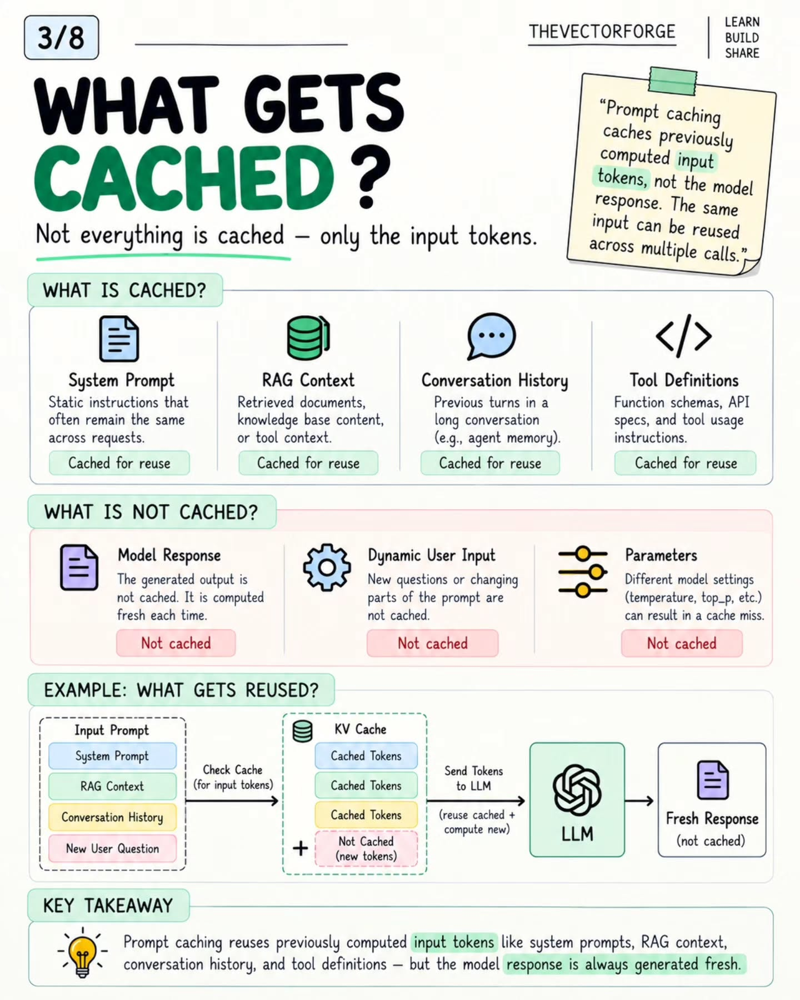
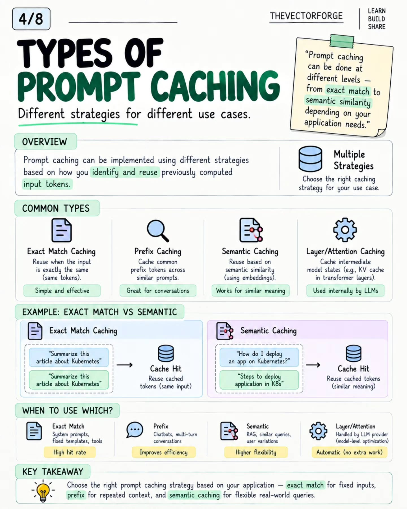
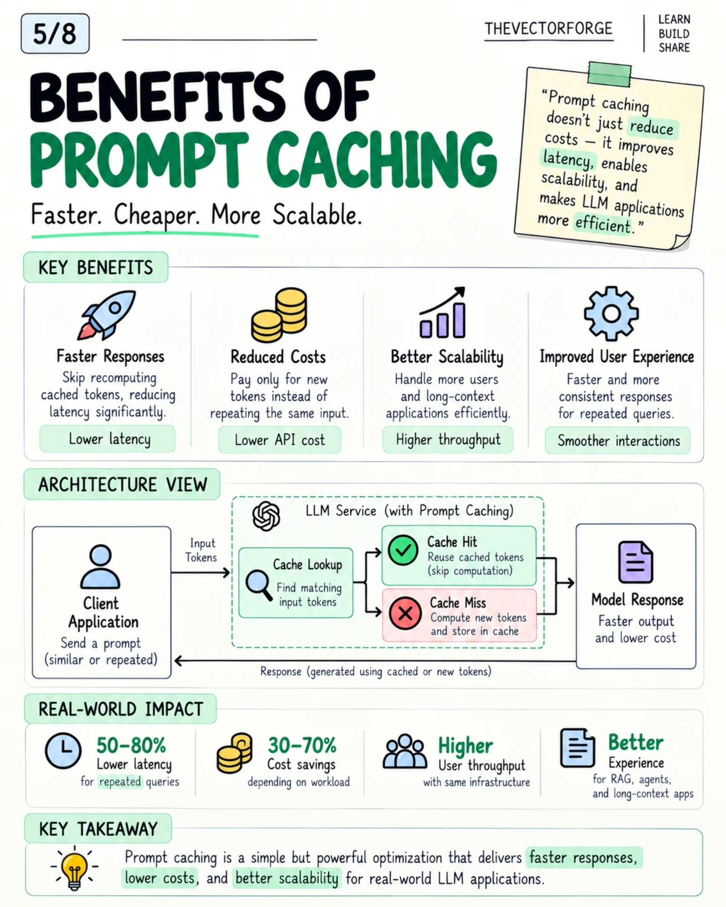
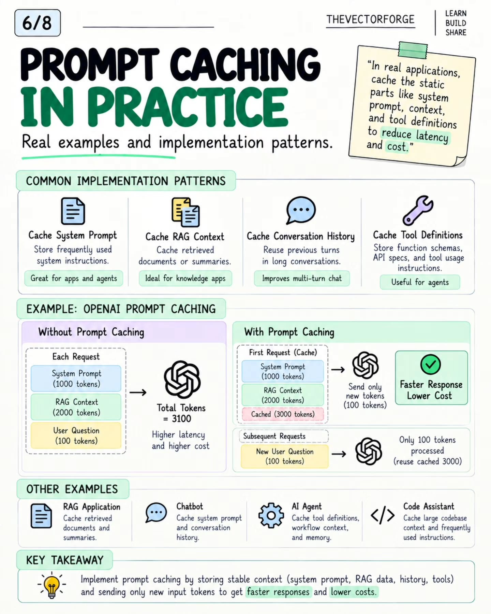
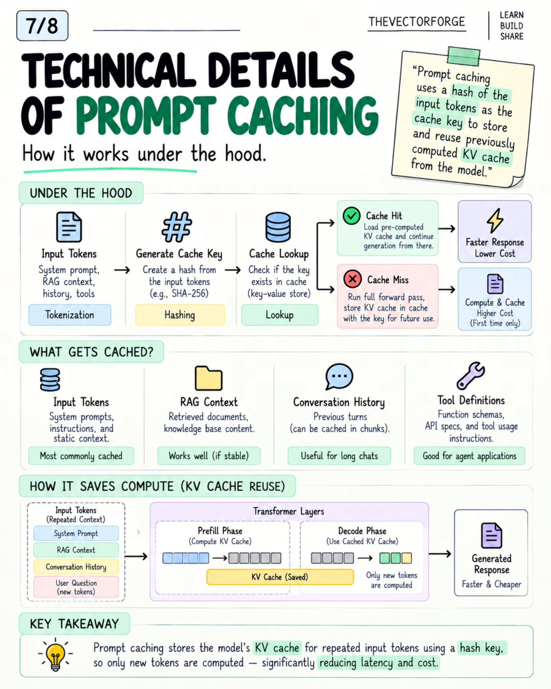
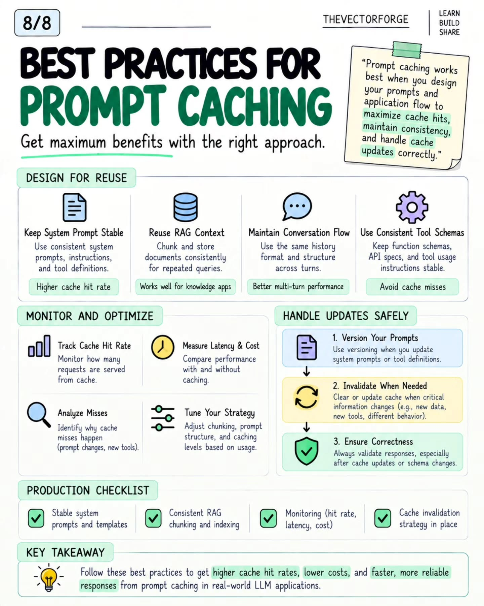

# Prompt Caching: the complete playbook

**What this is:** an 8-slide infographic carousel by @thevectorforge (TheVectorForge, Backend and AI, Oct 1, 2026) — the full walkthrough: what prompt caching is, the hit/miss flow, what gets cached and what doesn't, the four cache types, benefits with numbers, implementation patterns with a worked OpenAI example, the under-the-hood mechanics, and a production checklist. All eight infographics are saved below, in carousel order. Distilled here in my own words.

**Related:** [The Tokenomics Playbook](../tokenomics-playbook.md) (this page is the full treatment of the caching lever) · [20 AI inference engineering concepts](inference-engineering-concepts.md) (concept 7 — prefix caching — is the provider-side twin) · the Copilot shared-cache entry (96.22% hit rate, cross-user caching as CDN behavior)

**Thesis for the playbook:** prompt caching is where context hygiene turns into money. Every token your system re-sends instead of re-computing is a token you buy at the cached price — and cached input is priced far below fresh input (Mistral's current preview pricing: $0.68/M fresh in, $0.07/M cached in — roughly 10×). The lever is configuration, not a product: zero spend, and it stacks with everything else.

## 1 · What prompt caching is

Providers reuse the *computed key-value (KV) cache* for repeated input tokens instead of recomputing them. Send a similar prompt again, the model skips recomputing the repeated part — lower latency, lower cost. Four benefits the carousel names: lower latency (skip recomputing cached tokens), reduced cost (pay only for new tokens), better UX (faster repeated queries), and scalability (long context, RAG, and agent workflows — the workloads where the repeated part is the *big* part). The mechanism in one loop: client sends a prompt → provider checks the cache → hit (reuse KV, skip recomputation) or miss (compute and store) → response. The natural homes: RAG apps (repeated system prompt + documents), chatbots (ongoing conversations), AI agents (repeated tool definitions), code assistants (repeated codebase context).

## 2 · The hit/miss flow

Four steps: (1) client sends a prompt with repeated context — system prompt, RAG context, conversation history; (2) the provider looks up those input tokens in the KV cache; (3) hit → load cached tokens and generate, miss → compute the full forward pass and store the result for next time; (4) the response, faster and cheaper on hits. The side-by-side makes the economics visible: the same three-block prompt (system prompt + RAG context + user question) costs the full compute on a miss and only the delta on a hit. What the carousel says gets cached: repeated context (system prompts, static instructions, RAG documents), conversation history (previous turns), tool definitions (function schemas, API specs), structured data (code files, documents, knowledge-base content).

## 3 · The boundary: what gets cached vs what doesn't

The line the carousel draws matters more than the list: *only input tokens are cached — the model response is always generated fresh.* Cached: system prompt, RAG context, conversation history, tool definitions. Not cached: the generated response (computed fresh every time), dynamic user input (new questions), and — the one that bites — **parameters**: changing temperature or top_p between calls can produce a cache miss. The worked example: a prompt of system prompt + RAG context + conversation history + a new user question reuses the cached tokens for the first three blocks and computes only the new question.

## 4 · Four types, and when to use each

- **Exact match** — reuse when the input is byte-identical. Best for system prompts, fixed templates, tool definitions. Highest hit rate, simplest.
- **Prefix** — cache the common *prefix* tokens shared across similar prompts. The chatbot/multi-turn answer: each new turn reuses the conversation so far.
- **Semantic** — match on embedding similarity instead of token identity, so differently-worded questions with the same meaning hit. The RAG/flexible-query option — more flexibility, more machinery.
- **Layer/attention** — cache intermediate model states inside the transformer layers. Handled by the provider as a model-level optimization; automatic, nothing to configure.

The carousel's decision rule: exact match for fixed inputs, prefix for repeated context, semantic for flexible real-world queries. Its example pair: two identical "Summarize this article about Kubernetes" prompts hit on exact match; "How do I deploy an app on Kubernetes?" vs "Steps to deploy application in K8s" hit on semantic similarity.

## 5 · Benefits, with numbers

Faster responses (skip recomputation), reduced costs (pay only for new tokens), better scalability (more users, same infrastructure), better UX (faster, more consistent repeated queries). The carousel's claimed ranges: **50–80% lower latency for repeated queries, 30–70% cost savings depending on workload** — plus higher user throughput on the same infrastructure and the best experience gains in RAG, agents, and long-context apps. (On the honesty of these ranges: see the scoring section below.)

## 6 · In practice: the four patterns and the OpenAI example

The four implementation patterns, each a stable block at the front of the prompt: cache the **system prompt** (apps and agents), cache **RAG context** (retrieved documents or summaries — knowledge apps), cache **conversation history** (previous turns — multi-turn chat), cache **tool definitions** (function schemas, API specs — agents). The worked OpenAI example is the money diagram: without caching, every request reprocesses 3,100 tokens (1,000 system + 2,000 RAG + 100 question) at full latency and cost. With caching, the first request stores 3,000 cached tokens; every subsequent request sends only the 100 new question tokens and reuses the 3,000. That 31× reduction on the repeated portion is the arithmetic behind every "why does our agent bill drop" story.

## 7 · Under the hood

The mechanism: input tokens (system prompt, RAG context, history, tools) → tokenize → **hash the tokens (e.g., SHA-256) as the cache key** → look up in a key-value store. Hit: load the precomputed KV cache and continue generation from there. Miss: run the full forward pass, store the KV cache under the key for next time (the higher-cost path, paid once). The transformer-level view shows *why* it saves compute: in the prefill phase the model computes the KV cache for the repeated context; in the decode phase it reuses the saved cache and computes only the new tokens. One practical note the carousel adds: conversation history can be cached in chunks, not just as one monolith.

## 8 · Best practices and the production checklist

- **Design for reuse.** Keep the system prompt stable (consistent instructions + tool definitions = higher hit rate). Chunk and store RAG documents consistently for repeated queries. Keep the same history format and structure across turns. Keep function schemas and API specs stable — churn here is the silent hit-rate killer.
- **Monitor and optimize.** Track the cache hit rate (the metric that matters alongside the bill), measure latency and cost with vs without caching, analyze *why* misses happen (prompt changes, new tools), and tune chunking, prompt structure, and caching levels from real usage.
- **Handle updates safely.** Version your prompts when system prompts or tool definitions change; invalidate the cache when critical information changes (new data, new tools, different behavior); validate responses after cache updates or schema changes — correctness first.
- **Production checklist.** Stable system prompts and templates · consistent RAG chunking and indexing · monitoring (hit rate, latency, cost) · a cache invalidation strategy in place.

## Tokenomics / enterprise angle

1. **The 3100→100 diagram is the ROI slide for the caching lever.** In long-context agent workloads the static portion dominates — system prompt, retrieved docs, tool definitions — and it's the part caching erases from the bill. Cached-input pricing (~10× cheaper at current Mistral preview rates) turns that static portion from the biggest cost line into a rounding error.
2. **Hit rate is the metric; byte-stability is the mechanism.** Every practice on slide 8 reduces to one rule: make the repeated part byte-identical across calls. Stable prefix first, changing content last (the same rule as prefix caching in the inference deep dive). A timestamp, a reordered tool list, or a tweaked system prompt defeats hits silently — which is why "track hit rate alongside token savings" is the production nuance the carousel's own commenters raised.
3. **Tool definitions are the sleeper.** Agent systems re-send function schemas and API specs on every call; they're large, static, and almost never audited for cacheability. Moving them into the cached prefix is the cheapest win on slide 6's list.
4. **Version your prompts like you version code.** The invalidation guidance (version prompts, invalidate on material change, validate after) is the operational half most teams skip — a stale cache serving outdated instructions is worse than no cache, because the bill looks great while the answers rot.

## Honest scoring

This is an educational carousel, not a benchmark. The headline ranges — 50–80% lower latency, 30–70% cost savings — are unattributed and workload-dependent; treat them as directional, and measure your own hit rate before quoting savings. The mechanics are accurately described (hash-keyed KV cache, prefix ordering, parameter changes breaking hits, chunked history caching). One simplification worth flagging: the carousel presents *semantic caching* as reusing cached input tokens for similar-meaning queries — in practice, semantic caching usually caches *responses* (the answer to a similar question), not input KV state. The input-token caching it describes is really exact-match/prefix territory. The OpenAI 3100→100 example is a worked illustration of the arithmetic, not a measured benchmark. Solid as a design guide; verify the numbers on your own traffic.

**Source:** https://www.instagram.com/p/Dd-ru0KElPo/ (@thevectorforge, Oct 1, 2026)
