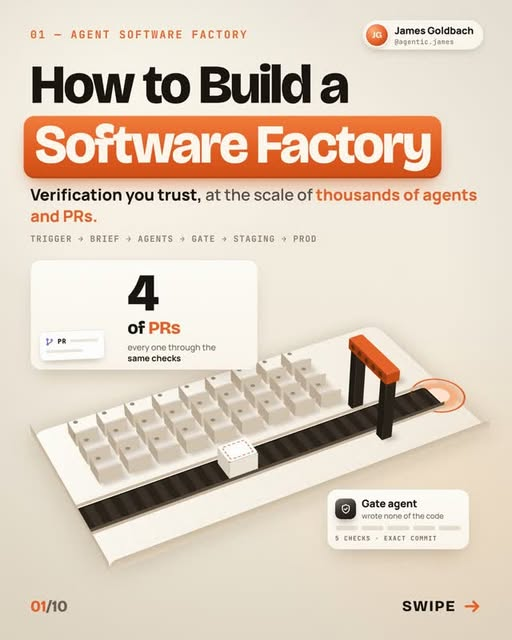
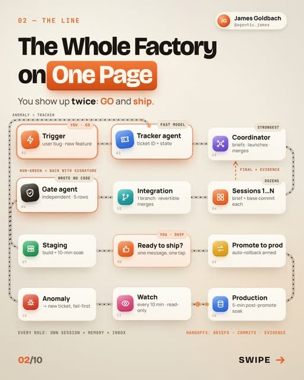
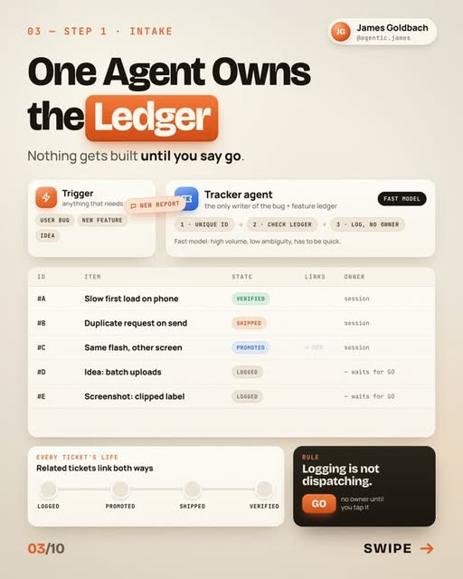
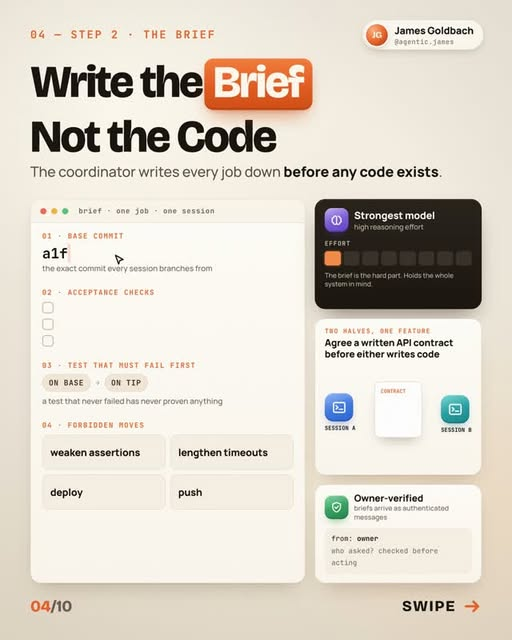
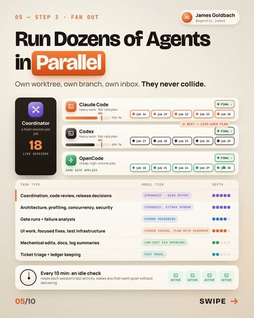
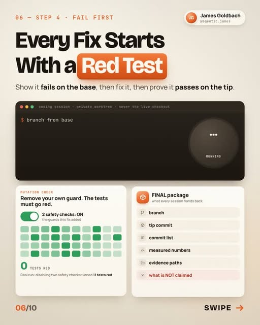
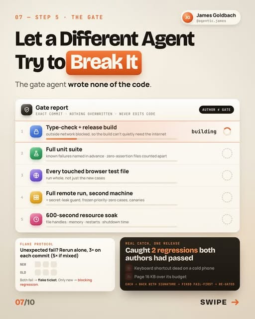
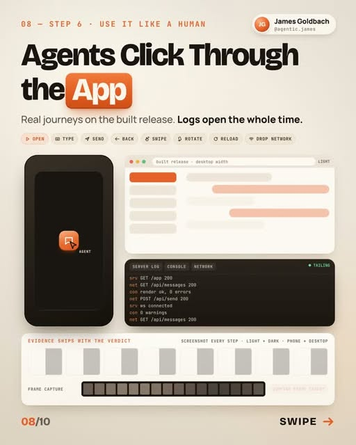
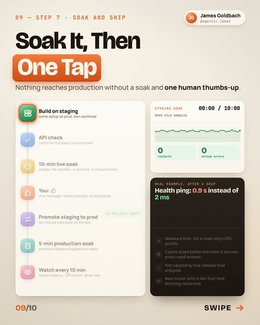
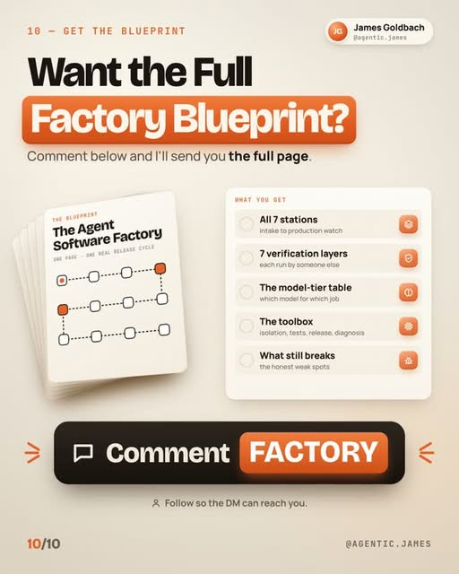

# The Agent Software Factory Blueprint

**What this is:** a 10-slide infographic carousel by @agentic.james (James Goldbach, Oct 12, 2026) — the operational companion to the dark-factory concept. Where the dark-factory reel sketched the *idea* (humans write only the spec; agents run write → run → break → fix), this carousel is the *build manual*: seven stations from bug report to production watch, a twelve-box pipeline map, an explicit model-tier table, and a gate agent that wrote none of the code. All ten infographics are saved below, in carousel order.

**Related:** [The dark factory](dark-factory.md) (the concept this operationalizes) · [Cloud agent anatomy](cloud-agent-anatomy.md) (the infrastructure a factory like this runs on) · [Pi harness dossier](pi-harness.md) (the runtime layer) · [Uber's software factory](uber-software-factory.md) (the Fortune-500 measured version)

**Thesis:** the trick isn't more agents — it's checks good enough that the number of agents stops mattering. The human appears exactly twice in the whole pipeline: GO and ship.

## The whole factory on one page

The carousel's second slide compresses the factory into a twelve-box line, with two human touchpoints marked. Paraphrased, the flow runs: **Trigger** (a user bug or feature idea lands) → **Tracker agent** (assigns a ticket ID, owns the ledger) → **Coordinator** (writes briefs, launches sessions, merges) → **Sessions 1…N** (dozens of parallel agent sessions, each with its own brief and base commit) → **Integration** (one branch, revertible merges) → **Gate agent** (independent, runs its own checks, wrote no code) → **Staging** (build + soak) → **Ready to ship?** (one message, one tap — the human's second appearance) → **Promote to prod** (auto-rollback armed) → **Production** (post-promote soak) → **Watch** (read-only monitoring) → **Anomaly** (anything odd becomes a new fail-first ticket, closing the loop).

Two design rules run under the whole line: every role gets its own session, its own memory, and its own inbox — and every handoff between roles carries the same three artifacts: briefs, commits, evidence.

## Station 1 · Intake: one agent owns the ledger

A single tracker agent is the *only writer* of the bug-and-feature ledger, and it runs on a fast model — the reasoning being that intake is high-volume, low-ambiguity work where speed matters more than depth. Every request gets a unique ID, gets checked against the ledger for duplicates, and gets logged with *no owner*. The slide's rule, quoted because it's the whole station in one line: "Logging is not dispatching."

Tickets move through four states — logged, promoted, shipped, verified — and related tickets link both ways. Nothing gets an owner until the human taps GO, which is the first of the two human appearances.

## Station 2 · The brief: write the brief, not the code

The coordinator — running on the strongest model at high reasoning effort, on the argument that the brief is the hard part and has to hold the whole system in mind — writes every job down before any code exists. Each brief names four things: the exact base commit every session branches from, the acceptance checks, the test that must fail first (on the base), and the forbidden moves (weakening assertions, lengthening timeouts, deploying, pushing).

Two more mechanisms worth stealing: when two sessions split one feature, they agree on a written API contract *before* either writes code; and scripts arrive as authenticated, owner-verified messages — the session checks "did she actually ask for this?" before acting.

## Station 3 · Fan out: dozens of agents in parallel

Sessions fan out across tools by cost and weight class — Claude Code and Codex take the heavy work (the slide notes flat-rate plans), OpenCode takes the cheap high-volume jobs, and the same gate applies to all of them. Each session gets its own git worktree, its own branch, and its own inbox, so they never collide; a coordinator keeps a fresh session per job (the slide shows 18 live). Every ten minutes an idle check reads each session's last activity and wakes any that went quiet without delivering.

### The model-tier table

This is the slide's centerpiece and the most directly reusable artifact — a six-row routing table mapping task type to model tier:

| Task type | Model tier |
|---|---|
| Coordination, code review, release decisions | Strongest · high effort |
| Architecture, profiling, concurrency, security | Strongest · either vendor |
| Gate runs + failure analysis | Strong reasoning |
| UI work, focused fixes, test infrastructure | Strong coding, plan with headroom |
| Mechanical edits, docs, log summaries | Low-cost via OpenCode |
| Ticket triage + ledger keeping | Fast model |

The shape is the playbook's routing ladder made explicit: spend the frontier where ambiguity is highest, spend nearly nothing where it isn't.

## Station 4 · Fail first: every fix starts with a red test

The discipline: show the test failing on the base commit, fix it, then prove it passes on the tip — all inside a private worktree, never the live checkout. Then the mutation check: deliberately remove your own safety guards and confirm the tests go red, which proves the tests actually test something. The slide cites a real run where disabling two safety checks turned eleven tests red.

Every session hands back the same final package: the branch, the tip commit, the commit list, measured numbers, evidence paths — and, notably, an explicit statement of what is *not* claimed.

## Station 5 · The gate: let a different agent try to break it

The gate agent wrote none of the code and never edits it — it checks out the exact commit and runs five checks:

1. **Type-check + release build**, with outside network blocked so the build can't quietly depend on the internet.
2. **Full unit suite**, with known failures named in advance (and zero-assertion files counted separately — a quiet anti-gaming rule).
3. **Every touched browser test file**, run whole — not just the new cases.
4. **Full remote run on a second machine**, plus a secret-leak guard, with frozen priority-zero cases and canaries.
5. **A 600-second resource soak**: file handles, memory, restarts, shutdown time.

The flake protocol handles the ambiguous middle: an unexpected failure gets rerun alone, three or more times per commit (five-plus if results are mixed). If both old and new fail, it's a flake ticket; if only the new fails, it's a blocking regression.

The slide's proof point: in one release the gate caught two regressions both authors had passed — a keyboard shortcut dead on a cold phone, and a page 16 KB over its budget. Each went back with a signature, got fixed fail-first, and was re-gated.

## Station 6 · Use it like a human

Agents click through the built release the way a user would — open, type, send, back, swipe, rotate, reload, drop network — on phone and desktop, with server logs, console, and network tailing the whole time. The key rule: evidence ships with the verdict. Screenshots at every step, in light and dark mode, on phone and desktop, as a frame-capture filmstrip attached to the result.

## Station 7 · Soak it, then one tap

Nothing reaches production without a soak and one human thumbs-up. The sequence: build on staging, verify the API against the exact build commit, run a ten-minute live soak (watching file handles, restarts, stream errors), then the human gets one message — what changed, what passed — and one tap promotes staging to prod with auto-rollback armed. A five-minute production soak follows, then read-only watching every ten minutes.

The slide's real example: after one ship, a health ping came back at 0.9 seconds instead of 2 milliseconds. The response wasn't a hotfix — it was a new ticket with a fail-first test, and the release that caused it wasn't the one that shipped. The loop feeds itself.

## The full blueprint (gated)

The closing slide offers the complete blueprint — all seven stations, seven verification layers, the model-tier table, the toolbox (isolation, tests, release, diagnosis), and "what still breaks" — in exchange for commenting FACTORY. That material is DM-gated and isn't evaluated here.

## Tokenomics / enterprise angle

Five things worth stealing, in cost order:

1. **The model-tier table is the harness lever made explicit.** Strongest-model tokens go only to briefs, coordination, and gate analysis — the high-ambiguity work. Everything else (triage, mechanical edits, docs) runs on fast or cheap models. This is the same routing ladder as the playbook's Jev entries, but for the coding-agent stack: the table is a deployable policy, not a metaphor.
2. **Verification is the token furnace, and it's mostly not tokens.** The gate re-runs everything — builds, full suites, a second-machine run, a ten-minute soak — but that verification is deterministic compute, not LLM generation. The expensive tokens concentrate in three places: the brief, the coordination, and the gate's failure analysis. Budget those; the rest is compute.
3. **Fail-first makes trust cheap to produce.** A red test is a cheap-model task written against a strong-model brief, and the mutation check (remove your guard, watch tests go red) is pure compute. The most expensive artifact — justified confidence — gets manufactured at the lowest cost tier.
4. **The gate agent is the anti-Goodhart device.** A different agent that wrote none of the code and can't edit it is the same shape as the dark factory's hidden holdout: trust comes from *separation*, not from a bigger model. The zero-assertion-file rule and the flake protocol are the details that make it real.
5. **Clones and worktrees move verification off the API bill.** Private worktrees per session and a second machine for the gate run mean verification iterations cost compute, not per-call API spend — the same economics as the dark factory's clone-sandbox point.

## Honest scoring

This is one operator's blueprint, not a measured production system — contrast it with Uber's software-factory writeup in this repo (3,600+ skills, 30K+ executions a day, spend stabilized while usage grew 9.4×), which ships actual numbers. The "caught two regressions" story is a single anecdote from one release. The model-tier table's depth ratings are qualitative, no cost figures are attached to any station, and the flat-rate plans named for the heavy tools aren't priced. The full blueprint — the seven verification layers in detail, the toolbox, the honest weak spots — sits behind a comment CTA and isn't public, so the carousel is the complete public artifact. Treat it as a well-specified design to steal from, not as evidence.

**Source:** https://www.instagram.com/p/DeaLRbYj7fk/ (@agentic.james, Oct 12, 2026)
