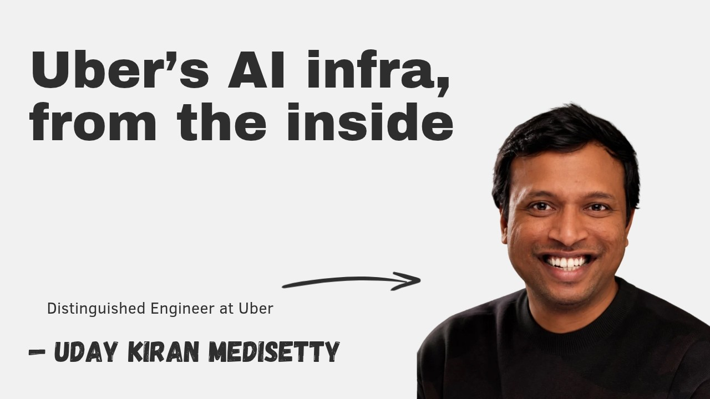
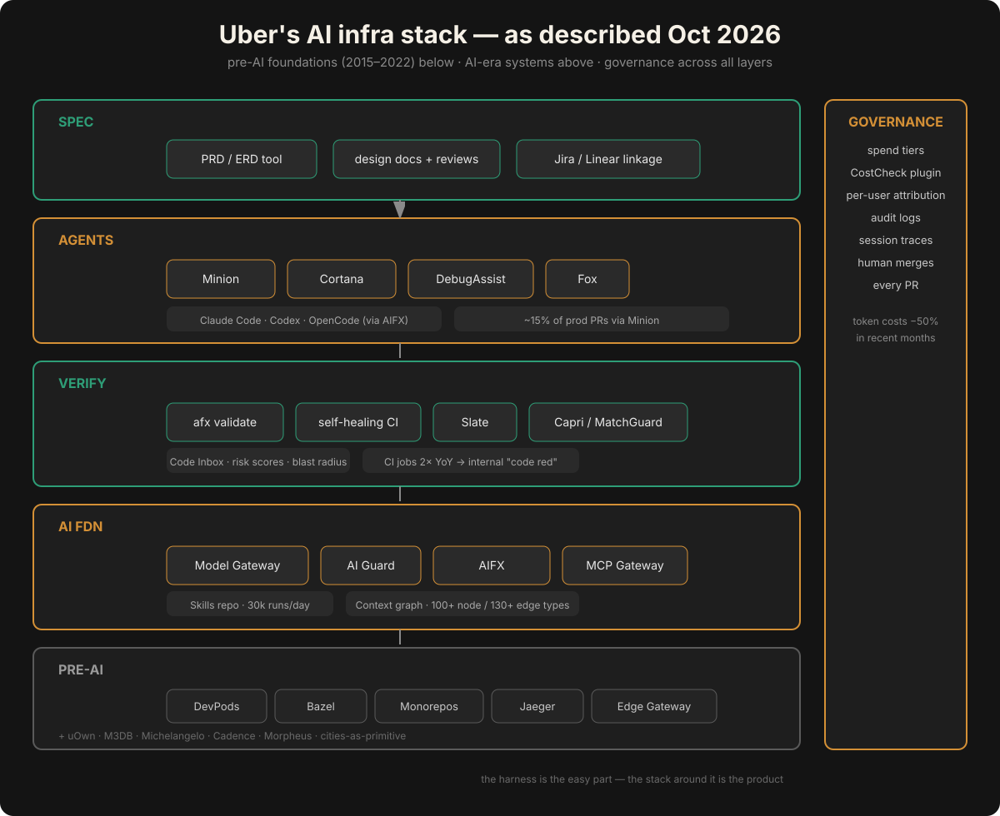
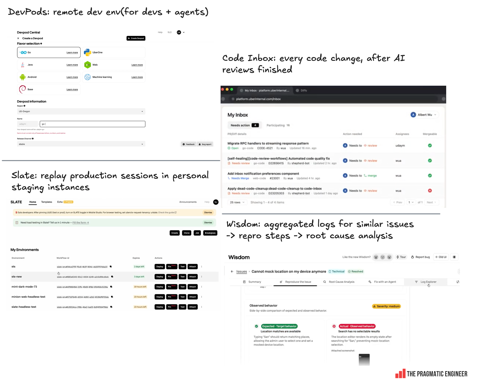

# Uber's AI Infra, From the Inside

**Source:** The Pragmatic Engineer podcast/video — *"Uber's AI infra, from the inside"* (published Oct 14, 2026, 94 minutes). Host: Gergely Orosz. Guest: Uday Kiran Medisetty, Uber Distinguished Engineer, who leads much of Uber's agentic AI work.
**Watch:** [YouTube](https://youtu.be/MDUYSMJmi8A) · **Read the companion writeup:** [newsletter.pragmaticengineer.com](https://newsletter.pragmaticengineer.com/p/ubers-ai-infra-from-the-inside)

> Note on method: this is a deep-dive *distillation*, not a verbatim transcript — the full chapter-by-chapter substance, the technical architecture, and the numbers, rewritten for technical leaders. Short attributed quotes are used sparingly; everything else is original analysis.

## TL;DR for technical leaders

1. **Uber's AI tooling looks like it was built in a year; it was built on a decade of dev-platform investment.** Minion (2025) rides on DevPods (2017). The MCP Gateway (April 2025) was fast because every service already had Thrift/Protobuf IDL in a single registry. Slate's test-account routing works because Jaeger tracing with baggage propagation was built out years earlier. The episode's thesis, from the host's intro: *the harness is the easy part — production-ready agentic coding is all the things around the harness.*
2. **Invest in model- and harness-agnostic foundations.** Uber's platform team decided in early 2023 that everything AI must be swappable. The Model Gateway exposes one OpenAI/Anthropic-compatible API across all vendors and open models, with security middleware (AI Guard), per-user attribution, spend tracking, audit logs, and session traces behind it. AIFX wraps Claude Code, Codex, and OpenCode so engineers carry settings, skills, and plugins when they switch harnesses.
3. **The numbers that matter:** ~15% of production PRs go through the Minion background agent; ~30,000 agent-skill executions per day; CI jobs doubled year-over-year (triggering an internal "code red" for CI in early 2026); token costs cut ~50% over a few months via spend tiers plus a CostCheck coaching plugin; the context graph holds 100+ node types and 130+ edge types.
4. **Humans still merge everything.** Code review is the acknowledged bottleneck. Every PR gets AI review, risk scores, blast-radius analysis, and attached screenshots/videos *before* a human looks — but a human engineer still approves every merge. "Green lane" auto-landing for low-risk PRs is explicitly future work, gated on backtested confidence.
5. **Measure feature velocity, not diff velocity.** Uber tags every PR by type (feature / bugfix / maintenance / testing / docs) plus complexity, and now tracks P50 feature time end-to-end using AI to cluster specs → tasks → PRs. Feature-PR share is rising, maintenance-PR share falling.
6. **The engineer's job is now context engineering.** Uday's framing: the core skill is building the right context for agents to produce reliable output, plus multitasking across parallel agent sessions and fast verification of their outputs.

## The speakers

**Uday Kiran Medisetty** — Distinguished Engineer at Uber (one of a small number of DEs at the company), and one of its longest-tenured engineers. He joined in May 2015 when the company had ~600 engineers and two production services, starting on the real-time API team during the monolith-to-microservices breakout. Over the following decade he worked across fulfillment, Uber for Business, earner onboarding, and marketplace pricing platforms — earlier a principal engineer on core distributed systems (with Uber Engineering bylines on the real-time push platform and the Edge Gateway API lifecycle platform) — before spending the last year on agentic AI, both for engineers and for end users (customer support, rider/earner experiences). He leads much of Uber's agentic AI work today, co-leads the company-wide engineering community that shapes Uber's architecture and standards, and has become the public face of Uber's "software factory" engineering posts in 2026 (the Aug 27 "Running a Software Factory Efficiently at Uber Scale" post and a June AI Engineer World's Fair session). ([X: @udaykiran](https://x.com/udaykiran) · [LinkedIn](https://www.linkedin.com/in/udaykiran) · [2024 theCUBE interview](https://siliconangle.com/2024/03/12/concept-code-evolution-ubers-ai-driven-platform-supercloud6/))

**Gergely Orosz** — author of The Pragmatic Engineer, the #1 technology newsletter on Substack (~700K+ subscribers). He went full-time on it in September 2021 after leaving Uber, where he spent four years as an engineering manager (2016–2020); before that, Skype/Microsoft, Skyscanner, and JP Morgan. He wrote *The Software Engineer's Guidebook* and has covered Uber's engineering culture for years (productivity, developer experience, observability, the cloud migration) — this episode continues that relationship, and his own time inside Uber lets him press on the parts outsiders wouldn't know to ask about.

## Uber's scale, in numbers

| Era | Services | Engineers | Notes |
|---|---|---|---|
| 2015 (Uday joins) | 2 — Dispatch (Node.js) + API (Python) | ~600 | 4-second ping protocol giving the whole world-state; monolith breakout just starting |
| 2019 | Thousands | Thousands, expanding to 12 global tech sites | Microservices boom; Go + Java standardized ~2018–19 |
| 2026 | ~4,500–5,000 | Thousands across 12 sites | Business ~10x larger than 2019 on roughly the *same* service count — consolidation into well-sized services, one global tech stack |

Supporting scale facts from the episode: ~500M metrics emitted per second at peak (which forced M3DB into existence); a single monorepo per language; Bazel as the one build system everywhere.

## The pre-AI foundations (the decade that paid off)

Every system below predates the LLM era. Each one became a load-bearing wall for the AI stack above it.

| System | What it is | Why it was built | AI-era payoff |
|---|---|---|---|
| **uOwn** | Ownership registry: who owns any service or asset, who's on-call | No vendor existed in 2015 for org-wide ownership at Uber's scale | Feeds the context graph; agents resolve "who owns this" without asking |
| **M3DB** | Time-series metrics DB (later open-sourced; Chronosphere built on it) | 500M metrics/sec with high cardinality — no off-the-shelf system could take it | Metrics foundations that make experiment analysis trustworthy |
| **Michelangelo** | End-to-end ML platform (features → training → serving → monitoring); deep-learning parts open-sourced 2026 | Hundreds of ML models with no unified lifecycle | The Model Gateway and GenAI foundations are built *on* Michelangelo |
| **Cadence** | Durable workflow engine for multi-day flows (driver onboarding, CRM campaigns); open-sourced (Temporal grew from the same ideas) | Engineers hand-rolling resiliency and state management everywhere | The pattern for long-running agent workflows |
| **Morpheus** | Config platform + feature flags + experimentation (incl. switchback tests) for 2- and 3-sided marketplaces, with automatic analysis | Data-driven company where everything ships behind a flag and an experiment | Experiment discipline carries into agent rollout measurement |
| **Edge Gateway** (ex-RT API) | Single entry point for all client APIs — REST, gRPC, webhooks, GraphQL — now in Go | Abstracting internal services from mobile clients; one of the highest-QPS services at Uber | Same "single entry point" pattern as the Model Gateway and MCP Gateway |
| **Jaeger** | Distributed tracing, open-sourced; span baggage propagates across the call stack | Debugging thousands of services | Slate's test-account routing rides on trace baggage |
| **DevPods** | Cloud dev boxes (2017), one flavor per monorepo, warm build caches, up to 48 cores/96GB RAM; 60%+ of engineers adopted by Nov 2022, p95 Go builds ~2.5x faster than laptops | Monorepo scale made laptop setup and build times untenable | Minion and all agents run on DevPods; a "mega DevPod" with every repo lets agents PR across repositories |
| **Cities as a primitive** | City-level sharding, observability cardinality, feature-flag targeting, region failover | The physical world is the product | Dimension-aware testing (Capri's MatchGuard catches e.g. cash-trips-only-in-Brazil regressions) |

The through-line Uday keeps returning to: *"All the things that we built to make life easier for engineers — it makes it easier for our agents as well."*

## The AI-era stack

### 1. Model Gateway + AI Guard (2023)

When ChatGPT launched, internal teams rushed to build on LLMs. The platform team made the call that everything would be **model- and harness-agnostic**, and built the Model Gateway on Michelangelo's new GenAI foundations. Any team creates a client with a project ID and caller token and gets one OpenAI/Anthropic-compatible API; every model across every vendor — plus open models Uber runs — sits behind it. Uber's 2024 write-up documents it as a Go service with an OpenAI-compatible HTTP/JSON interface (so the whole open-source ecosystem works against it unmodified), PII redaction at the infrastructure layer, and a standardized security review as the front door; by 2024 it was already serving ~30 customer teams and ~16 million queries per month.

The gateway accumulated the enterprise controls as middleware:
- **AI Guard** — security-team-owned middleware running on every request *and* response: content/safety/comms-policy checks via a set of fine-tuned models, with strict latency guardrails so guardrails don't become the bottleneck.
- **Attribution and spend** — per-user, per-caller tracking, added as the program matured.
- **Visibility** — audit logs and session traces for every call.
- **The invariant:** every model request at Uber goes through this gateway. No side doors.

Tokenomics read: this is the meter. One choke point means one place to enforce policy, one place to measure, and one seam where model routing can later be inserted — because every call already flows through it.

### 2. AIFX — the harness wrapper

Models churn; harnesses churn faster. AIFX (AI Foundations) wraps Claude Code, Codex, and OpenCode so an engineer switching harnesses keeps their settings, skills, and plugins. It's preinstalled on DevPods (and installable locally), ships **personas** — bundles of default plugins and skills so a new engineer is productive immediately — and syncs settings centrally across all of a user's environments. A status line surfaces tips and live spend tracking across harnesses and within the session.

The enterprise pattern: treat the harness as a replaceable shell and own the layer above it (settings, skills, spend, audit). When the next harness arrives, you port a wrapper, not a workflow.

### 3. MCP Gateway (April 2025)

As Cursor and MCP took off in early 2025, Uber realized agents needed its *internal* tools — and that every service already had a Thrift or Protobuf IDL in a single registry. The same team that builds the API Edge Gateway built the MCP Gateway: it **auto-generates MCP specs from the IDL registry**, so every internal service API becomes an MCP tool with request/response packs and descriptions. Two refinements matter:
- **LLM-optimized descriptions** — some generated tools ran 3,000–4,000 tokens of schema; the team generates condensed descriptions so tool definitions don't eat the context window.
- **CLI projection** — every MCP is also exposed as a CLI. This turned out to be a major token win: with pure MCP, installing two skills could pin six always-on MCP servers into context; the CLI pattern loads nothing until invoked. A couple of engineers converted the whole skills repo to the CLI pattern and moved token efficiency materially.

Vendor tools (Google Workspace, Slack, Jira, Linear) are proxied through the same gateway, so internal and external tools install and authenticate identically.

**Production scale (Oct 2026):** Uber's engineering post on the MCP Gateway puts it at **800+ MCP servers and 5,000 individual tools** behind a single control surface, in a dual-plane design — an MCP Registry as the control plane (catalog of servers, tools, ownership, enablement state) and a Proxy Gateway as the data plane, translating MCP calls into HTTP, gRPC, or TChannel and routing through Muttley, Uber's service mesh. One governance detail worth stealing: **every discovered tool starts disabled** — the owning team must review and enable it. Discovery is not authorization.

### 4. The Agent Skills repo

Uber runs a **skills monorepo**: core skills built by platform teams plus team-specific skills, all portable across harnesses (one quality gate runs everywhere), installed via the same AIFX tooling — `plugin add` updates configs across all harnesses at once, even ones the engineer isn't currently using. The marketplace is auto-installed for everyone, which solves discoverability.

The part most teams skip: **skills are a lifecycle, not a folder.** Uber is building eval pipelines and discoverability tooling around the repo, plus a coaching tool that reviews a skill and suggests improvements. In flight: collecting harness traces to auto-generate improvement patches for skills — continuous skill evolution from production traces. Scale, per Uber's August 2026 engineering post: **3,600+ agent skills built by engineers, 30,000+ skill executions per day** — and a Warp roundtable with Uber's team describes governing the resulting sprawl with golden skills, quality scores, and self-improving skills.

### 5. The context graph + Cortana

The origin story: in December an engineer built an assistant ("Cortana," reachable via web and Slack) that answered questions across all of Uber's codebases. Usage showed it needed too many turns to get grounded — because Uber's systems are siloed (task tracker, on-call dashboards, design docs, uOwn). The answer was a **context graph**: 100+ node types, 130+ edge types, live. Every person, PR, asset, design doc, on-call event, config change, and incident is a node; edges say who created what, who manages what, what relates to what.

Cortana now uses the graph as default grounding: a question first resolves to a domain and service set via the graph, *then* goes deep into documents. Reported effect: quality up, cost down, latency down — and the team considers it early days. Secondary write-ups of Uber's software-factory talks put the graph at **~40 million entries across ~150 node and edge types**, and give the canonical grounding story: an agent answering from the graph finished in 38 seconds where an ungrounded agent searched 20+ minutes and still got it wrong. It also powers 360° service-health reports (dependencies, storage, queries) and **carries forward existing user permissions**, so the assistant only sees what the asker could already see — the enterprise answer to the "agent sees everything" problem.

The technical-leader takeaway: retrieval quality is a data-modeling problem. Uber's graph team (which runs a production graph with billions of nodes for the business) built this one, and at internal scale it wasn't even a hard scaling problem.

### 6. PRD/ERD tooling — the spec layer

Uber is pushing product and engineering design docs, launch reviews, experiment reviews, and production-readiness reviews into one system with owners, status, and Jira/Linear links — a source of truth for specs that both humans and agents can read. The traceability matters downstream: it's what makes end-to-end *feature* cycle time measurable (see the productivity section). Everything feeds the context graph, so the full history of a project's source-of-truth docs is queryable.

### 7. Minion — the background coding agent

Minion is Uber's background coding agent: hand it a spec or a Slack thread (`@minion`, follow this thread) and it works in plan mode or fire-and-forget, on a **mega DevPod** with all repos checked out, creating one or many PRs across repositories. It has self-validation skills (spin up web/mobile/backend and test). Currently ~**15% of all production PRs** go through Minion (a Background Agents summit talk put agent-opened PRs at 11%); it started on maintenance tasks and the task range keeps widening as validation tooling improves. Two design decisions worth noting: Minion **stops at a draft PR without pushing to CI** — autonomous coding is for toil reduction, but end-to-end features need validation before consuming CI resources — and prompt caching is part of its cost optimization. The support-channel loop is the killer demo: on-call pastes a bug report, Minion finds the root cause, fixes it, opens the PR — no backlog, no sprint planning.

### 8. The verification pipeline — CI, self-healing, and Code Inbox

PR volume exploded, so Uber attacked every stage:
- **`afx validate`** — the inner loop, one command: linter, coverage rules, build rules, template rules. Simple CI jobs that used to run post-PR moved *before* PR creation, so agents self-check before opening.
- **Visual/self validation** — agents spin up emulators, web, or staging environments, deploy the change, run APIs, and verify. A/B browser tests produce before/after reports attached to the PR.
- **Self-healing CI** — when CI still fails post-PR, agents retry and fix; applicable per-PR or repo-wide.
- **Code Inbox** — the review surface: every PR waiting on you in one place, with AI code review already run, screenshots/videos attached, **risk scores and blast radius** computed. The engineer's job shifts from "read everything" to "decide where attention goes."

The load forced the issue: CI jobs **more than doubled year-over-year**, and Uber had to declare an internal "code red" on CI in early 2026 to keep build speeds up.

### 9. Slate — personal staging with test-account routing

Slate gives every engineer personal staging environments: deploy your branch, then **pin your test account** to it — your requests route to your instance while everything else flows to normal staging. Multi-service changes route across all services under test. The mechanism is Jaeger trace baggage: pinning adds routing metadata that the service mesh honors hop by hop. Agents now deploy Slate environments themselves and run the A/B validation loops.

Gergely's point, worth repeating: this took *years* to retrofit across thousands of services. Without it, agents couldn't self-validate, and the whole automation story would stall at "trust me."

### 10. Capri — capture/replay + MatchGuard

Uber's rider app has hundreds of screens × product lines × cities × configurations — combinatorial explosion no test suite can cover. **Capri** captures real production traffic through a middleware hook (standardized language frameworks make this a one-line integration): full inbound request/response *plus* all downstream API calls. Captured sessions get tagged with dimensions (marketplace type, line of business, terminal state…), and the system derives the full set of live dimension combinations — **MatchGuard** — which runs pre-deploy in CI/CD against every PR in the deploy, showing before/after deltas. The canonical example: catching a regression that only breaks *cash trips in Brazil*.

For debugging, Capri composes with Slate beautifully: take a failing production request, replay it against your Slate environment, and iterate the fix in a loop — agents do this autonomously now. (Predecessors: Deputy and Cerberus, which could route production traffic to test instances but were hard to use; Slate made them unnecessary.)

### 11. Edge Gateway

The renamed, Go-based RT API: every client API — REST, gRPC, webhooks, GraphQL — enters through one gateway with monitoring, alerting, and reliability features built around it. It has its own capture/replay (Capri under the hood) and rich dependency metadata (required vs. optional per service), which feeds both human debugging and agent-driven incident response.

### 12. Shepherd + Fox — migrations and self-improving codebases

Moving to monorepos solved the "upgrade libraries everywhere" problem in theory; **Shepherd** solves it in practice. Deterministic changes go through OpenRewrite policies; agentic changes go through prompt+skill campaigns. Shepherd knows which modules each team owns, opens a PR per module, and the campaign owner tracks the whole migration. The documented exemplar is the JUnit 4→5 migration: an initial rollout of 2,000+ diffs, iterated through failure analysis, ultimately migrating **75,000+ test classes and ~1.25 million lines of code**.

**Fox** is the continuous version: services enroll in skills (dead-code cleanup, performance analysis, noisy-log fixes), and every Sunday — when CI load is low — Fox opens improvement PRs. Still opt-in while skills mature; the plan is opt-out. The operating principle: continuously convert maintenance-PR categories into automated loops, freeing engineers for feature work.

### 13. Wisdom + DebugAssist — dogfood bugs to RCA to PR

Every Uber employee dogfoods the rider/earner apps. **Wisdom** lets them report a bug from the app; it auto-routes to the owning team and captures the full telemetry bundle (logs, analytics, network requests, feature flags, screen journey) plus location mocking for country-specific features. Reproduction — historically the hardest part — becomes "replay the employee's session." **DebugAssist**, a managed agent, then produces root-cause analysis with impact and an evidence timeline; a human confirms, and it hands off to Minion, which opens the PR *with the RCA attached to the Jira task*. The loop is instrumented: bad RCAs and bad PRs feed back into improving both agents.

The Wisdom UI (visible in the episode's infographic): issue view with tabs for Summary, Reproduce the Issue, Root Cause Analysis, Fix with an Agent, and Log Explorer — expected vs. observed behavior compared side by side.

*Four of Uber's 20+ internal tools, as shown in the episode: DevPods (remote dev environments for devs + agents), Code Inbox (every code change after AI review), Slate (replay production sessions in personal staging), Wisdom (aggregated logs → repro steps → root cause analysis). Via The Pragmatic Engineer.*

## The economics of AI at Uber

This is the section most directly relevant to anyone running token budgets — and Uber has published unusually honest numbers (via Uday's Aug 27, 2026 engineering post, "Running a Software Factory Efficiently at Uber Scale"):

- **The crisis first:** Uber burned through its entire annual 2026 AI budget in the *first three months* of the year. In May, Uber's COO said publicly it was getting harder to justify spending on tools like Claude Code without visible benefits. That's the forcing function behind everything below.
- **The turnaround:** cost per AI request down **34%** from its April peak; cost per AI session down **52%** from its June peak; total AI spend flat since March/April — *while* weekly active users grew 7x and weekly agentic requests grew 9.4x (Feb–Aug 2026).
- **How they did it:** open-weight models on Uber's own inference instead of frontier models; weekly benchmark-driven model selection on real work (not vendor claims); cheaper subagent models for small tasks; reasoning effort defaulted to "Medium" (their best cost-to-output ratio); automatic context compaction above 400K tokens even on 1M-context models; prompt caching on Minion.
- **The spend equation they manage:** users × sessions/user × turns/session × requests/turn × tokens/request × price/token. Every factor is a lever; most teams only watch the last one.
- **Spend tiers, not hard blocks.** Every engineer gets a default tier; approaching the limit triggers a lightweight manager conversation about ROI, then the tier goes up. Separate tiers for interactive harnesses vs. background agents. One shared tier across interactive harnesses; Slack alerts at 50/80/100% of expected spend; live cost counters in harness status lines. The philosophy: no arbitrary cap on legitimate work, but zero tolerance for careless burn.
- **CostCheck plugin + anti-pattern dashboards.** CostCheck coaches cost hygiene across sessions in real time; behind it sits a session-analysis dashboard flagging **16 wasted-spend anti-patterns** (suboptimal model routing, MCP context bloat, and friends).
- **The meter is the Model Gateway.** Per-user/per-caller attribution plus audit logs means spend is observable by construction, not by after-the-fact log scraping.
- **Token efficiency as architecture:** the MCP→CLI projection (avoiding always-on MCP servers in context), LLM-optimized tool descriptions (3–4k tokens → condensed), and the context graph (fewer grounding turns) are all cost controls disguised as architecture choices.

## Code review: where it's headed

Uday is candid: review is the bottleneck, and it's getting worse as PR volume climbs — first-review wait times at Uber ballooned from 3 hours (2024) to 9 hours (2026). Uber's current posture:
- AI review + risk scores + blast radius + screenshots/videos land *before* the human. The companion system uReview generates ~25,000 review comments per week at ~60% lower cost than a naive implementation, ~70% better accuracy, and a 67% comment-addressal rate.
- **A human engineer still approves every merge.** No exceptions today — incident cost at Uber's scale demands it.
- **Green lane** (auto-landing low-risk PRs) is the explicit future, but gated on backtesting risk scoring against years of incident data. The priority order is deliberate: first make review fast and well-signaled (P0), then automate the safe tail (P1).

Gergely's closing observation generalizes it: code review is slowly dying everywhere; the question is what replaces the *assurance* function, and Uber's answer is risk-scored, evidence-attached review with humans on the merge button until the data says otherwise.

## Measuring productivity: from diff velocity to feature velocity

The old world measured diff/code throughput and ran developer-experience surveys (NPS, sentiment, incidents-per-diff, coverage) — Uber has run an internal Eng Metrics Dashboard since ~2017 (diffs and reviews per engineer, create-to-close time, focus hours; access initially restricted to director level and above so nobody would game it), plus laptop/DevPod instrumentation and dev-tooling NPS (which went from −50 to +8 during the Developer Experience era). The new world, as Uber is building it:

- **Tag every PR** by type — feature, bugfix, maintenance, testing, docs — plus complexity. Year-over-year the mix is moving the right way: feature-PR share up, maintenance-PR share down.
- **P50 feature time, end to end.** The hard part was always tracing a feature from product spec → engineering spec → tasks → PRs. Uber now uses AI to cluster and backfill those links, producing reliable cycle-time numbers per feature-complexity class over the last 2–3 years — then hunts the bottleneck phase (PRD? launch? rollout?) and invests there.
- **The metric that matters:** not how many diffs, but how much throughput converts into shipped features. A hundred agent-generated diffs with no product impact is noise; the tagging system is what separates signal from noise.

## The changing job of the engineer

Uday's summary, paraphrased: the job is becoming *how do you build the right context for agents to produce reliable output*. Three skills are appreciating fast:

1. **Context engineering** — knowing what context an agent needs, what specs and constraints to give it, and how to set up its environment.
2. **Multitasking across parallel sessions** — scoping work, tracking multiple agent threads, switching constantly. The old "laser focus on one PR" rhythm is gone.
3. **Verification** — reading agent output fast, catching code smells, never shipping regressions. Parallel output multiplies the cost of weak verification.

He also names the constraint honestly: **capability overhang** — the models can already do more than the orchestration, harnesses, and tooling around them can reliably exploit. Every bottleneck removed unlocks the next one. His personal example: a customer-support policy-migration workflow that took *weeks* of runbook→policy→API-wiring→config→manual-eval work now produces a solid V0 policy in short order, with synthetic evals generated from past context replacing manual evals.

## Extractable patterns for enterprise technical leaders

The checklist version — what to steal, in dependency order:

1. **One model gateway, no side doors.** Single entry point for all model traffic → policy, attribution, spend, audit, and future routing for free.
2. **Own the layer above the harness.** Wrap whatever coding agents you allow; sync settings/skills/plugins centrally; track spend in the status line. Harnesses are replaceable; your layer isn't.
3. **Auto-generate tool access from your API contracts.** If you have IDL/schema registries, MCP servers are a codegen problem, not a hand-authoring problem.
4. **Prefer CLI-shaped tools over always-on MCP servers** for token efficiency — load nothing into context until invocation.
5. **Build the skills repo as a lifecycle** — quality gates, evals, discoverability, trace-driven improvement — not a folder of markdown.
6. **Ground agents in a knowledge graph** of your org's actual entities (people, services, docs, incidents) before letting them loose on documents. Fewer turns, lower cost, better answers — and carry user permissions through.
7. **Give agents the same verification environments humans use** — personal staging with request routing (Slate pattern) and production-traffic replay (Capri pattern). Agents that can't self-validate can't be trusted.
8. **Spend tiers + coaching beats hard caps.** Lightweight manager conversation at tier boundaries; a CostCheck-style plugin for real-time feedback.
9. **Measure feature velocity, not diff velocity.** Tag PRs by type; track P50 feature time end-to-end; invest in the bottleneck phase.
10. **Keep humans on the merge button** until risk scoring is backtested against years of incident data — then green-lane the safe tail.

## Honest scoring

- **This is a tour, not an audit.** It's one distinguished engineer's guided walkthrough on a friendly podcast (with a former-Uber host). The numbers quoted (15% of PRs via Minion, 30k skill runs/day, 50% cost cut, 100+ node types) are Uber's own, not independently verified. Treat them as directional and self-reported.
- **Survivorship and scale bias.** Uber had a decade of platform investment and thousands of engineers. The "retrofit AI onto battle-tested infra" moral doesn't transfer cleanly to a 50-person company with no platform team — though the *patterns* (gateway, wrapper, skills lifecycle, verification environments) scale down even if the org doesn't.
- **What's missing:** the episode doesn't cover failure modes in depth (bad Minion PRs, skill quality regressions, the incident that the "code red" was responding to), vendor pricing details, or how the spend tiers are actually calibrated. The open question Uday leaves hanging — when green-lane auto-merge becomes safe — is the one to watch.
- **Auto-caption artifacts:** the working transcript had the usual ASR errors (names, "late 2013" for the ChatGPT era); corrected in this writeup against the episode's own context.

## Sources and further reading

- Episode: [Uber's AI infra, from the inside — YouTube](https://youtu.be/MDUYSMJmi8A) · [Pragmatic Engineer newsletter writeup + transcript](https://newsletter.pragmaticengineer.com/p/ubers-ai-infra-from-the-inside) (Oct 14, 2026)
- Uday Kiran Medisetty: [X @udaykiran](https://x.com/udaykiran) · [LinkedIn](https://www.linkedin.com/in/udaykiran) · [2024 theCUBE interview on Uber's platform evolution](https://siliconangle.com/2024/03/12/concept-code-evolution-ubers-ai-driven-platform-supercloud6/)
- Uber engineering, primary sources: [Running a Software Factory Efficiently at Uber Scale](https://www.uber.com/us/en/blog/efficient-software-factory/) (Aug 27, 2026 — the cost numbers, spend equation, skills scale) · [MCP Gateway at production scale](https://forkast.news/uber-ships-mcp-gateway-at-production-scale-800-servers-and-5000-tools-behind-a-single-control-surface/) (Oct 2026 — 800+ servers, 5,000 tools, dual-plane design) · [DevPods: improving developer productivity](https://www.uber.com/tw/en/blog/devpod-improving-developer-productivity-at-uber/) · [Go monorepo + Bazel](https://www.uber.com/de/en/blog/go-monorepo-bazel/) · [JUnit migration via Shepherd](https://www.uber.com/hk/en/blog/junit-migration/) · [Michelangelo ML platform](https://www.uber.com/gh/en/blog/michelangelo-machine-learning-platform/) · [Edge Gateway](https://www.uber.com/nz/en/blog/gatewayuberapi/)
- Related Pragmatic Engineer deep dives: [How Uber uses AI for development](https://newsletter.pragmaticengineer.com/p/how-uber-uses-ai-for-development) (March 2026 — 92% monthly agent adoption, 65–72% of IDE code AI-generated, 11% of PRs agent-opened, AI costs up 6x since 2024) · [How Uber built its observability platform](https://newsletter.pragmaticengineer.com/p/how-uber-built-its-observability-platform) · [How Uber is measuring engineering productivity](https://newsletter.pragmaticengineer.com/p/how-uber-is-measuring-engineering-productivity) · [Developer experience at Uber (Gautam Korlam)](https://newsletter.pragmaticengineer.com/p/developer-experience-at-uber) · [Scaling Uber with Thuan Pham](https://newsletter.pragmaticengineer.com/p/scaling-uber-with-thuan-pham-ubers) · [Uber eng productivity metrics](https://newsletter.pragmaticengineer.com/p/uber-eng-productivity)
- Open-source systems mentioned: [M3DB](https://github.com/m3db/m3) · [Cadence](https://github.com/uber/cadence) · [Jaeger](https://github.com/jaegertracing/jaeger) · [Bazel](https://opensource.google/projects/bazel)
