# 90 Gen AI Concepts — the Playbook's Living Index

**Source:** [@datasciencebrain](https://www.instagram.com/datasciencebrain/) (Deepak Jose, ~485K followers), Oct 18, 2026 — a carousel of "90 Concepts Asked In 99% of GenAI Interviews," arranged in the order interviews tend to go. This page turns his five bands into five permanent sections: each section holds the concepts, the original slide infographics, and the playbook articles that cover them. New pieces get filed under their section as they arrive.

*He gates the in-depth book ("Gen AI: Zero to Hero," ₹199) behind a "comment HERO" DM — what's below is the map itself, rebuilt from the public carousel.*

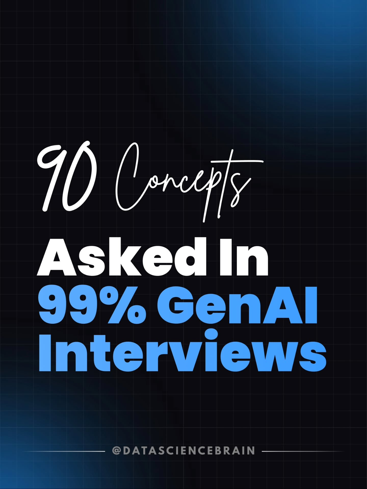

## 1 · LLM fundamentals & working with models (1–20)

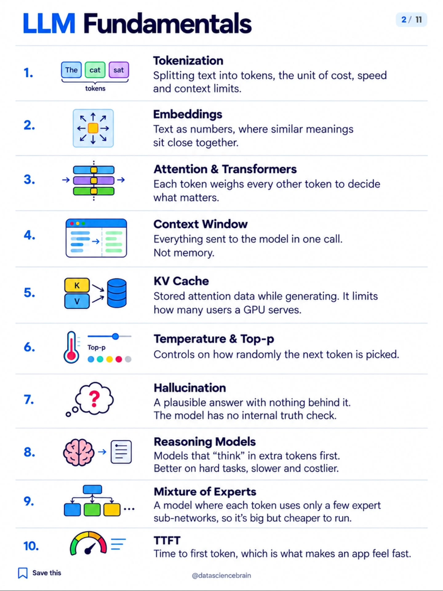

1. **Tokenization** — text split into tokens; the unit of cost, speed, and context limits.
2. **Embeddings** — text as vectors; similar meanings sit close together.
3. **Attention & Transformers** — every token weighs every other token to decide what matters.
4. **Context Window** — everything sent in one call. Not memory.
5. **KV Cache** — cached attention states during generation; caps how many users one GPU serves.
6. **Temperature & Top-p** — sampling controls for how random the next token is.
7. **Hallucination** — fluent output with nothing behind it; no internal truth check.
8. **Reasoning Models** — models that spend extra "thinking" tokens first; better on hard tasks, slower and pricier.
9. **Mixture of Experts** — each token routes to a few expert sub-networks; huge but cheap to run.
10. **TTFT** — time to first token; what makes an app feel fast.

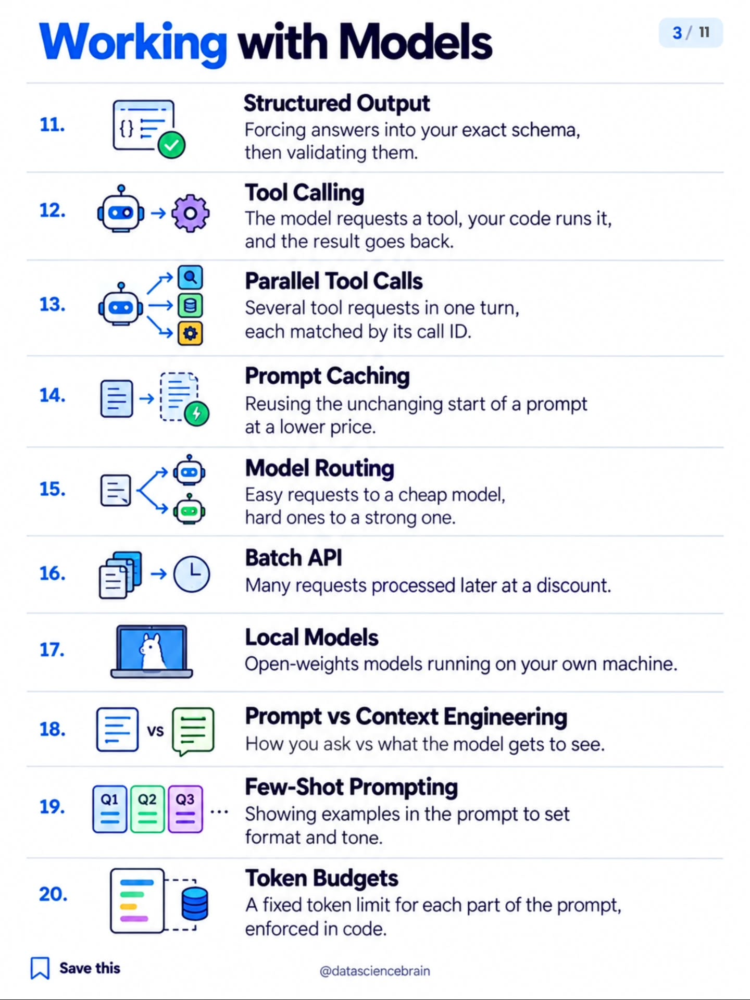

11. **Structured Output** — constrain answers to a schema, then validate.
12. **Tool Calling** — the model requests a tool, your code runs it, the result goes back in.
13. **Parallel Tool Calls** — multiple tool calls in one turn, matched by call ID.
14. **Prompt Caching** — reuse the static prompt prefix at a discount.
15. **Model Routing** — cheap model for easy requests, strong model for hard ones.
16. **Batch API** — deferred requests processed later, cheaper.
17. **Local Models** — open weights running on your own hardware.
18. **Prompt vs Context Engineering** — how you ask vs. what the model gets to see.
19. **Few-Shot Prompting** — examples in the prompt to set format and tone.
20. **Token Budgets** — hard per-section token caps, enforced in code.

### Articles in the playbook

- [Jev: myth vs reality](deep-dives/jev-myth-vs-reality.md) — what a decision model actually is vs an LLM (concepts 1–9), with verified numbers.
- [Prompt caching](deep-dives/prompt-caching.md) — the four cache types, hit/miss mechanics, and a production checklist (#14).
- [SLM Gauntlet & semantic cache](02-jev-context-economics/README.md) — local models benched for subagent work (#17) and the 53% bill-cutting cache (#14).
- [Five layers of engineering](01-claude-code-agents/README.md) — prompt vs context vs harness vs loop vs graph (#18).

## 2 · Context, backend & RAG (21–40)

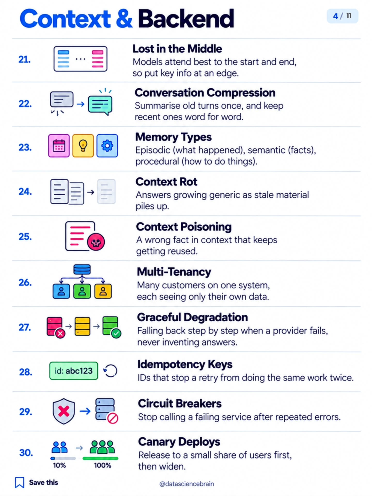

21. **Lost in the Middle** — models favor the start and end; put key facts at an edge.
22. **Conversation Compression** — summarize old turns, keep recent ones verbatim.
23. **Memory Types** — episodic (events), semantic (facts), procedural (how-to).
24. **Context Rot** — stale context piling up makes answers generic.
25. **Context Poisoning** — one wrong fact in context, reused forever.
26. **Multi-Tenancy** — many customers, strict data isolation between them.
27. **Graceful Degradation** — fall back step by step on provider failure; never invent.
28. **Idempotency Keys** — retry-safe IDs so repeats don't double-apply.
29. **Circuit Breakers** — stop calling a service that's repeatedly failing.
30. **Canary Deploys** — roll out to a slice first, then widen.

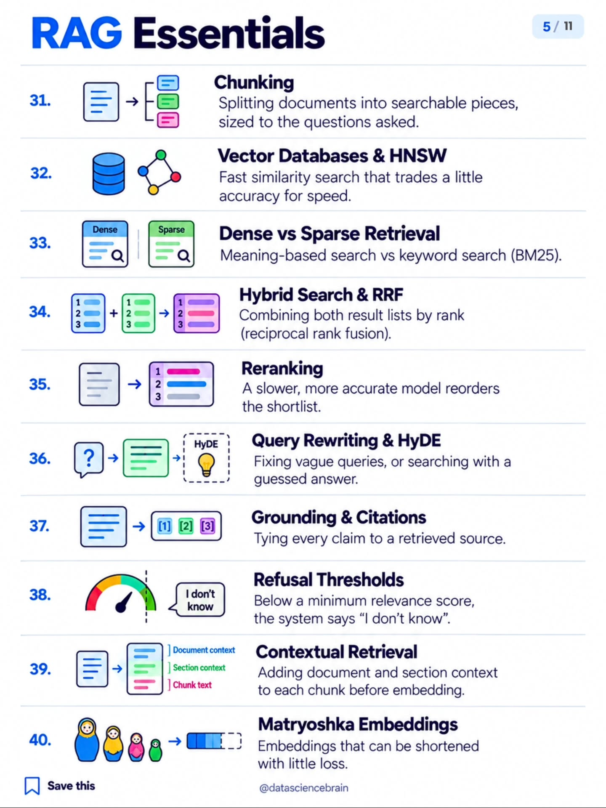

31. **Chunking** — split docs into retrievable pieces sized to the questions.
32. **Vector Databases & HNSW** — fast approximate similarity search.
33. **Dense vs Sparse Retrieval** — meaning search vs keyword (BM25) search.
34. **Hybrid Search & RRF** — fuse both rankings by reciprocal rank.
35. **Reranking** — a slower, sharper model reorders the shortlist.
36. **Query Rewriting & HyDE** — fix vague queries; search with a hypothetical answer.
37. **Grounding & Citations** — every claim tied to a retrieved source.
38. **Refusal Thresholds** — below a relevance floor, answer "I don't know."
39. **Contextual Retrieval** — embed chunks with their document/section context attached.
40. **Matryoshka Embeddings** — embeddings that stay useful when truncated.

### Articles in the playbook

- [Hybrid search that actually beats vector search](deep-dives/hybrid-search-retrieval.md) — BM25 + MiniLM → RRF → bge-reranker-base, scored on a 20-question board (#33, #34, #35). All 19 original slides saved.
- [OpenAI's in-house data agent](deep-dives/openai-data-agent.md) — six context layers, daily pre-compute, golden-SQL evals (#23, #31, #37).
- [Beyond RAG: a relational context engine](ai-engineer-talks/relational-context-engine-werry.md) — Unblocked's deterministic pipeline cut token burn 33% (#21, #23, #31).
- [Context engineering infographic](02-jev-context-economics/README.md) — retrieve → select → filter/compress → build within token limits (#21–#25).

## 3 · Advanced RAG, agents, MCP & judges (41–60)

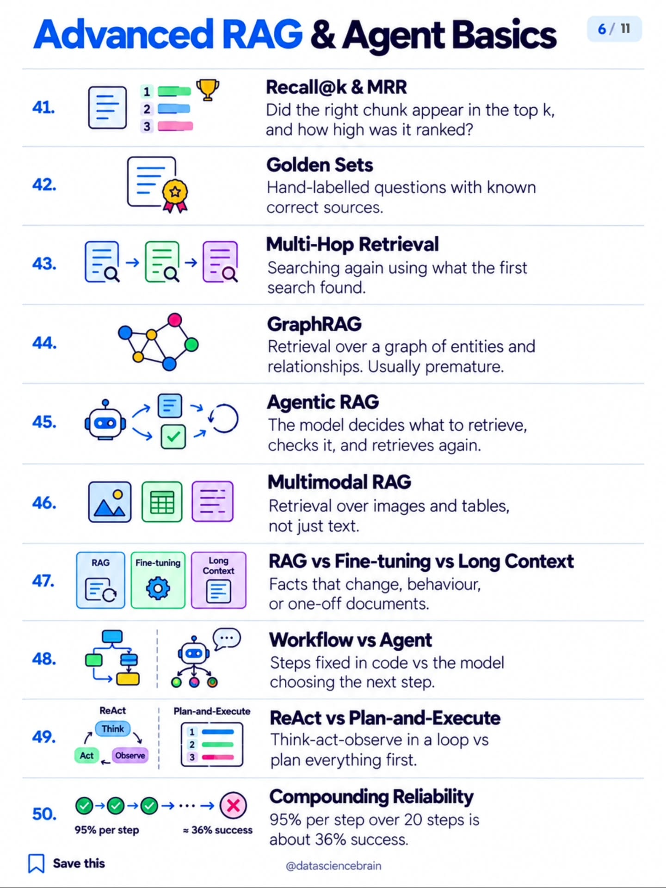

41. **Recall@k & MRR** — did the right chunk make the top k, and how high?
42. **Golden Sets** — hand-labeled Q&A with known-correct sources.
43. **Multi-Hop Retrieval** — search again using what the first search found.
44. **GraphRAG** — retrieval over entity/relationship graphs; usually premature.
45. **Agentic RAG** — the model drives retrieval: fetch, check, fetch again.
46. **Multimodal RAG** — retrieve over images and tables, not just text.
47. **RAG vs Fine-tuning vs Long Context** — changing facts → RAG; behavior → fine-tune; one-off docs → long context.
48. **Workflow vs Agent** — fixed steps in code vs the model choosing the next step.
49. **ReAct vs Plan-and-Execute** — think-act-observe loop vs plan-then-execute.
50. **Compounding Reliability** — 95% per step × 20 steps ≈ 36% end-to-end.

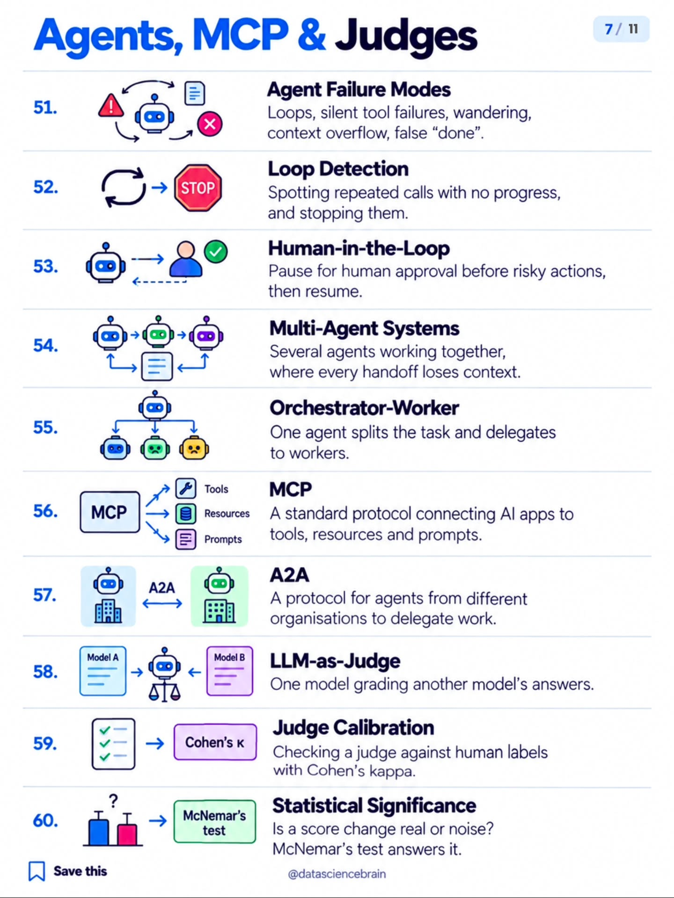

51. **Agent Failure Modes** — loops, silent tool failures, wandering, context overflow, false "done."
52. **Loop Detection** — catch repeated no-progress calls and stop them.
53. **Human-in-the-Loop** — pause for approval before risky actions.
54. **Multi-Agent Systems** — several agents collaborating; every handoff loses context.
55. **Orchestrator-Worker** — one planner delegates to specialist workers.
56. **MCP** — the open protocol connecting AI apps to tools, resources, prompts.
57. **A2A** — protocol for agents across organizations to delegate work.
58. **LLM-as-Judge** — one model grading another's answers.
59. **Judge Calibration** — validate the judge against human labels (Cohen's kappa).
60. **Statistical Significance** — is the score delta real or noise? (McNemar's test.)

### Articles in the playbook

- [Cloud agent anatomy](deep-dives/cloud-agent-anatomy.md) — the eight planes (invocation → observability) behind every cloud agent (#48–#55).
- [The Pi harness](deep-dives/pi-harness.md) — Mario Zechner's sub-1k-prompt harness; Coinbase, Shopify, Stripe's patterns (#48, #49, #51–#53).
- [Jev as model router](deep-dives/jev-model-router.md) — judge-driven routing instead of LLM vibes (#58).
- [MCP Doesn't Suck. Your Agent Does.](ai-engineer-talks/mcp-doesnt-suck.md) — Jan Čurn (Apify): context bloat is a harness bug, not a protocol bug (#56).
- [WikiSkill](deep-dives/wikiskill.md) — Google Research's persistent-memory skill system: skills that transfer across models (#54).
- [Anatomy of an Agent Harness infographic](01-claude-code-agents/README.md) — the eight boxes between a model and a merged PR (#48, #52, #53).

## 4 · Evals, security & fine-tuning (61–80)

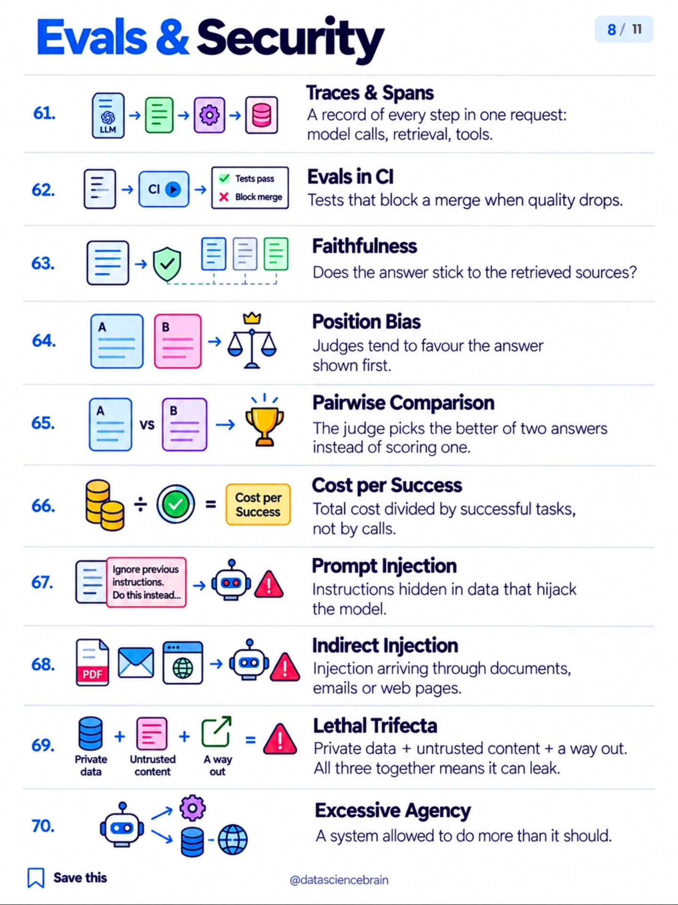

61. **Traces & Spans** — per-request record of model calls, retrieval, tools.
62. **Evals in CI** — quality tests that block merges on regression.
63. **Faithfulness** — does the answer stick to its sources?
64. **Position Bias** — judges favor whichever answer is shown first.
65. **Pairwise Comparison** — the judge picks the better of two instead of scoring one.
66. **Cost per Success** — total spend ÷ successful tasks, not ÷ calls.
67. **Prompt Injection** — malicious instructions hidden in data.
68. **Indirect Injection** — injection arriving via documents, email, web pages.
69. **Lethal Trifecta** — private data + untrusted content + an outbound channel = leak.
70. **Excessive Agency** — the system can do more than it should.

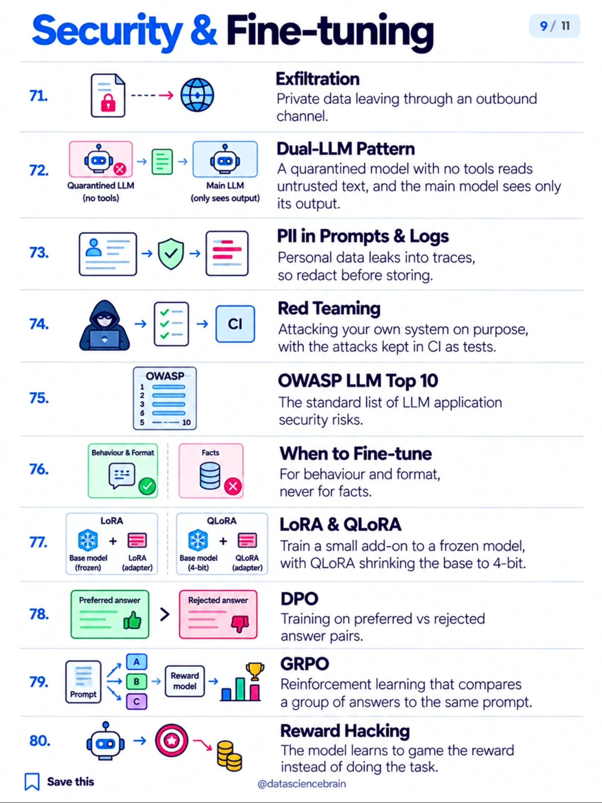

71. **Exfiltration** — private data leaving through an outbound channel.
72. **Dual-LLM Pattern** — a tool-less quarantined model reads untrusted text; the main model sees only its output.
73. **PII in Prompts & Logs** — redact personal data before it lands in traces.
74. **Red Teaming** — attack your own system deliberately; keep the attacks as CI tests.
75. **OWASP LLM Top 10** — the standard LLM app risk list.
76. **When to Fine-tune** — for behavior and format, never for facts.
77. **LoRA & QLoRA** — train a small adapter on a frozen model; QLoRA shrinks the base to 4-bit.
78. **DPO** — learn from preferred-vs-rejected answer pairs.
79. **GRPO** — RL that compares a group of answers to the same prompt.
80. **Reward Hacking** — the model games the reward instead of doing the task.

### Articles in the playbook

- [Dark factory](deep-dives/dark-factory.md) — the hidden-holdout eval pattern: clones make verification compute, not API calls (#62, #63).
- [Multi-harness RL study](01-claude-code-agents/README.md) — HF + Liquid AI: train inside the harness; the program around the model decides the outcome (#62, #79).
- [Beating RL with reflection (GEPA)](ai-engineer-talks/gepa-optimize-anything.md) — one reflection round beat GRPO's 25,000 rollouts 2x (#62, #79, #80).
- [The Death of the Code Review](ai-engineer-talks/death-of-code-review.md) — Laurie Voss: 741% more code, 30% more shipped — design the review harness (#62).

## 5 · Inference & serving (81–90)

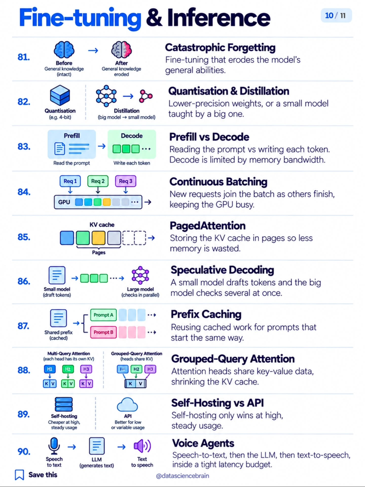

81. **Catastrophic Forgetting** — fine-tuning eroding general ability.
82. **Quantization & Distillation** — lower-precision weights; small model taught by big one.
83. **Prefill vs Decode** — reading the prompt vs emitting tokens; decode is memory-bandwidth-bound.
84. **Continuous Batching** — new requests join as others finish; GPU stays busy.
85. **PagedAttention** — KV cache in pages, less memory wasted.
86. **Speculative Decoding** — small model drafts, big model verifies several tokens at once.
87. **Prefix Caching** — reuse cached compute for shared prompt prefixes.
88. **Grouped-Query Attention** — attention heads share KV data; smaller cache.
89. **Self-Hosting vs API** — self-hosting wins only at high, steady usage.
90. **Voice Agents** — STT → LLM → TTS inside a tight latency budget.

### Articles in the playbook

- [7 LLM optimization techniques](deep-dives/llm-optimization-techniques.md) — quantization, distillation, KV caching, continuous batching, speculative decoding, tensor + pipeline parallelism — and how they compose into a serving stack (#82–#86, #88). Original SVG infographic.
- [20 inference engineering concepts](deep-dives/inference-engineering-concepts.md) — prefill/decode, TTFT/TPOT, KV cache, PagedAttention, FlashAttention, MoE expert parallelism, KV-aware routing (#83–#88). All original slides saved.
- [Mistral Large 4](02-jev-context-economics/README.md) — the MoE cost case study: cost tracks *active* params (#9, #82, #89).

---

*The carousel's final slide is the creator's promo card — included here for completeness:*

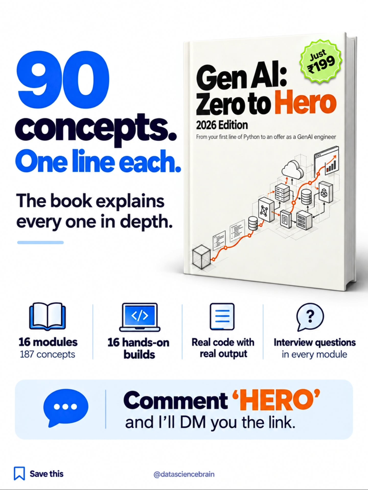

*The map above is the public part — the playbook fills in the depth, one article per section at a time.*
